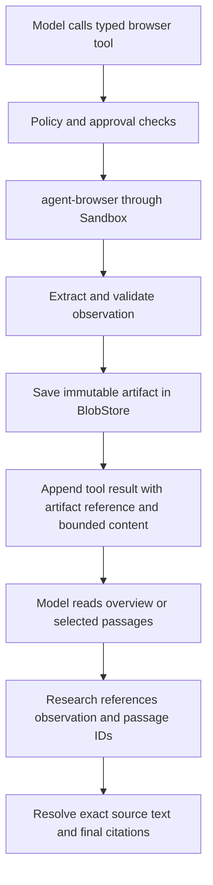

# Browser and Research Improvement Plan

Zendriver driver/runtime implementation and remaining enforcement gates are recorded in [zendriver-browser-design.md](./zendriver-browser-design.md); it preserves this plan's evidence and approval rules.

Date: 2026-10-09  
Status: Typed capture, scoped interactions, screenshots, evidence integration and controlled comparative evaluation are implemented for explicit trusted CDP attachment. The efficiency/answer-quality rollout gate is not met. Managed Chrome is a deployment-guide TODO.  
Design authority: [design.md](./design.md).  
Related evaluation: [research-evaluation.md](./research-evaluation.md).

Revision: Adopt Anthropic's browser interaction patterns through Trinity's existing tool, sandbox, and event contracts; retain Trinity's immutable evidence workflow.

## Implementation status (2026-10-09)

The read-only foundation is implemented in `packages/core/src/tools/browser*` and `packages/contracts/src/browser.ts`:

- Bounded literal-argv Sandbox execution caps stdout/stderr while consuming process chunks; overflow kills/reaps the process. The trusted adapter owns CLI flags, fixed extractor and envelope validation.
- Versioned semantic observations preserve punctuation, code whitespace, list order and table rows/headers. Visibility is checked on live nodes before cloning. Ordinal blocks, explicit metadata/coverage, SHA-256 canonical JSON and mandatory BlobStore persistence support deterministic saved evidence.
- Semantic v2 also captures visible generic container/inline text used by SPAs, in DOM order alongside semantic blocks without duplicating descendants. Empty extractions are partial; DOMContentLoaded does not guarantee asynchronous content readiness. Expected-text readiness and fresh snapshots/screenshots distinguish loading from extraction gaps. Saved semantic-v1 artifacts remain readable.
- Saved block/section reads, Unicode code-point cursors, literal search, bounded outlines/excerpts, duplicate suppression and exact exposure receipts use committed events rather than worker caches. Individual limits are 256 KiB per captured artifact, 6 KiB per overview, 8 KiB per focused response and 2 KiB per diagnostic. Captures retain explicit truncation metadata. Complete serialized results, including metadata, fit their per-response allowance. There is no cumulative text/image evidence or diagnostic ceiling per turn; saved artifacts and cursor reads support continued research.
- The Loop serializes browser operations in model order, skips later same-step browser calls after an error/denial without prompting again, and permits continued research across later steps regardless of cumulative evidence volume. Generic spill never rewrites browser receipts.
- Research sources accept `{ observationId, blockId, start?, end? }`. The server resolves exact quotes/URL/callId/event seq from current-turn committed exposures, revalidates artifact integrity, and carries source metadata into existing Sources / View evidence. Legacy URL/quote sources remain supported.
- Server/worker roots inject `TrustedCdpBrowserAccess` when `BROWSER_CDP_ENDPOINT` is configured. On this machine it attaches to existing Chrome at 9222. Authenticated live reads are restricted to the configured Chrome owner’s personal sessions; no endpoint means saved reads only. The adapter validates CLI 0.38.x, HTTP/port-to-WebSocket discovery, final destination and current owned target. Successful event receipts preserve the actual CDP target ID for restart recovery; only that owned state is delivered. It never launches or closes Chrome. Trusted CDP explicitly does not certify a network/privacy isolation boundary.
- Generic `read_blob` and HTTP blob downloads refuse the browser artifact namespace. Cross-session and fork-copied receipts do not confer ownership. Orphan blobs never establish evidence. Artifacts are retained conservatively; automated retention/GC is not implemented.

Scoped DOM role/name refs, delivered-target validation, checked native button/link DOM activation and custom-control/coordinate pointer input, fill/key/scroll and post-action observations are implemented. Native accessibility text remains a bounded reading representation; model refs are adapter-owned `r` refs, not arbitrary CLI selectors. Optional visible-text readiness records ready/timed_out coverage. Viewport/cropped PNGs have per-image pixel/byte limits, immutable image receipts, current-turn authorized multimodal replay and a session-authenticated Sources / View evidence route. Sensitive controls and suspected credential URLs are refused. Readability comparison fixtures retain semantic extraction for canonical table/code/punctuation fidelity.

The controlled 24-run comparison is complete; a separate interaction follow-up tests the activation refinement. See [browser-research-evaluation-results.md](./browser-research-evaluation-results.md). Citation-note failures fell on reading tasks, while cumulative provider input increased and final quotation/caveat quality varied. The general efficiency/answer-quality rollout gate is **not met**; this is a measured limitation, not an unimplemented comparison. The baseline is a controlled literal-command/fixed-extractor workflow, not the earlier public-web session.

Deployment work outside this trusted-CDP scope remains: enforced browser-side egress and profile isolation; closing every legacy Bash/CDP/workspace bypass before asserting strict deployment-wide guarantees; complete private-page redaction and download containment; global shared-browser input/takeover coordination; and automated artifact GC. Artifacts, including uncommitted orphans, are retained conservatively until a full-log retention process can establish safe deletion. Managed Chrome remains a TODO in [deployment-guide.md](./deployment-guide.md), and is never launched. Shared Chrome input can race with users/other sessions; avoid concurrent interacting turns. Captured hashes and revalidation do not make live browsing deterministic.

This status overrides the original phase estimates below. The implementation lives in existing Tool Runtime/Sandbox contracts and retains legacy citation validation. Normal tests use fakes/DOM fixtures; separately opted-in CDP/model checks use controlled localhost pages only and preserve the existing Chrome. Typed interaction grants are independent of legacy CLI-prefix grants. No independent browser service or subagent was added.

## 1. Goal

Make browser research consume less model context and produce more reliable evidence references. Move command construction, extraction, validation, persistence, and output limits into a typed browser tool. Give the model small, useful observations and focused retrieval instead of repeated page dumps.

The recommended solution combines `agent-browser`, scoped accessibility reads, visible-text extraction, optional screenshots, immutable saved observations, and passage references. HTML LSP is useful for editing HTML source; it is not required for this reading workflow. A parser alone does not select relevant content or observe JavaScript-rendered browser state.

The deterministic guarantee starts at a captured observation: validation, saved reads, range resolution, budget enforcement, and replay must be reproducible. Live page contents, rendering timing, element availability, model decisions, and task outcomes can vary. A content hash proves artifact integrity; it does not prove website truth or reproduce a live browser trajectory.

## 2. Problems to address

- The model currently constructs browser CLI commands and supplies the extractor script through Bash. Connection flags and extraction conventions depend on instruction following.
- Article extraction currently returns up to 24,000 characters. Generic tool-result spill defaults to a threshold of roughly 50 KB, so substantial browser text can enter model context directly.
- Generic spill is best effort and can return the full result when storage fails. That behavior cannot provide a strict browser output budget.
- Research citations require the model to reproduce exact text. In session `01a1206d-c6bb-7000-ba16-ef5c0059fd35`, Chinese colons became ASCII colons and intervening text was omitted. Citation retries failed despite successful article extraction.
- Large observations remain in active-turn tool history. Saving an artifact helps only if subsequent reads also have enforced limits.
- A valid source reference establishes provenance, not the truth of a website or the correctness of the model's interpretation.

## 3. Improvements already made

The current working tree includes these initial changes:

- Mismatch feedback identifies the finding and source position and returns up to 600 characters of nearby observed text.
- Quote instructions require short contiguous passages with original punctuation and intervening text preserved.
- After two citation rejections, replayable runtime guidance advises changing the quote or removing the unsupported finding.
- Error feedback and the browser skill instruct the model to keep internal research bookkeeping out of final answers.
- Deterministic regression coverage was added; the implementation passed 333 tests, lint, and typecheck before this plan was written.

These improve recovery. The remaining phases reduce how often the model needs to perform that recovery.

## 4. Proposed architecture

Keep execution in the existing Tool Runtime. Define cross-module ports and Zod DTOs in `packages/contracts`; inject adapters at app composition roots. All CLI process effects continue through `SandboxPort`. The wrapper must receive equivalent permission, approval, timeout, cancellation, and egress checks to the underlying operation.

Use `BlobStore` for artifacts, with the existing local filesystem adapter for development and replaceable object storage for deployment. PostgreSQL events remain the authority for artifact ownership, observation provenance, and model-visible results. Browser observations must not depend on a worker's in-memory cache.

### 4.1 Design basis and Trinity decisions

Anthropic distinguishes lightweight search/fetch from live browser interaction, combines accessibility references with visual fallback, and assigns execution to the application. Its browser protocol orders dependent calls and reports skipped calls after failure. These are the interaction patterns to adopt. [Browser use documentation](https://platform.claude.com/docs/en/agents-and-tools/tool-use/browser-use-tool).

Its SDK guidance separates navigation URL checks from network enforcement and confines file transfers. These inform the deployment requirements in §9. [Browser SDK guidance](https://platform.claude.com/docs/en/agents-and-tools/tool-use/browser-use-sdk).

Its agent guidance emphasizes simple, clearly documented tools and evaluation before adding complexity. Apply that to the initial operation set. [Building effective agents](https://www.anthropic.com/engineering/building-effective-agents).

Trinity-specific decisions follow below. Immutable artifacts, event-authorized exposure receipts, bounded individual responses, and block-based grounding are our proposed evidence contract; the cited browser API does not establish these guarantees for Trinity. Keep the interface provider-neutral through Vercel AI SDK custom tools. Do not add an Anthropic-specific execution channel or import its entire browser toolset.

For source discovery or ordinary public documents, prefer an authorized search/fetch capability when one is available. The core registry now advertises `browser(operation="web_search", query=...)` when live access exists. It navigates the authorized browser to Google Search and returns bounded observation/link metadata through the same persistence and receipt boundary. `search_observation` only searches saved content. Standalone `web_search`/`web_fetch` tools and a separate HTTP search-provider transport are not implemented. The first backend remains `agent-browser`. A future fetch adapter must use the same persistence, provenance, and delivery limits before its results can support research notes.

## 5. Browser tool and output contracts

Expose one provider-neutral `browser` tool with a Zod discriminated union on `operation`. Each call requests one operation; v1 has no nested action-batch argument. Advertise only implemented, deployment-enabled operations. Reject disabled or unknown operations before browser effects.

### 5.1 Operations and model workflow

The following operation names define the proposed semantic boundaries; implementation may rename them consistently in contracts and skill instructions.

| Operation                        | Arguments and behavior                                                                                                                                                  | Phase |
| -------------------------------- | ----------------------------------------------------------------------------------------------------------------------------------------------------------------------- | ----- |
| `navigate`                       | HTTP(S) URL and an optional bounded readiness condition; use the task-owned tab, report final URL and readiness, return a bounded fresh overview                        | 2     |
| `read_page`                      | Read-only accessibility snapshot, `interactive` or `all` filter, optional container reference from a valid snapshot; return scoped roles, names, and element references | 2     |
| `get_page_text`                  | Capture visible semantic blocks in article, documentation, or scoped mode; save observation and return outline plus excerpt                                             | 2–3   |
| `read_observation`               | Observation ID with section/block IDs or a bounded range; read the saved artifact without network access                                                                | 3     |
| `search_observation`             | Observation ID and bounded literal query; return matching saved ranges with limited context, not web search results                                                     | 3     |
| `screenshot`                     | Capture the owned viewport, with optional bounded crop; record image dimensions and coordinate mapping                                                                  | 3     |
| `click`, `fill`, `scroll`, `key` | Act on a valid scoped target, subject to per-operation policy and approval; return a short acknowledgment and bounded post-action observation                           | 5     |

An ordinary reading trajectory is `navigate` → `get_page_text` → focused saved reads → research block references. Use `read_page` to locate controls or scope a subtree. After an interaction, inspect its returned observation before choosing the next action. Use a screenshot when visual layout or inaccessible controls require it. Do not force a screenshot after every text read.

Initially support one owned pinned tab per session binding. Return only its bounded state, not the user's full tab inventory. Report an unexpected popup as a state change; do not silently adopt it or navigate other user tabs. Multi-tab operations are deferred until measured tasks require them.

The wrapper owns CLI discovery, supported-version handling, safe argument construction, connection mode, named sessions, pinned tabs, extraction scripts, and CLI envelope parsing. The model supplies task arguments rather than executable JavaScript or shell commands for ordinary research.

The existing `SandboxPort.exec` returns accumulated stdout/stderr and has no byte-cap options. Before capture ships, add a bounded argv-based Sandbox execution contract or enforce caps while consuming `openProcess` chunks, with deterministic process cleanup. Never accumulate an unlimited CLI result and trim it afterward. A transport overflow yields a bounded error; planned capture truncation must be performed by the extractor while retaining valid structured JSON.

Model-authored JavaScript, arbitrary selectors, raw CDP commands, console/network dumps, file upload, and browser-host filesystem paths are absent from the initial surface. The trusted adapter may run a fixed, versioned, read-only extractor. Adding a diagnostic or file-transfer operation requires a separate bounded contract and policy review; hiding an operation from the model catalog is insufficient enforcement.

### 5.2 Persisted and delivered data

Define versioned schemas for:

| Contract             | Required information                                                                                                                                                                                                                                                                                 |
| -------------------- | ---------------------------------------------------------------------------------------------------------------------------------------------------------------------------------------------------------------------------------------------------------------------------------------------------- |
| Saved observation    | Observation ID, schema/extractor and CLI/browser versions, browser binding/tab/document revision, final observed URL, title, explicit publication metadata or null, capture time, readiness outcome, representation/scope/exclusions, content hash, structured blocks, links, and capture truncation |
| Tool response        | Operation, call ID, owned tab state, observation/artifact reference, bounded overview or selected blocks, exact delivered ranges, output truncation, and continuation information                                                                                                                    |
| Evidence block       | ID scoped to an immutable observation, block type, exact extracted text, section relationship, and relevant links or table structure                                                                                                                                                                 |
| Interaction snapshot | Snapshot ID, binding/tab/document revision, observed URL, scope, roles/names, actionable element references, and truncation                                                                                                                                                                          |
| Screenshot           | Observation/artifact reference, binding/tab/document revision, capture time, viewport and image dimensions, crop/scale mapping, and image limits                                                                                                                                                     |
| Error                | Stable code, failed operation, effect status (`none`, `applied`, or `unknown`), bounded diagnostic, and recovery information without full stdout/stderr                                                                                                                                              |

Validate external CLI JSON before treating it as evidence. Validate persisted artifacts again on retrieval. Capture time is distinct from publication time; inject the clock for deterministic tests. Block IDs remain stable within a saved observation; a fresh extraction creates a new observation.

Assign block IDs by deterministic traversal ordinal within the immutable observation; identical text in two positions remains two blocks. Define canonical block text once during capture, preserving punctuation and code whitespace. All text ranges use zero-based, half-open Unicode code-point offsets into that canonical text. Byte limits are separate UTF-8 measurements; never use JS UTF-16 indices interchangeably. Hash a specified canonical JSON encoding of the artifact payload, excluding its hash field. Verify the hash on retrieval; never regenerate missing evidence from a changed live page.

The committed bounded result includes an exposure receipt listing the exact observation/block/range or image delivered. The receipt describes the final model-visible result after trimming, not all content in the blob. It supports replay, citation validation, and cumulative delivery accounting. If generic spill or another renderer changes delivery, its receipt must change accordingly; an unavailable artifact is an error, not permission to cite unseen text.

### 5.3 Execution order and target validity

Register the initial `browser` tool as `exclusive`. Calls on a browser binding execute in model order under existing session coordination. Exclusivity only serializes calls: today's Loop continues after an error, so ordered browser failure handling is a required scheduler change, not an existing guarantee.

Within a model step, a failed, denied, cancelled, stale-target, or unknown-outcome browser call causes all subsequent browser calls in that step to receive a bounded `NOT_EXECUTED` error without execution or further approval prompts. Preserve one tool result per emitted call in model order; cancellation uses the existing terminal/torn-tail repair path for outstanding pairs. Unrelated tools retain their existing scheduling rules. Do not introduce provider-specific message ordering or rely on a model honoring parallel-tool settings.

An element target contains `snapshotId` and `ref`; the server resolves binding, tab, and document revision from its authenticated mapping. The reference must have been delivered to this session and must still identify the same connected node. Never renumber a delivered reference to mean a different element. Navigation, reload, reconnect, or a material change affecting the target invalidates it; return `STALE_TARGET` and request a new read rather than guessing a selector or clicking a similarly named element. If the CLI cannot establish mapping continuity, invalidate conservatively. The immutable snapshot remains readable evidence after its action references expire.

A coordinate target contains a screenshot observation ID and viewport pixel coordinates. Validate ownership, current document/viewport/scroll state, bounds, and any crop/scale transform before dispatch. Reject stale or ambiguous coordinates. Coordinate actions are the visual fallback; they require the same permission checks as element actions.

Recovery errors distinguish a pre-execution refusal from a side effect that may already have happened. An acknowledgment means the driver completed an operation, not that the user's goal succeeded. After timeout, persistence failure following an action, or a lost browser connection, mark the effect `unknown` when it cannot be established. Reobserve before proceeding; never automatically replay clicks, key submissions, or navigation to reconstruct state.

## 6. Structured HTML reading

Choose a representation suited to the task:

| Task                            | Default representation                                 | Focused fallback                                                |
| ------------------------------- | ------------------------------------------------------ | --------------------------------------------------------------- |
| Article research                | Article headings, paragraphs, lists, tables, and links | Selected rendered DOM subtree                                   |
| Documentation/reference reading | Semantic sections, code blocks, lists, and tables      | Selected DOM subtree or HTML fragment                           |
| Navigation/forms                | Scoped accessibility snapshot with element references  | Screenshot with checked coordinate targeting                    |
| Visual verification             | Screenshot                                             | Visible text and accessibility inspection for supporting detail |

Read the rendered page through `agent-browser`. Evaluate Mozilla Readability as an article-body selector against the existing extractor and representative fixtures. Use deterministic semantic DOM extraction for documentation and general pages, and as an explicit fallback when article extraction fails or omits needed sections.

Compute visibility and scope against the live rendered tree, then extract from a clone so reading does not mutate the page. A cloned DOM alone cannot establish computed visibility. Exclude CSS-hidden and collapsed body content, scripts, styles, navigation clutter, and private form values from ordinary research artifacts. Accessibility reads follow the accessibility tree; text reads follow visible content, and their coverage may differ. Preserve original punctuation, paragraph boundaries, list order, table header/cell relationships, code whitespace, and source URLs. Record extraction method, scope, and exclusions; do not claim complete coverage when hidden, collapsed, inaccessible, or truncated content was not read. Publication metadata may come from explicitly identified metadata fields, with its origin recorded; it does not become visible body evidence.

Use a bounded navigation deadline and a documented default capture point (`DOMContentLoaded`, followed by the read operation), with an optional bounded wait for visible literal text or a role/name condition. Do not accept arbitrary readiness scripts or selectors, or assume network idle means completeness. Return `ready`, `partial`, or `timed_out` plus the applied condition. A successful partial capture may be read and cited within its stated coverage; a failed navigation is not evidence. Record viewport, scroll position, locale, and timezone where they affect interpretation. These identify the capture context without promising that revisiting the URL reproduces it.

Screenshot artifacts use the existing multimodal image path rather than base64 in text tool results. Cap encoded bytes, dimensions, and images per turn; account for image input separately from text bytes. Persist authorized images before returning them and keep them session-scoped. Screenshot provenance may support visual findings, but a screenshot alone does not create canonical text blocks or authorize a verbatim text citation. If text is needed, obtain a visible-text observation; any later OCR capability needs its own representation and provenance contract.

Do not use a model to rewrite the canonical evidence text. Do not save full raw HTML by default: it can contain unnecessary private data and adds storage without improving ordinary reading. Permit bounded HTML fragments for an explicit debugging need under the same access policy. Page content and metadata remain untrusted input.

## 7. Save first and retrieve selectively

1. Capture a bounded observation and validate its contract.
2. Persist the immutable artifact under a session-scoped key.
3. Return its reference and bounded useful content through the ordinary tool result event.
4. Serve subsequent reads from that saved observation; re-extract explicitly when fresh browser state is required.

If persistence fails, return a bounded storage error. Do not fall back to placing the full page in the event log or model context. The CLI adapter must also cap capture bytes and diagnostics before parsing; saving first does not eliminate temporary process memory use.

Initial configurable limits to evaluate:

| Surface                        | Proposed initial limit                                                            |
| ------------------------------ | --------------------------------------------------------------------------------- |
| Extracted observation artifact | 256 KiB of UTF-8 JSON; explicit capture truncation                                |
| Initial overview               | 6 KiB serialized response, including metadata, section outline, and short excerpt |
| Focused read or search         | 8 KiB serialized response; bounded blocks/hits and continuation                   |
| Error diagnostics              | 2 KiB serialized response                                                         |

Enforce UTF-8 byte limits on complete serialized responses, including metadata. Preserve valid JSON and Unicode when trimming. These limits are engineering starting points, not measured token savings. Measure actual tokenizer/provider usage separately.

Support reading block IDs or sections and literal search within an observation, returning bounded surrounding blocks. Always distinguish artifact capture truncation from response truncation. If even a single block exceeds the response budget, return bounded text slices with explicit offsets and continuation.

Use per-response limits to keep direct model input manageable. Preserve captured evidence in immutable artifacts and read it through block/section/cursor operations. There is no cumulative evidence allowance that stops a long research turn. Track delivered ranges for citation validation and duplicate suppression; legitimate rereads and refreshed observations remain distinguishable.

Do not impose aggregate text, screenshot-count, image-byte, or diagnostic quotas. Keep each focused response and diagnostic bounded, preserve pagination and complete tool pairs, and derive delivered ranges from committed receipts after restart. Errors may prompt a change of strategy but do not force a final answer because of accumulated evidence. Existing context compaction handles growing request history. Measure unique and repeated evidence delivery without treating those counters as a stop condition. Never rewrite historical tool results to save context.

Do not route browser artifacts through unrestricted full-content retrieval as the normal workflow. Every supported retrieval route must enforce artifact ownership and an appropriate model-visible output budget.

## 8. Evidence references and grounding

Let research sources reference an observation ID and block ID, optionally with a bounded text range for long blocks. Resolve the exact quote, observed URL, artifact reference, originating call ID, and event sequence on the server.

- Accept only references authorized for the current session and permitted evidence scope. Preserve the current rule that new research notes cite successful current-turn observations.
- Require a successful committed tool result for provenance. A blob that was written before a crash but never referenced by a successful event is not evidence.
- Require cited blocks/ranges to have been exposed in a successful current-turn tool result. Saving unseen content does not establish that the model read it.
- Validate against committed exposure receipts, including exact sliced ranges; a section outline or search-hit title does not expose every block in that section. An old saved observation may be reread in the current turn through an authorized new result; retain its original capture time and mark that this is saved evidence, not a fresh website visit.
- Resolve and bound excerpts deterministically; reject unknown observations, missing artifacts, invalid ranges, and cross-session references.
- Do not silently change a source URL or accept a paraphrase as a direct quote.
- Keep claim interpretation the model's responsibility. Exact text resolution cannot prove that a claim follows from a passage.
- Carry resolved metadata into the existing Sources / View evidence presentation and completed-turn source references.

Retain legacy URL/quote validation for old events and the migration period. New structured references eliminate punctuation retyping for the new workflow without weakening validation of legacy citations.

## 9. Replay, permissions, and lifecycle

- Replay saved observations and bounded delivered excerpts without reopening a website. Live pages may have changed.
- Recover tool pairs through existing torn-tail repair. Do not automatically retry navigation or interaction effects after a crash.
- Preserve observations referenced by retained events and final citations. Define retention and garbage collection for unreferenced artifacts created before interrupted event appends.
- Derive ownership from authenticated session events, not a model-supplied path or artifact URI. Define fork behavior explicitly and test it.
- Preserve explicit CDP connections, named sessions, pinned tabs, and user-owned Chrome. The wrapper does not make shared browser cookies tenant-isolated.
- Serialize operations on a shared session/tab; resolve ownership through existing execution coordination rather than process-local mutable state.
- Propagate AbortSignal to CLI execution and retrieval; bound execution time and provide deterministic cleanup.
- Navigation, clicks, fills, and publication actions retain their applicable approval requirements. Skill content never grants execution permission.
- Keep secrets, private form values, and full page bodies out of operational logs. Store only the authorized, necessary extracted evidence.

### 9.1 Enforcement and deployment requirements

Validate schemes and credential-free URLs with a browser-compatible URL parser before effects. User navigation accepts HTTP(S) only; any internal blank page is adapter-owned. Recheck the final URL and reject redirects outside the permitted scope. Site access permission is distinct from permission to fill, submit, send, purchase, or change an account. Check each operation at execution time against the actual target and authenticated persisted grant; a CLI executable-prefix grant does not authorize every typed browser action. Never infer harmlessness solely from a button label or HTTP GET. Unknown action intent requires the applicable approval policy.

For a future `enforced` deployment, the browser's actual network environment must enforce the administrator's egress allowlist, default off. The current explicitly configured `trusted-cdp` mode attaches to owner-controlled Chrome with existing permissions and shared cookies; it does not assert this stronger boundary. Managed Chrome provisioning is a deployment-guide TODO. Specify that enforcement point before enabling enforced-mode guarantees. It must cover redirect hops, subresources, script requests, WebSockets, service workers, and resolved destination IPs, with private/link-local/loopback access denied unless explicitly configured for the task. Keep page traffic away from CDP/control endpoints. A navigation check or worker-pod NetworkPolicy alone cannot enforce traffic originating in a separately hosted Chrome. Fail closed if the configured browser cannot provide the required boundary; a skill instruction is not an egress control.

TODO in the deployment guide: managed research browsers would require isolated session profiles without ambient credentials or access to host files; they are not implemented or launched. Explicit user-owned CDP attachment remains a trusted deployment mode and must preserve existing tabs and Chrome. Restrict a shared endpoint to its authenticated owner/trust domain; it is not suitable for independent tenants. User takeover suspends agent actions until ownership is reacquired and targets are refreshed.

Automatic downloads are blocked or quarantined outside model-readable workspace/artifact routes by default. Report only bounded sanitized status; do not expose host paths or execute downloaded content. Uploads remain disabled. A later transfer capability requires task-staged upload roots separate from downloads, size/MIME limits, path/symlink validation, and destination-bound consent. Redact secrets before persistence, including sensitive URL components, form values, and screenshot regions; refuse a capture when necessary redaction cannot be guaranteed. Record the omission and never present a redacted passage as an unmodified source quote.

### 9.2 Compatibility boundary

During migration, current Bash browsing remains an explicitly documented legacy mode with its existing limitations. Do not claim strict browser budgets or action isolation while the model can invoke unrestricted `agent-browser` through Bash, arbitrary page `eval`, or full artifact reads. Before enabling the new guarantees, deny model-facing direct browser commands and alternate control routes for that deployment; only the trusted adapter receives its narrow Sandbox execution capability. Diagnostic escape hatches are administrator-controlled, separately audited, and disable the strict guarantee for that run. Existing broad executable grants must not silently carry over to the wrapper.

## 10. Implementation phases

| Phase                        | Changes                                                                                                                                                                        | Completion criteria                                                                                                                        |
| ---------------------------- | ------------------------------------------------------------------------------------------------------------------------------------------------------------------------------ | ------------------------------------------------------------------------------------------------------------------------------------------ |
| 1. Design and contracts      | Update design §§5–8, security/grounding sections, and AGENTS.md; define operation schemas, target lifetime, exposure receipts, ownership, budgets, and browser egress boundary | Reviewed contracts and explicit proposal/current-state distinction; include scheduler and Bash migration requirements                      |
| 2. Browser capture wrapper   | Add Sandbox-backed CLI adapter, connection handling, navigation/read-only accessibility reads, validated text capture, mandatory persistence, and bounded overview             | Policy and egress enforced; ordered calls stop on failure with paired skipped results; invalid output and storage failure are bounded      |
| 3. Structured reading        | Add semantic blocks, evaluate article selection, preserve visible tables/code, implement focused read/search, visual fallback, and cumulative exposure accounting              | Representative pages retain evidence coverage without full-page dumps; text/image limits, readiness, and recovery are explicit             |
| 4. Evidence integration      | Add observation/block references to research, grounding, progress guidance, and source rendering                                                                               | Exact excerpts resolve without model retyping; legacy sessions and replay remain supported                                                 |
| 5. Interaction and migration | Add checked reference/coordinate actions and post-action observations; update bundled skill and composition-root wiring                                                        | Stale targets, approvals, takeover, and unknown outcomes are handled; legacy Bash/control/artifact routes cannot bypass enabled guarantees |
| 6. Evaluation and rollout    | Run deterministic checks and separately authorized live comparisons; update research evaluation and project progress                                                           | Quality and usage evidence supports rollout; remaining limitations are documented                                                          |

Implement within existing modules where possible. Add a new port only for a real module boundary; assemble dependencies at app entry points. No new plugin framework or independent browser service is required for the first version.

## 11. Validation and success criteria

Deterministic coverage must include:

- Zod rejection of malformed CLI output, invalid URLs, oversized fields, and unsupported schema versions.
- DOM fixtures for Chinese/English punctuation, intervening UI text, article selectors, documentation, tables, code blocks, and missing publication metadata.
- Serialized byte limits, Unicode boundaries, large single blocks, pagination, duplicate reads, and continued retrieval beyond the former cumulative ceilings.
- Save failure, missing/corrupt artifacts, cross-session access, fork policy, cancellation, restart replay, and torn-tail recovery.
- Block/range citation resolution, unexposed-block rejection, stale interaction references, legacy quote validation, and final source provenance.
- Equivalent policy/approval behavior for wrapper operations, explicit CDP attachment, and preservation of user-owned browser state.
- Ordered multi-call steps: first failure/denial skips later browser calls; every call retains a result; generic exclusive scheduling alone is not accepted as coverage.
- Reference reuse, navigation/reload/reconnect, target replacement, viewport/scroll changes, screenshot crops/scaling, user takeover, and unknown side-effect completion.
- Hidden/collapsed content and visibility-before-cloning, readiness timeout/partial captures, duplicate text blocks, astral Unicode range offsets, canonical hashes, and exposure receipts after trimming/spill.
- Per-response text/image bounds with no cumulative evidence cap; continued retrieval after restart; image deduplication within each request with fresh pixels on later requests; no unauthorized artifact access through Bash, blob, or workspace reads.
- Browser-boundary enforcement with a local controlled fixture server: disallowed schemes, redirect/subresource egress, DNS/private destinations, browser control endpoints, download quarantine, and isolated profiles. Use fakes for deterministic policy cases; browser integration fixtures must not contact the public internet.

Run `pnpm test`, `pnpm lint`, and `pnpm typecheck` for implementation changes. Add browser validation when the UI evidence flow changes, using the repository's agent-browser skill.

Compare the current workflow with the new workflow on a fixed set of article, documentation, table, and interaction tasks. Include the observed semaglutide quote-failure pattern and the Teams/MCP Apps distinction from the existing evaluation. Keep model/configuration consistent and repeat runs to account for variation.

Stage the comparison: baseline → bounded capture and saved reads → accessibility-first interaction with visual fallback. Evaluate each increment before adding more operations or automatic delegation. This isolates whether savings come from better reading, fewer redundant observations, or lower task completeness. No dedicated browser subagent is required for the initial rollout; any later delegation must preserve the parent turn's evidence authorization without passing raw page dumps between agents.

Measure cumulative input tokens, unique and repeated browser bytes exposed, model steps, browser calls, retrieval calls, citation failures, latency, answer completeness, and grounding correctness. Context reduction must not come from dropping caveats, table relationships, or contrary evidence. Define numerical rollout targets after obtaining the baseline; do not claim a percentage improvement from one run.

Success means bounded output is enforced even on failure, saved evidence can be replayed, block references remove punctuation transcription failures, and evaluated answers retain quality while reducing unnecessary context exposure.

## 12. Supporting references

- [Anthropic browser use](https://platform.claude.com/docs/en/agents-and-tools/tool-use/browser-use-tool): interaction strategy referenced in §4.1; input/output conventions still require executor enforcement.
- [Anthropic browser SDK](https://platform.claude.com/docs/en/agents-and-tools/tool-use/browser-use-sdk): policy, network boundary, and file-transfer guidance referenced in §§4.1 and 9.
- [Anthropic web fetch](https://platform.claude.com/docs/en/agents-and-tools/tool-use/web-fetch-tool): passage citations for fetched documents; a separate capability from live browser interaction.
- [Anthropic building effective agents](https://www.anthropic.com/engineering/building-effective-agents): tool-interface design and incremental evaluation.
- [Microsoft HTML language service](https://github.com/microsoft/vscode-html-languageservice): source-editing language features.
- [Mozilla Readability](https://github.com/mozilla/readability): deterministic article extraction from a DOM.
- [Playwright accessibility snapshots](https://playwright.dev/docs/aria-snapshots): structured accessibility-tree representation.
