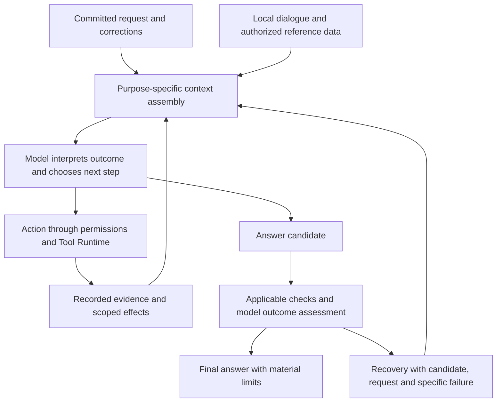

# Intent, context, execution and recovery

Status: runtime execution v2 implemented, 2026-10-22. Deterministic regression and integration validation covers the mechanisms; comparative real-model quality validation remains pending. This document extends design §6/§7/§21. Optional semantic reviewers, reranking and broad release trials remain separate evaluation work.

Implementation: contracts now define context/effect, candidate, intent and outcome records; the existing Loop, PersonalContext, Context Manager and Tool Runtime implement phases 1–3 below. New source/context assembly uses committed input, authorized bounded local dialogue and explicit recall. Private per-request artifacts preserve exact model input where a BlobStore is configured (both stock roots provide one); embedded callers without it receive manifest metadata only. Each actual input snapshot is retained separately, so storage growth and operator retention/GC remain deployment concerns. Effects currently use conservative per-session resource scopes rather than per-file or cross-session mutation tracking. The expanded opt-in evaluator uses production core components with synthetic memory/index, file and browser adapters, not the full HTTP/queue/live-browser topology. It has not been run as a paid quality study for this change.

## 1. Problem and success criterion

The desired improvement is reliable pursuit of the user's actual outcome across conversation, research and actions. Understanding a request, choosing useful work, interpreting evidence and deciding when to answer are coupled model/harness responsibilities. Preserving the last answer helps conversational continuity, but cannot by itself prevent a confidently wrong interpretation, an irrelevant investigation or recovery that reinforces the wrong objective.

The harness should supply sufficient relevant context, preserve the authority and provenance of each input, expose useful feedback, and enforce execution invariants. Semantic interpretation and suitability remain model judgments. More instructions, a structured plan, additional model calls and a passing checklist each require evaluation; none proves increased intelligence.

The target is higher measured task success with fewer irrelevant actions and unnecessary clarifications, while preserving permissions, factual qualification, cancellation and replay. There is no universal semantic completion guarantee.

## 2. Observed incident and contributing mechanisms

The inspected session was `01a16350-8b9a-7000-ab70-10824fb7bbf0`. The second request, at seq 222, was “translate into Chinese,” following an English answer about building a coding agent. Its turn ended at seq 327 with reason `error`. Times below are UTC on 2026-10-22.

| Evidence                     | Observation                                                                                                | Implication                                                                                                            |
| ---------------------------- | ---------------------------------------------------------------------------------------------------------- | ---------------------------------------------------------------------------------------------------------------------- |
| seq 220–222                  | Coding-agent final, completed turn, then translation request                                               | The current conversation supplied a natural translation source.                                                        |
| seq 225, repeated selections | Two episodes: the coding-agent answer and a local-model recommendation from another session                | The model received unrelated historical work as an additional candidate source.                                        |
| seq 230–246                  | Skill load, navigation to an Ollama model page, failed `read_file(".")`                                    | Work had already drifted before completion verification ran.                                                           |
| seq 254                      | A draft offered to translate both earlier answers                                                          | The model treated background recall as part of the requested scope.                                                    |
| seq 252–253, 260–262         | Missing-plan assessments, recovery instructions, then a contradictory draft saying source text was missing | Recovery did not restore a stable objective or preserve the rejected candidate as usable working state.                |
| seq 304                      | A new plan interpreted the request as translating the old local-model recommendation                       | A model-authored interpretation became the operational target without meaningful coverage of the current conversation. |
| seq 311–319                  | Verification referenced evidence collected before the new plan; status exposed no eligible evidence        | The ordering rule created additional work after the off-topic investigation.                                           |
| seq 326–327                  | Local-model recommendation and incomplete-verification failure                                             | The user did not receive the requested result.                                                                         |

The second turn recorded 14 model requests and 11 tool calls, including six browser calls. Its 28 memory-selection events are two selections per request, not 28 model calls. Counts measure effort, not intelligence.

Relevant implementation at the time of the incident:

- `personal-assistant/memory.ts` unconditionally merges the two most recent account episodes with lexical matches. Recency is not evidence that both are objects of the current request.
- `loop/to-model-messages.ts::personalModelMessages` removes earlier same-session dialogue and substitutes recall records. This changes the conversational evidence the model receives. The record's `outcome` is a bounded excerpt, not necessarily the full previous answer.
- The coding-agent episode also carried the prior local-model topic. `suggestTopic` falls back to the last topic when matching is inconclusive. Topic labels can therefore reinforce an incorrect association.
- `loop/agent-loop.ts` requires verification after substantive tool use, even if that use was unnecessary. Missing plans trigger completion-repair requests. Recovery has no explicit path for deciding that the tool work or derived checks were irrelevant.
- A rejected final is stored as ordinary assistant progress. `toModelMessages` removes ordinary progress text from model history. The next attempt receives recovery advice without the rejected answer it is supposed to repair. The observed contradiction is consistent with this information loss; it does not prove that this alone caused the model's wording.
- `task-verification.ts` uses a global latest-plan/effect boundary. Initial planning after source reads makes those reads ineligible; navigation is treated as a potential effect despite immutable source artifacts.
- Recall selection happens both before the step and inside request dispatch. Dispatch rebuilds messages again from live state. Recall also uses the caller's `prompt` string although the committed user message is available separately.
- The same dispatcher is supplied to compaction and unconditionally replaces personal-session request messages. It can overwrite a summarizer's deliberately selected input with assistant context. No compaction event appeared in this incident; this is a separate code-path risk to address and test.

These are interacting failure opportunities. The trace supports the context contamination and recovery sequence; it cannot identify the model's private causal reasoning.

## 3. Responsibilities and authority

Use the existing module boundaries: contracts owns DTOs and ports; Session Core/Context Manager own projections and request assembly; Personal Assistant owns authorized memory retrieval; Agent Loop owns execution and recovery; Tool Runtime owns tool effects and evidence. Composition remains in `apps/*`. No additional service, classifier daemon or plugin framework is required.

| Input/state                                     | Authority and use                                                                                                                                                                    |
| ----------------------------------------------- | ------------------------------------------------------------------------------------------------------------------------------------------------------------------------------------ |
| Committed user messages and current corrections | Source of requested outcomes and explicit constraints. Preserve original content, identity, attachments and sequence references.                                                     |
| Same-session user/final dialogue                | Conversational evidence for references, decisions and changes of subject. Historical instructions have their original scope; they do not automatically become permanent preferences. |
| Saved preferences                               | Authorized versioned preferences, subject to scope, current correction and forget fences.                                                                                            |
| Cross-session episodes and external sources     | Reference data with provenance, retrieval purpose and limits. They do not add deliverables or execution authority.                                                                   |
| Working interpretation, plan and assumptions    | Revisable model-authored hypotheses. Source links explain their relationship to user input; those links do not certify that relationship.                                            |
| Harness control state                           | Facts about permissions, tool outcomes, available evidence, budgets and pending obligations. It must not manufacture the user's objective.                                           |

The harness can validate source identity, reference ranges, chronology and permission. It cannot prove that a paraphrase preserves every user requirement. Never promote a model-created objective, retrieved episode or topic label into authenticated user text.

The model can reconsider its interpretation anywhere in this loop. The harness preserves the inputs and constraints for that decision; the assessment node does not certify semantic success.

## 4. Context that supports interpretation

### 4.1 Preserve conversation before retrieving memory

Assemble a bounded chronological window of same-session committed user inputs and final outputs, in addition to the active turn. Choose whole exchanges when they fit. Preserve final-answer source references and attachment metadata; explicit authorized source expansion can deliver the original image/file blocks through the normal provider gateway, without eager replay of historical media; do not replay completed tool histories, progress or reasoning. Retain interrupted original objectives using the existing authorized interrupted-turn mechanism, without treating old unknown effects as successful or safe to repeat.

Allocate space in this order: current request and required instruction/control state; active tool pairs and recovery state; recent local dialogue; applicable explicit preferences; relevant retrieved evidence. Context limits use the actual model window and output reserve. They do not create task-duration, step or cumulative browsing limits.

A source too large to fit gets an exact bounded excerpt, truncation information and an authorized expansion reference. Never label a 6,000-character episode outcome as the complete answer. A translation, comparison, correction or continuation can expand its actual source through the existing bounded tools when necessary. The model resolves what “it,” “those,” “continue,” or a language request refers to from context; production code must not implement a keyword-to-task classifier or force every short message onto the immediately preceding answer. Explicit references to older or multiple sources remain possible. Material ambiguity prompts one focused clarification when available context cannot resolve it.

### 4.2 Retrieve with a purpose

Remove unconditional injection of the last two account-wide episodes. Recency can order otherwise useful candidates; it does not establish relevance. Keep current-session dialogue separate from optional history retrieval and avoid duplicating its turns in the episode section.

Use current wording, local conversational context and explicit source references to form retrieval queries. A model can request targeted `recall` through the existing loop when broader history is needed. Exact requested history is retrieved directly; lexical matching is a baseline for candidate discovery, not a calibrated semantic ranking. Do not add an unconditional intent-classification model call. Evaluate reranking or embeddings separately if lexical retrieval remains inadequate.

Each delivered reference records its actual query or selection reason, origin session/event/range, content snapshot, timestamp and policy revision. A retrieval reason is a model/harness explanation, not authorization or proof of usefulness. An empty candidate set is valid. Source expansion rechecks ownership and suppression. Team Work continues to receive no personal history.

Topic suggestions remain navigation metadata. Inconclusive matching should allow a new/uncertain topic rather than silently inheriting an unrelated account-wide label. Topic IDs and labels cannot select the active objective or override explicit content.

### 4.3 Assemble once and preserve request purpose

Create one effective context snapshot for each assistant request after instruction, recall and control updates. Reuse unchanged selection snapshots by reference; do not append identical recall payloads twice per step. Record the exact delivered selection and a versioned manifest of source events/ranges, rendered sections, truncation and projector version before dispatch. This must allow reconstruction of the model-visible inputs, not just hashes that cannot be expanded. Store large snapshots as authorized immutable artifacts. Avoid secrets and provider headers/bodies.

All query text and user-context derivation starts from the committed prompt's complete content, never a retry caller's potentially different string. Retry uses the committed snapshot unless a recorded change requires reassembly. Permission and forget-policy validation still runs before each dispatch and effect. Changed policy follows the existing stop/fence behavior; context reuse never bypasses it.

Assistant, compaction and any future review requests have separate assembly paths. The common dispatch wrapper only applies cancellation, quota, request reservation, usage accounting and safe provider recovery; it does not rewrite purpose-specific messages. A summarizer receives exactly the prefix/checkpoint input its caller assembled. Revalidate the final assembled token estimate and account for output reserve at the dispatch boundary.

Keep actual user/assistant/tool chronology intact. Introduce typed context sections in contracts, rendered by the gateway with a provider-compatible representation. Trusted runtime instructions can describe how to use sections; memory and website contents remain reference data rather than being elevated into system instructions. Providers without separate data channels receive explicit labeled provenance alongside the actual request. Labels reduce confusion but do not enforce semantic isolation. Never fabricate tool results without matching calls or make runtime advice look like a fresh user request.

## 5. Intent and strategy as revisable working state

For substantial work, extend the existing optional plan interpretation with a concise outcome, deliverables, explicit constraints, selected source references and consequential unresolved assumptions. Each has source-message references where applicable. Mark inferred requirements as inferred. A simple answer can proceed directly without persisting a speculative plan or calling a separate planner.

Before expanding work, the agent should be able to state the unresolved question and how answering it affects the requested outcome. This is concise working state, not private chain-of-thought. Research, coding, analysis and everyday tasks use the same principle. A tool's availability, a recent memory, an unfinished old plan or a successful source read does not itself create a question worth pursuing.

For consequential actions or a substantial expansion of scope, retain a concise action purpose in the working plan: which requested outcome or unresolved assumption it serves, what result would change the next decision, and the relevant user/source references. Reuse that state for a coherent group of calls; do not require a separate planning call for each read. Before an effect, the Loop validates active prompt/context revisions and normal authorization; the model assesses whether the action advances the request. A source ID or well-formed rationale proves neither relevance nor user approval. If new evidence undermines the working interpretation, update it before taking dependent actions rather than continuing the old survey or implementation by inertia.

Treat interpretations as provisional when distinct meanings would materially change the approach. Use local context, a focused source lookup or a targeted clarification to resolve that uncertainty. Preserve clear user outcomes while correcting false premises and proposed methods. Clear low-risk requests should not gain extra research merely because the model can imagine uncertainty.

User steering updates the effective task while retaining the original request. A plan revision records why the approach changed and what user outcomes remain covered. Explicit correction has precedence over older assumptions; a genuine new request need not continue the old task. The model decides these semantic relationships. Structural validation checks provenance and explicit revision, not semantic truth.

Do not enforce an arbitrary mandatory model confidence threshold. A numeric confidence field is uncalibrated until evaluated. An optional reviewer for consequential ambiguity or conflicting plans is an experimental extension using the same LLM port, durable reservations and cancellation; it has advisory status and cannot grant permission or certify completion. Start with improved primary-model context and feedback before adding that latency to all requests.

## 6. Execution checks proportional to the requested outcome

Security checks, tool schema validation, approval and effect constraints remain deterministic and fail closed. Quality checks serve requested deliverables. Tool use alone must not force a new project checklist: a source lookup, read error or unnecessary browse does not make external research a prerequisite to answering.

For substantial changes, declare meaningful tests/observations before effects where practical. Existing requested tests, explicit constraints and pending effect verification cannot be discarded to make completion easier. If an early read establishes that no implementation is needed, the agent can answer directly. Missing optional bookkeeping alone should not trigger an unrelated recovery task.

Plans must distinguish user obligations from method checks. A reasoned revision may retire a mistaken method check while retaining every recorded user obligation, its source and any unresolved question about coverage. Require a revision explanation; do not assert that a deterministic validator can prove coverage. Expose the original request beside the revised interpretation so the next model call can reconsider relevance.

Represent completion with separate fields: the model's outcome assessment, mechanically verified checks, unresolved user requirements, and execution/permission failures. A verified observation only establishes a successful delivered read. It does not prove a recommendation is suitable, a translation is faithful, or the requested task is complete.

### 6.1 Evidence validity follows its dependency

Replace the single global plan/effect cutoff with check revisions and explicit dependency scopes. New evidence-version-2 plans use this behavior; legacy plans without the version retain the earlier blanket rule.

| Evidence/check                                  | Validity rule                                                                                                                                                             |
| ----------------------------------------------- | ------------------------------------------------------------------------------------------------------------------------------------------------------------------------- |
| Immutable observed passage                      | Retains its identity and delivered-range validity for claims about that observation; it does not prove the current live page is unchanged.                                |
| Current workspace test                          | Requires a successful matching command after the latest relevant workspace mutation. Unknown shell effects invalidate conservatively.                                     |
| Current browser target/state                    | Requires fresh owned tab/document/snapshot authorization and relevant post-action observation. Another saved document's existence is unaffected.                          |
| Initial plan using an earlier current-turn read | May explicitly bind that successful read if it covers the declared check and no relevant change invalidated it. No automatic re-read solely to satisfy declaration order. |
| Revised requirement/assumption                  | Changed checks require fresh evidence under the new revision. Preserve unchanged checks only where their dependency and meaning are unchanged.                            |

Tool effect descriptions are adapter-owned metadata in contracts: read, navigation, scoped mutation or unknown, with authenticated affected-resource identities. A model's claim that a command is read-only is insufficient. Existing tools without reliable metadata use the conservative fallback. Browser navigation can invalidate interaction targets without invalidating unrelated immutable research observations. Raw Bash retains broad uncertainty. Permissions, sensitive-path checks, unknown-effect handling and cancellation remain active.

`task status`, verification and model context must share one eligibility projection. Surface why a receipt is ineligible and the smallest useful repair: failed call, wrong check revision, relevant later effect, wrong command or unauthorized source. Retain old receipts for audit; bounded display must not invalidate undisplayed evidence.

## 7. Recovery repairs the candidate against the request

When a no-tool answer is rejected, append a distinct `response/candidate` record before recovery. It stores the candidate text or an immutable bounded expansion reference, original request reference, plan/context revision, exact failed conditions and eligible evidence references. It is not ordinary progress or an accepted final. Preserve required active reasoning/tool protocol pairs without exporting private reasoning as a review artifact.

The next assistant request receives the candidate and precise feedback together. Ordinary progress remains excluded from model history. This fixes the structural information loss without reintroducing the full stream of progress as conversation memory. A candidate can be summarized for space only with explicit limits and a route to its exact source; do not silently discard the content recovery needs.

Recovery distinguishes provider/transport errors, missing access, stale evidence, incomplete effects and a possible wrong interpretation. Provider recovery retains its existing bounded timing and replay semantics. Before repairing a quality checklist, the model rechecks the candidate and plan against the committed request and selected sources. It may correct an interpretation or withdraw irrelevant method checks with an audited reason. The controller never tells it that the old checklist is necessarily the user's objective.

Keep quality recovery bounded and persisted, including a fingerprint of the candidate/plan/failure condition. Repeating the same unresolved condition prompts a changed approach, qualified useful answer or clarification; it does not recursively create more prerequisites. Do not impose a new task-wide step ceiling or terminate substantial work solely because it has many steps.

If the user-requested outcome is met and optional process checks are irrelevant, finish with the useful answer and a recorded reason for retiring those checks. If required work/tests cannot be completed, retain that gap and return a qualified partial result. Runtime/permission failures remain visible through existing terminal ACP events. Preserve existing terminal schemas during the first implementation; add a typed completion assessment rather than silently changing what `completed` means or hiding an `error`. User-facing text describes the actual outcome and material limits, rather than prepending raw internal checklists. Mechanical completion still does not establish semantic success.

## 8. Contracts, persistence and compatibility

Define new cross-module DTOs with Zod in contracts and re-export shared UI shapes through shared. Extend existing ports only where needed; keep internal projection helpers internal. Runtime records:

- Context selection/assembly revision: purpose, committed prompt reference, policy/instruction revisions, local dialogue ranges, reference snapshots, omissions and manifest/artifact references. The exact assembled request is reproducible under its projector version.
- Working interpretation revision: model provenance, outcome/deliverables, constraint/source references, assumptions, selected referents and revision reason. This extends the current working plan instead of creating another competing task store.
- Candidate/recovery record: candidate reference, rejected conditions, applicable plan/context revision and next repair outcome. Repeated identical writes use stable prompt-scoped operation keys.
- Completion assessment: model-assessed outcome and gaps alongside deterministic check state, without a semantic-success certificate.
- Effect/evidence metadata: adapter-derived scope and check revision dependencies. Missing metadata remains conservative.

All records append to the existing event log. PostgreSQL remains the authority, distributed locks retain prompt serialization, and replay derives control state from committed events. A new event decoder must accept old records. Deploy compatible readers before writers; preserve legacy event projections rather than rewriting historical messages or inventing old snapshots. Never reinterpret an old answer as a newly verified result.

Compaction retains the committed request, loaded instruction snapshots, current interpretation/check revision, selected reference provenance, active candidate/recovery state, unknown effects and complete tool pairs. It can compress source text with authorized references, not silently drop governing constraints. Restart restores the same pending candidate/repair and does not reset budgets or repeat effects. Child requests receive the authenticated original user text separately from delegated guidance, selected relevant source references only, and inherited cancellation/permission fences. Cross-session context must not be copied wholesale into children.

UI work is limited to typed ACP metadata and existing Memory/evidence disclosure where needed. One assistant response per prompt, expandable history, drafts, streams and cancellation behavior remain governed by the current shared projections. Diagnostic manifests disclose provenance and omissions without exposing secrets or chain-of-thought.

## 9. Validation that can demonstrate broader improvement

The original minimal intent evaluator used synthetic `read_file`/`task` fixtures and did not exercise memory selection, browser operations or dispatch context rewriting. The implemented personal mode now exercises those core paths with isolated fixtures, while the full deployment quality evaluation remains outstanding. Prior results in `intent-evaluation-results.md` explicitly did not establish general quality improvement. Extend that evaluation rather than treating another prompt change as a solved issue.

### Deterministic mechanism coverage

Test source identity and ordering, local dialogue retention, explicit older/multiple-source selection, no arbitrary cross-session recent injection, bounded/truncated source expansion, topic labels without task authority, suppression/team isolation and exact replay. Verify all committed user text blocks beat mismatched caller text. Assert one selection per changed snapshot and correct request-purpose inputs: compaction never receives substituted assistant messages.

Scripted model sequences must exercise a wrong candidate followed by recovery that receives its actual text, a mistaken plan retired with a reason, unchanged checks preserved across unrelated changes, changed checks invalidated, unknown effects, target freshness, and successful initial-plan binding of earlier reads. Test cancellation/crash between candidate append and repair, missing/failed manifests, duplicate retries, policy revision during dispatch and independent worker sessions. No fake-model test claims that a real model understood the task.

### Behavioral coverage

Use stock server/worker composition with authorized in-memory fixtures or isolated PG/Redis where needed. Seed multiple personal sessions and misleading recent episodes. Use deterministic browser fixtures and controlled failures; do not contact public sites for CI. Keep actual model trials opt-in with normal quota/accounting and private reports. Include:

| Family                              | Required behavior                                                                                                                                          |
| ----------------------------------- | ---------------------------------------------------------------------------------------------------------------------------------------------------------- |
| Transformations and references      | Translate, summarize, explain, critique or reformat the requested artifact; handle older sources, several artifacts, long output and ambiguous references. |
| Topic and constraint changes        | Follow explicit corrections, new topics, temporary instructions and return-to-earlier-topic requests without inheriting unrelated goals.                   |
| False premises and proposed methods | Resolve role/function meaning, correct unsupported premises and choose work that advances the actual outcome.                                              |
| Recall                              | Use relevant prior decisions when requested, abstain when unavailable, and ignore tempting unrelated recent outcomes.                                      |
| Actions                             | Implement a user goal, validate meaningful effects, recover failures and preserve approval/cancellation boundaries.                                        |
| Recovery                            | Repair a rejected answer while retaining its source and objective; retire wrong method checks and preserve genuine unmet obligations.                      |
| Direct requests                     | Answer clear tasks without avoidable planning, research or clarification.                                                                                  |

Use synthetic variations of this incident, not raw exported conversation content or hardcoded production terms. Reserve fresh held-out tasks across domains and languages. Begin diagnostics with 12 representative tasks and three repeats; this is a debugging sample. For a release comparison, predeclare a broader set, for example 40 development tasks and 20 fresh held-out tasks with five repeats, subject to an explicit evaluation budget. Do not run paid trials silently as a consequence of writing this design.

Hold model/provider, reasoning/output settings, permissions, tools, fixture state and ceilings fixed for harness comparisons. Compare model changes separately. Record effective request manifests, source/prompt versions, final outcomes, failed attempts, all usage buckets and costs, latency and tool trajectories. Missing finals and runtime errors remain in the denominator.

Blind human review scores requested-outcome success, constraint preservation, reference resolution, relevance of actions, uncertainty handling, faithful transformation and factual grounding. Model-assisted grading can support review after calibration; it cannot become an unevaluated runtime semantic gate. Track unnecessary clarification, unrelated tool work and repeated verification separately from total calls. Lower cost alone is not success.

Release requires passing deterministic isolation/replay/effect tests and a predeclared paired comparison showing better human-scored task success without material regressions on direct answers or consequential constraints. Report per-family results and task-clustered uncertainty, not just an aggregate percentage across repeated samples. If uncertainty includes no improvement, broaden the trials or report the result as inconclusive. Define acceptable latency/cost tradeoffs before inspecting results. Claims of greater general intelligence require broader independent evidence than this suite.

## 10. Delivery sequence and decision points

| Phase                    | Concrete scope                                                                                                                                                                                   | Exit evidence                                                                                                              |
| ------------------------ | ------------------------------------------------------------------------------------------------------------------------------------------------------------------------------------------------ | -------------------------------------------------------------------------------------------------------------------------- |
| 1. Faithful inputs       | Separate assistant/compaction assembly; derive from committed prompt; retain bounded local dialogue; remove unconditional account recency; deduplicate selections; version exact input manifests | Projection/request-purpose tests, replay/forget/isolation tests and inspected manifests from synthetic multi-session tasks |
| 2. Coherent recovery     | Persist rejected candidates; expose precise failure and original request; permit audited correction of irrelevant method checks; stop missing-plan-only recovery for incidental reads            | Scripted wrong-plan/candidate/restart tests and real-model diagnostic traces                                               |
| 3. Relevant evidence     | Add adapter effect scopes and per-check dependency revisions; support initial binding of eligible reads; preserve conservative fallback                                                          | Mutation/unknown-effect/current-target tests and one shared eligibility projection                                         |
| 4. Demonstrated behavior | Expand stock-harness evaluations and holdout review; simplify redundant prompt instructions based on observed failures                                                                           | Paired task-success/constraint/effort results and explicit release decision                                                |

Keep phases independently reviewable. Introduce event/schema readers before writers. For an active old turn, continue its recorded context/projection version or terminate explicitly if it cannot be safely supported; never silently switch its source interpretation mid-step. New turns can use the new version. Rollback stops new-version dispatch and retains readable audit records. A configuration switch cannot revoke memory fences or reactivate an incompatible pending turn.

Changes to prompts or model choice follow measured remaining failure classes. Additional planning agents, unconditional reviewers, fixed task-domain routers, embeddings and broader tool filtering remain separate experiments. They should earn their complexity by improving outcomes under the same constraints.

## 11. Supporting sources and limits

[Anthropic, Effective context engineering for AI agents](https://www.anthropic.com/research/effective-context-engineering-for-ai-agents) motivates deliberate context selection, clear structure and avoiding both brittle behavioral scripts and vague guidance. Our local dialogue, provenance and request-purpose design is an engineering proposal derived from this incident; the source does not validate this implementation.

[Anthropic, Demystifying evals for AI agents](https://www.anthropic.com/research/demystifying-evals-for-ai-agents) distinguishes traces from actual outcomes and recommends repeated trials and appropriate grading. This supports evaluating the model/harness combination against user outcomes; it does not establish that the proposed changes improve Trinity.

Existing project references: design §6/§7/§21, `refactor-as-personal-assistant.md` §6.9/§13, `intent-evaluation.md` and `intent-evaluation-results.md`. The runtime implementation and mechanism tests are delivered. Broader real-model trials, human scoring and release-quality gates remain outstanding.

## 12. Implementation verification

The backend test command `pnpm test --exclude 'apps/web/test/**'` passes 684 tests, with five tests skipped (including opt-in provider/fixture runs). `pnpm lint` and the full workspace `pnpm typecheck` pass. Backend changes did not require frontend unit tests; frontend types are included in workspace typechecking. No paid model evaluation was run. These results validate the implementation mechanisms and existing integration behavior; they do not establish a semantic quality gain.

The distributed SSE integration also exposed connection establishment waiting for a heartbeat when the retained log contained no wire-visible event. The server now sends its readiness comment after installing distributed durable/live subscriptions, independently of private audit events. The distributed integration passes with the additional context/completion event types.
