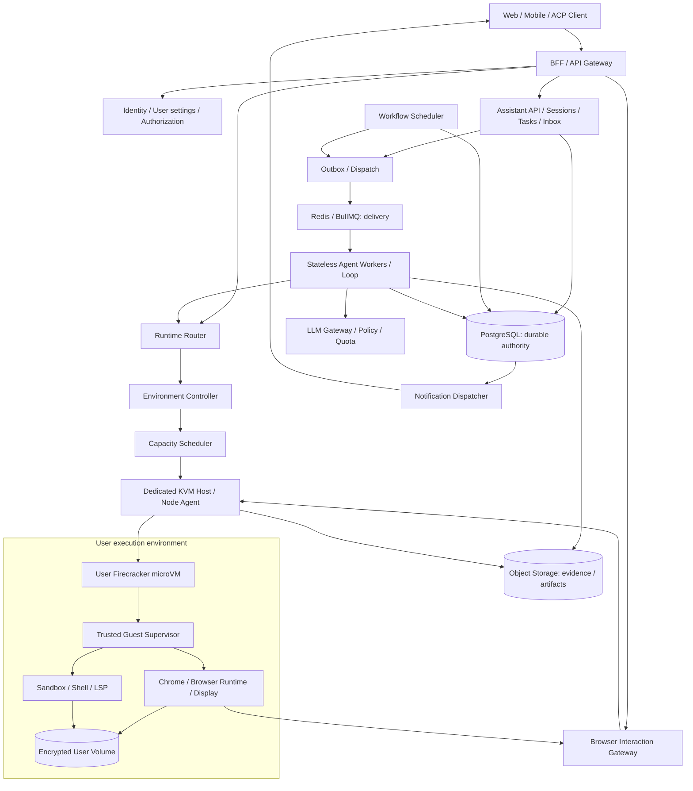
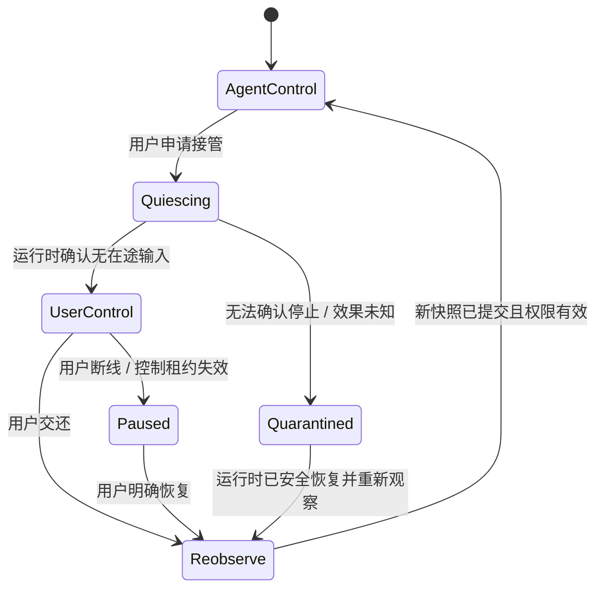
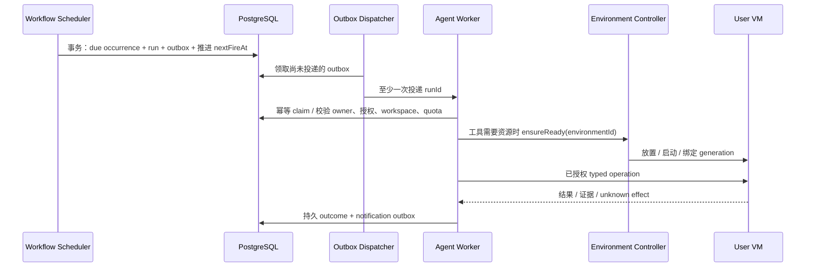

# Trinity Personal Assistant：用户云电脑与主动执行架构

> 日期：2026-10-24  
> 状态：架构提案，待评审；不代表已实现或已具备生产隔离。  
> 范围：Browser 可视化、BFF / 用户路由、Firecracker 用户环境、资源调度、定时与批量任务、主动沟通。

2026-10-24 实现进展：控制面继续使用 K8s。只读 Browser 观看、初步持久 Scheduled / Inbox 和实验性 Node Agent 生命周期代码已交付；其余能力仍按本文分阶段推进。精确实现边界与部署入口见 [首批实现](runtime-implementation.md)，不以本文目标描述代替已实现状态。

## 1. 建议采用的整体方向

把 Trinity 从“共享 worker 执行工具的聊天系统”，演进为“每位用户拥有持久个人环境、能够后台工作、可被观察和接管的个人助理”。

整体拆成三个部分：

1. **控制面**：身份、用户配置、会话、权限、记忆、任务与定时计划、通知、计费，以及无状态 Agent Loop。
2. **用户执行面**：每个 `(tenantId, userId)` 一个稳定的逻辑云电脑，活跃时由独占 Firecracker microVM 承载 Browser、Shell、LSP 和工作文件。
3. **实时交互面**：浏览器画面、控制权和人类输入，通过经过鉴权的网关连接到该用户正在运行的云电脑。

“一个用户一个 VM”指稳定的环境归属，不要求每位注册用户一直占用运行中的 VM。不同用户共享宿主机、基础镜像和空闲算力；不共享带登录状态的 Chrome、可写磁盘或恢复后的用户内存。

BFF 保持薄层，负责鉴权、协议适配、路由和连接，不承载 Agent Loop 或调度决策。用户信息归 Identity 服务；VM 在休眠时，历史、设置、任务和通知仍然可访问。

本提案保留现有 PG 事实源、ACP、contracts / DI、Vercel AI SDK、权限审批和事件溯源，不把 VM 磁盘改成会话事实源。模型推理默认通过控制面的 LLM Gateway 调用外部 provider，不要求每台用户 VM 部署模型或 GPU。

## 2. 对 Meta Muse 的参考边界

Meta 的官方架构说明描述了用户专属云电脑、浏览器与后台任务，以及客户端到个人 VM 的安全连接；也说明用户接管浏览器时 Agent 暂停操作。这支持我们采用“个人环境 + 可视浏览器 + 人机互斥控制”的产品方向。[Meta：Muse 安全与架构说明](https://research.meta.ai/blog/security-and-safety-for-ai-agents-our-approach-with-muse)

以下设计是 Trinity 的选择，不是对 Muse 内部实现的复刻：Firecracker、PG 中央事件源、共享无状态 Loop worker、外部持久调度器和具体媒体协议。尤其不照搬“VM 本身是用户数据事实源”的存储方式，也不推断 Muse 使用 Firecracker。

## 3. 当前系统与目标系统

| 能力           | 当前状态                                                                                          | 本提案目标                                                         |
| -------------- | ------------------------------------------------------------------------------------------------- | ------------------------------------------------------------------ |
| 浏览器执行记录 | typed browser、命令 journal、immutable observations、Sources / View evidence 已存在               | 在会话中持续显示 Browser 状态和画面，可打开大视图                  |
| 用户观看与接管 | 证据截图可查看；缺少持续观看和跨输入通道的控制权协调                                              | Watching / Agent controlling / You controlling / Paused 有明确状态 |
| 用户环境       | Chat 自动 workspace；Work 绑定个人或团队 workspace；managed browser 为 configured-owner 的 opt-in | 用户独立 microVM、持久盘、浏览器 profile 和可恢复环境              |
| 计算资源       | 共享 agent-worker，浏览器 supervisor 有容量与空闲回收                                             | 用户环境按需启动、资源准入、空闲回收、跨用户公平调度               |
| 后台执行       | 独立 Work、队列、取消和恢复已存在                                                                 | 支持周期执行、batch、授权事件触发与持久等待                        |
| 主动沟通       | 已有任务关联和持久状态基础；Scheduled 仍未实现                                                    | 持久 Inbox、审批 / 提问 / 结果通知、安静时段与去重                 |

现有边界以 [主设计](design.md)、[个人助理设计 §13](refactor-as-personal-assistant.md#13-implemented-behavior-and-current-limits)、[Zendriver 设计](zendriver-browser-design.md) 和 [execution v2](intent-execution-design.md) 为准。`trusted-cdp` / `trusted-managed` 不因本提案而变成多租户隔离模式。

## 4. 总体拓扑与责任分配



图中的模块是逻辑职责，初期可以在少量进程中部署；不要为每个框都创建一个微服务。

| 组件                        | 核心职责                                                       | 不承担的职责                                    |
| --------------------------- | -------------------------------------------------------------- | ----------------------------------------------- |
| Identity / User settings    | 租户与用户、登录、角色、时区、通知偏好、环境归属               | 不以用户提交的 VM 地址决定路由                  |
| BFF                         | 请求鉴权、CSRF / 限流、ACP / REST / SSE、签发短期交互会话      | 不运行模型循环、不持有 VM 权威映射              |
| Assistant API               | 会话与任务命令、schedule 定义、Inbox、审批、访问控制           | 不直接启动 Firecracker                          |
| Agent Worker                | 日志重放、上下文、模型调用、计划、工具编排、预算与验收         | 不把本地内存作为持久状态，不直接 spawn 用户命令 |
| Runtime Router              | 根据已验证的环境身份解析当前实例 / generation，转发类型化调用  | 不信任前端 / 模型指定的 host、IP、profile path  |
| Environment Controller      | 用户环境生命周期、租约、volume 绑定、恢复与对账                | 不解释自然语言任务                              |
| Capacity Scheduler          | VM 放置、CPU / 内存 / I/O 准入、优先级、公平性                 | 不决定“每天九点做什么”                          |
| Workflow Scheduler          | 到期 occurrence、batch、触发器、重试与持久等待                 | 不决定 VM 放在哪台宿主机                        |
| Node Agent                  | 宿主资源核实、jailer 启停、网络、盘挂载、vsock、隔离 / fencing | 不向模型暴露宿主机管理 API                      |
| Guest Supervisor            | 接受有作用域的执行请求，管理工具与浏览器、隔离子进程           | 不持有平台 DB 管理权限或长期 provider key       |
| Browser Interaction Gateway | 画面转发、观看与输入授权、控制权协调                           | 不向前端暴露 CDP、MCP 或任意 evaluate           |
| Notification Dispatcher     | Inbox / 推送投递、去重、静默时段与重试                         | 不把“已发送”当成“用户已阅读”                    |

### 4.1 为什么 Loop 暂留控制面

推荐第一版把个人身份与环境绑定到用户，把 Loop 进程继续放在共享无状态 agent-worker。它用该用户的持久上下文思考，通过 `SandboxPort` / `BrowserRuntimePort` 操作用户 VM。个人助理身份无需绑定某个永不退出的 Node 进程。

这样保留现有恢复、配额和密钥边界；VM 休眠时仍可回答不需要执行环境的问题。唤醒只发生在工具、浏览器、文件上传落盘或用户打开云电脑时。用户编写的代码留在 VM 的受限执行域，不能接触 worker 的模型 key。

若后续选择 Loop 入 VM，应单独评审可信 supervisor 与用户 shell 的隔离、远程日志提交、短期凭证和升级策略；不同时改变执行位置与存储事实源。

## 5. 用户身份、环境与路由

### 5.1 三类身份分离

| 身份                      | 生命周期                  | 说明                                                |
| ------------------------- | ------------------------- | --------------------------------------------------- |
| `assistantId`             | 随 tenant / user 持久存在 | 对话、记忆、偏好和授权，不随 VM 重启变化            |
| `environmentId`           | 稳定的逻辑云电脑          | volume、镜像版本、运行等级与 owner；不等于固定 IP   |
| `instanceId + generation` | 每次启动 / 恢复生成       | 当前 host、执行租约和控制通道；旧代不可继续接受操作 |

一个用户有一个默认个人环境；同一环境第一版至多一个活跃实例。会话 ID、任务 run ID 与环境 ID 不合并：Main chat、多个 Work 可以属于同一用户环境，但拥有独立日志与任务状态。

### 5.2 建议的外部路由

以下均为待实现 API。`/acp` 保留，新增 REST 只承担控制面和浏览器交互资源，不另建聊天协议。

| 路由                                        | 语义                              | VM 未启动时                             |
| ------------------------------------------- | --------------------------------- | --------------------------------------- |
| `GET/PATCH /api/me`                         | 用户资料、时区和允许编辑的偏好    | 正常使用；不能修改角色 / tenant / owner |
| `GET /api/me/environment`                   | 逻辑环境及当前运行状态            | 正常返回状态                            |
| `POST /api/me/environment/wake`             | 幂等申请唤醒                      | 返回 `202` 与 operationId               |
| `POST /api/me/environment/suspend`          | 请求安全休眠                      | 受活跃执行 / 控制权约束，异步确认       |
| `POST /acp`、`GET /acp/stream`              | 既有 Agent 命令和会话更新         | 对话与日志不依赖 VM 在线                |
| `POST /api/sessions/:id/browser-view`       | 创建短期观看会话                  | 按用户显式请求唤醒，显示准备状态        |
| `POST /api/browser-views/:id/control`       | 请求接管 / 交还                   | 必须验证实例、session 和控制权          |
| `GET/POST/PATCH /api/schedules[/:id]`       | 查询、创建、修改 / 暂停 schedule  | 正常使用                                |
| `POST /api/schedules/:id/run-now`           | 为当前定义版本创建手动 occurrence | 先创建持久 run，按执行需要唤醒          |
| `GET /api/inbox`、`POST /api/inbox/:id/ack` | 待处理事项与阅读状态              | 正常使用                                |

浏览器通过 BFF 认证，服务端从 owner 与 session 权限确定 `environmentId`。Router 查 PG 权威映射，缓存仅加速；缓存过期、generation 不匹配时重新解析。跨 host 管理链路使用 mTLS，host 到 guest 使用受限 vsock RPC。vsock 提供宿主 / guest 通道，本身不替代业务身份认证与请求授权。[Firecracker vsock 文档](https://github.com/firecracker-microvm/firecracker/blob/main/docs/vsock.md)

唤醒期间不得一直挂起 HTTP 等待启动：返回操作标识，使用持久状态与 SSE 更新；operation 查询可在 BFF 重启后继续。已接受的 ACP 请求沿用其现有幂等与异步执行语义。

## 6. 用户 microVM、持久化与隔离

### 6.1 VM 内部

```text
User microVM
├── Trusted guest supervisor       # 受保护身份、命令校验、控制权仲裁
├── Browser execution domain       # Chrome、private driver、display / capture
│   └── private browser profile    # 仅 browser 域可读
└── Workspace execution domain     # 非特权 shell、LSP、用户代码
    ├── personal workspace
    └── Chat session workspaces
```

VM 边界解决不同用户间的执行隔离；同一 VM 内还需以 UID、mount namespace、权限和系统调用策略隔离用户 shell 与 supervisor / browser profile。不能让任意 Bash 直接读取 cookies、profile 或控制 socket。浏览器执行域只接收已授权的 typed commands；为用户代码保留的网络通道也不能绕过出口策略。

个人 workspace 与 Chat workspace 继续保持现有不可变绑定语义；guest 中的路径映射由服务端元数据派生，模型不能选择宿主盘路径。`BROWSER_PROFILE_DIR` 的现有配置是迁移源，不直接作为跨用户宿主目录暴露到 VM。新部署将 profile 放入 browser 域的加密持久盘，并保持单写者。

### 6.2 数据分别放在哪里

| 数据                                               | 权威位置                             | VM 丢失后的处理                                |
| -------------------------------------------------- | ------------------------------------ | ---------------------------------------------- |
| 用户、权限、记忆版本、会话 / 工具事件、审批、usage | PG                                   | 继续读取 / 重放；VM 无权任意改写               |
| schedule、occurrence、run、控制权、通知与 outbox   | PG                                   | 扫描 / 对账恢复                                |
| 用户文件、Chrome profile                           | 加密持久 volume；有版本化备份        | 确认旧实例停止并解除旧挂载后，在新实例独占挂载 |
| 证据、附件、大输出、volume 备份、snapshot 文件     | 对象存储；PG 保存授权引用与 manifest | 按 owner、版本、hash 与引用恢复                |
| Redis 队列、实时 delta、路由缓存                   | 可重建分发 / 缓存                    | 从 PG 重建，不据缓存丢失推断任务完成           |
| Chrome 内存、LSP 缓存、直播帧                      | 临时运行状态                         | 重建；不声称恢复了原网络连接或未提交页面效果   |

PG 是业务状态与数据归属的事实源；文件字节由持久 volume / 对象存储承载，数据库不会复制每次磁盘写入。默认选择支持单写挂载和备份的远程块存储方案；Node Agent 将其以受控宿主 backing device / file 接入 guest。跨宿主 attach、fencing 与 RPO / RTO 必须通过实际存储方案验证，不靠 Firecracker 自动提供。

生产使用 Linux / KVM 节点、Firecracker jailer、最小宿主权限、cgroup 与受控网络。Firecracker 提供 VMM、block / net 等设备能力；宿主网络和资源编排仍由平台集成负责。[Firecracker 设计](https://github.com/firecracker-microvm/firecracker/blob/main/docs/design.md)

### 6.3 团队 Work 的边界

个人浏览器登录态不得自动用于团队会话。保留现有团队 Work 和共享 workspace 能力，但将其路由到明确的 team execution environment，或受控团队文件服务；使用团队授权凭证和独立 browser profile。任务 owner、执行主体和结果可见范围分别记录。

团队文件不能永久复制到多个个人盘后继续绕过撤权。第一版沿用独立团队执行路径并在每次执行 / 读取时校验成员身份；个人 VM 改造不强制团队任务挤进个人环境。个人结果分享至团队仍需用户明确选择内容。

## 7. Browser 可见、可暂停、可接管

### 7.1 前端产品形态

每个正在使用浏览器的 assistant response 显示 Browser activity 卡片：当前任务、脱敏站点 / 标题、最后更新时间、Agent / User 控制状态和“打开浏览器”。桌面端右侧展开实时画面，移动端进入独立面板，保留 composer 节点、输入草稿与后台订阅。

用户可以观看、暂停自动操作、接管鼠标键盘、交还控制、停止任务。多个标签页显示当前属于哪个任务；同一 profile 的操作使用用户级资源仲裁，不能只有单个 session 内串行。

画面断开显示“连接中断 / 最后画面时间”，不得冻结画面却仍标为实时。用户关闭画面只结束观看，不取消任务。切换会话后仍可从运行中任务入口返回。

### 7.2 三条通道

| 通道     | 传输与持久化                                                               | 用途                                              |
| -------- | -------------------------------------------------------------------------- | ------------------------------------------------- |
| 业务事件 | 既有 ACP over POST + SSE；PG 事件可重放                                    | tool 状态、审批、浏览器绑定、控制权变化、任务状态 |
| 实时画面 | 目标为经授权媒体网关中继的 WebRTC；可配置 TURN；帧不逐条进 PG              | 持续观看；无人观看时停止编码或降频                |
| 人类输入 | 带 epoch、输入序号与作用域的鉴权命令；初期 POST，后期可用受控 data channel | 鼠标、键盘、滚动；拒绝过期 / 重复输入             |

第一阶段只读画面可先使用有界低频截图与鉴权图片端点，不必等待 WebRTC 或 VM 交付。截图仍标明时间和非连续画面；这一步不等于完成交互式远程浏览器。

`design.md` §11.1 的 POST + SSE 继续适用于 Agent 业务协议。WebRTC 是本提案新增的媒体通道，信令经鉴权 REST；不能把视频帧塞入 ACP 文本流，也不把这一例外扩成任意 CDP / WebSocket 透传。guest 内显示与采集按软件渲染 / 编码验证，不预设 GPU 或完整桌面加速可用。

Browser Interaction Gateway 根据 view 会话解析 host，再由 Node Agent 转入 guest 的受限画面服务。前端只拿短期、可撤销的 view 授权，不拿 VM IP、CDP endpoint 或运行时 secret。已连接的流也要响应撤权和 generation 失效；仅签发时检查权限不够。

### 7.3 人机互斥控制



观看权可多开；写控制权同一时刻只授予一个用户连接或一个 Agent run。接管不是设置前端 boolean，而是：

1. 服务端持久化接管请求；运行时关闭旧 epoch 的新输入准入。
2. 取消 / 排空已接受的 Agent 输入，获取 runtime acknowledgment；有未知效果时隔离，不能直接授权另一方继续。
3. 确认静止后提交新的 `controlEpoch` 和 controller，前端才显示“你正在控制”。
4. 每个输入在运行时检查 owner、instance generation、epoch、输入序号和授权有效期。
5. 用户交还后，废弃旧 refs、坐标和当前状态 evidence；Agent 重新观察再继续。

接管期间阻止所有能访问该 browser 的 Agent 通道，包括其他 Work、child 和 legacy Bash 控制路径。无法关闭旁路的 trusted-CDP 部署只能提供明确标注的只读观看，不能宣称有可靠接管互斥。

人类手动输入不是 Agent 自动获准执行同类动作。登录 / 密码输入阶段暂停模型读取、截图证据采集与普通日志录制；输入值不进入 prompt、tool arguments 或事件。用户确认结束私密阶段后才恢复观察。此机制也不保证登录后页面永远不含敏感内容，仍需现有捕获策略与用户隐私控制。

### 7.4 直播与证据分开

实时帧是体验通道，不能直接用于模型引用或 completion verification。模型需要观察时仍走 typed browser → immutable observation → 成功 tool/result 与 delivered-range receipt；截图沿用单张尺寸与字节约束。

浏览器 lifecycle / 控制事件可通过 ACP `_meta` 扩展投影，Zod DTO 放 contracts、shared 重导出。建议事件族 `browser/view_state`、`browser/control_requested`、`browser/control_changed`，字段包含 session / run / browser binding、generation、epoch、原因及时间；不含连接凭证。已有 observation schema 与 `Sources / View evidence` 保持兼容。

默认不录制完整视频。可选历史回看使用显式开启的留存策略和关键帧 / 分段对象引用，禁止把密码输入、cookies 或私密登录画面录成普通执行历史。

## 8. 调度一：VM 容量与生命周期

### 8.1 状态机

```text
Unprovisioned → Stopped → Queued → Starting → Ready → Draining → Stopped
                                      └──────→ Failed / Quarantined
Ready → Draining → Snapshotting → Hibernated → Queued → Restoring → Ready
```

第一版只交付 `Stopped ↔ Ready`：正常停止 Chrome、flush / sync volume、关闭 VM，下一次用同一持久盘启动。不要把“冻结进程”叫成可回收内存的休眠；VM 处于 paused 状态仍可能占用内存。

`Hibernated` 属后续优化：停止外部输入、排空执行、冻结文件系统写入，生成匹配的 memory / device state / volume generation manifest，加密并完整落盘后，才停止 VMM 和释放资源。跨 host 恢复前验证版本与 CPU 兼容性、存储 manifest，重建身份与连接；不兼容时回退安全冷启动，而不是重发旧浏览器动作。

Firecracker snapshot 不替平台管理 guest 磁盘的一致版本；恢复后的网络 / vsock 连接也可能失效。因此 snapshot 只能优化启动，不能替代业务日志和外部效果对账。[Firecracker snapshot 支持与限制](https://github.com/firecracker-microvm/firecracker/blob/main/docs/snapshotting/snapshot-support.md)

### 8.2 何时启动，何时释放

唤醒来源：用户打开云电脑、已授权工具调用、到期任务需要执行资源、通过验证的事件触发。预热池只包含无用户数据和凭证的干净镜像 / 环境；绑定用户 volume 之后，该实例不能直接回池服务另一用户。

资源优先级建议：人工交互与接管 > 用户主动任务 > 有截止时间的 schedule > 普通 batch。为后台队列保留容量并按等待时间老化，避免持续前台负载饿死后台。每 tenant / user 设置并发、vCPU、内存、磁盘和媒体带宽配额，具体初值通过 Chrome 与实际任务压测决定。

空闲回收以实际资源使用和活跃 pin 为准，不以“前端没有连接”判断：运行中的工具、browser action、上传、接管和未解决效果均会阻止自动停机。纯文本模型调用可以不持有 VM pin。审批 / 用户输入等待若需保留页面，可持有有期限的 pin；到期先记录等待状态再安全关闭环境，恢复后重新观察并要求必要的重新确认。

### 8.3 放置与公平性

Capacity Scheduler 根据 node 心跳、可分配内存、CPU 压力、volume attach 条件、镜像缓存和健康状态选择宿主机。准入在持久 reservation 下完成，Node Agent 再核实本地资源，防止多个 scheduler 同时超分配。

第一版不超卖已承诺的运行内存；CPU 可按压测结果设置 share / quota。用空闲停机、只读基础镜像缓存和按需媒体编码提高利用率。不能以“多数用户可能不忙”为依据假定内存无限超卖。LLM 网络等待也不代表 Chrome、下载或用户代码已经空闲。

同一用户可并行执行独立只读 / 不冲突任务；browser profile 使用单写控制锁，共享 workspace 按资源 scope 仲裁。前台任务可要求后台在安全检查点让出 browser；不在点击 / 提交中途强杀以制造“抢占成功”。并发 batch 需要额外执行单元时可分配无个人 profile 的临时 sandbox，作为后续扩展，不破坏默认个人环境单实例约束。

### 8.4 单写与失联恢复

每次启动持有递增 generation、PG 租约和存储单写 reservation。租约过期只说明控制面失去联系，不证明旧 Chrome 或 VM 已停止。

旧节点失联时先撤销执行凭证和出口访问，再通过可靠的 host / infrastructure fencing 确认旧实例断电或失去盘与网络写权限；完成后才能在新节点挂盘。若底层平台不能证明 fencing，环境标为 `Quarantined`，等待恢复；不能只靠 TTL 启动第二实例。

所有工具与交互网关都校验 generation。已被外部网站接受的操作不能被 fencing 撤回；未结算命令保持 unknown，先查询 / 重新观察再决定是否继续。

## 9. 调度二：个人助理的定时、批量和事件任务

### 9.1 为什么调度器要在 VM 外

业务计划应在 VM 停机、迁移或崩溃时仍然到期。VM 内 cron 可作为用户代码能力，但不能作为产品 Scheduled 的权威实现；guest 自建常驻进程也不自动获得平台唤醒 / 通知权限。

Workflow Scheduler 是无状态服务，PG 保存计划和 occurrence；BullMQ 只负责唤醒 / 投递。多个 scheduler 可用事务与 `FOR UPDATE SKIP LOCKED` 领取到期记录，唯一约束负责 occurrence 去重，定期对账修复漏投递。

### 9.2 四类触发统一进入 Run

| 触发类型    | 示例                          | 持久标识                              |
| ----------- | ----------------------------- | ------------------------------------- |
| 手动任务    | “分析这批报告”                | client operation ID                   |
| 定时 / 周期 | “每个工作日早上九点汇总”      | schedule revision + scheduled instant |
| 事件触发    | 授权邮箱新邮件 / 外部 webhook | provider event ID + subscription ID   |
| 延后续作    | 等用户回答、下次检查、重试    | wait ID + resume version              |

所有触发创建独立 run，携带 owner、原始请求 / 授权来源、workspace、上下文范围和权限版本。用户给出的 schedule 请求保存原文与确认后的结构化定义；模型生成的执行 brief 明确标记为解释，不能伪装成新用户消息。外部事件 payload 是不可信数据，不是新的指令。

### 9.3 Schedule 定义

建议记录：`id / tenantId / ownerId / revision / requestSource / requestText / workspaceRef / taskTemplate / timezone / recurrence / startsAt / endsAt / nextFireAt / missedRunPolicy / overlapPolicy / permissionPolicyRef / notificationPolicy / status`。

使用 IANA 时区和受约束的 calendar recurrence / interval 类型，不接受 shell cron command。展示未来几次精确本地时间，启用前让用户看清频率、任务内容与授权范围。夏令时缺失时间默认跳过、重复时间默认执行一次；UTC occurrence 和具体折叠选择都落库，保证重启不改变结果。

沿用已有设计默认：**同一 schedule 不重叠，停机漏跑跳过并记录，不无声补跑整个历史**。可显式选择 `run_once_after_recovery`，合并为一次补偿 run；被 active / waiting run 阻塞的 occurrence 记录 skipped。若确有“每份都处理”的需求，以有界 batch 和游标补齐，不靠无限补发 occurrence。

修改计划创建新 revision，保留过去 occurrence；暂停禁止生成后续 occurrence，停止当前 run 是独立命令。运行中的旧 revision 继续使用原任务定义，但下一次 effect 必须满足当前授权；用户可同时取消它。时区修改只影响未来尚未生成的 occurrence，历史执行时间不重新解释。

### 9.4 持久执行路径



这里的唯一性是“一个 occurrence 一个 run”，不是“网站副作用 exactly once”。投递可重复，run claim、调用 journal 与通知键各自幂等；外部接口支持幂等键时使用，不支持时保留 unknown outcome，禁止自动重复发送、购买或提交。

### 9.5 等待、重试和 Batch

Run 状态建议：`queued → running → waiting_approval / waiting_input / waiting_external → running → completed / failed / cancelled`；资源准入另有 `waiting_capacity`，不要把排队当作执行失败。

等待必须保存 checkpoint / continuation、触发条件和超时，不长期占住 worker。到期 / 回答 / 审批通过后重新投递 run，重放原请求与授权来源。取消先持久化，再唤醒活跃执行，并等待终止记录；沿用现有 prompt-scoped cancel 与 AbortSignal 语义。

Batch 使用父 run、不可变 input manifest、可分页 items 和每项稳定 ID。每项独立记录进度、输出和 effect 状态；恢复只领取未完成且可安全重试的项。父结果显示成功 / 失败 / 未知 / 待处理数量及产物，不能因最后一次模型调用成功就把整批标为 completed。依赖图和复杂 workflow DSL 不是第一版必要条件。

交互和后台任务沿用现有 durable task reservation、usage 与租户配额；任务可显式配置独立预算，但不偷偷给全部主 / child turn 新增默认时长上限。计算资源的排队、休眠和并发限制与模型调用预算分开计量。

## 10. 主动帮助与主动找用户沟通

### 10.1 主动性的来源

Agent 可以依据用户启用的周期任务、明确订阅的事件或已授权任务中的 follow-up 主动工作。记忆、账号最近活动或主题标签不能自行制造新的目标。模型可提出新 schedule / 后续动作，启用与权限扩张仍通过用户可审阅的命令和既有授权边界。

例如，“每个工作日检查供应商报价，有异常来问我”定义了持续委托；模型在授权范围内判断异常与是否提问。系统负责时间、运行与通知可靠性，不用硬编码领域规则替模型解释“异常”。

### 10.2 两种主动沟通

1. **通知**：任务完成、发现变化、失败或需要审批。写入 Inbox，必要时推送外部渠道，无需生成一轮假的用户对话。
2. **主动提问**：Agent 保存具体问题、原因、关联 run、可选答案与截止时间，进入 `waiting_input`。用户回答以新的真实用户事件记录，关联 questionId；过期 / 重复回答不能误恢复别的 run。

Main chat 显示关联卡片，Task 保留执行细节；通知卡片不是原 prompt 的第二份 assistant final。需要模型解读的更新按 Main chat 的持久队列进入新的系统触发活动，保留 trigger provenance，与真实用户输入区分；不并行写入破坏当前 turn 边界。

### 10.3 通知可靠性与打扰控制

通知先进入 PG Inbox / outbox，再通过 SSE、Web Push 或用户绑定的邮件等渠道投递。首版先完成站内 Inbox；外部渠道按用户显式开启逐步接入。

稳定去重键采用 `(runId, eventKind, outcomeVersion, channel)`；有状态卡片更新同一事项，少发重复提醒。Inbox 未读、外部投递已确认、用户已阅读、用户已回复分开记录。第三方通知接口超时后可能已投递，不承诺端到端 exactly once。

用户可设置安静时段、摘要频率、渠道、事项优先级和主动任务暂停。审批或提问等待期间不在无人应答时默认允许；策略拒绝、撤权或审批过期阻止 effect。显式授权的无人值守规则可以允许其范围内动作，但“允许每天运行”不等于“允许任意发送 / 付款”。

敏感通知默认只展示“任务需要处理”与鉴权链接。团队结果在 Main chat 中仅显示授权可见的状态和链接，不能将正文复制到个人通知后绕过团队撤权。

## 11. 数据模型与 contracts 演进

以下是拟新增的逻辑记录，表名 / 拆分在实现评审时确定；不在本次文档任务中新增 migration。

| 记录                                             | 关键约束                                                                          |
| ------------------------------------------------ | --------------------------------------------------------------------------------- |
| `assistant_environments`                         | 唯一 `(tenantId, ownerId, personal)`；持久 environmentId、volumeRef、image policy |
| `environment_instances` / `runtime_reservations` | generation 单调；至多一个未安全释放的写实例；host / lease / resource claim        |
| `environment_events`                             | append-only 生命周期、fencing 与恢复结果；状态表是可重建投影                      |
| `browser_control_leases`                         | browser binding / profile 级单控制者、epoch、controller、expiry                   |
| `schedules` / `schedule_revisions`               | owner scoped、版本化任务定义、已确认授权来源                                      |
| `schedule_occurrences`                           | 唯一 `(scheduleId, revision, scheduledAt)`；保留 skipped / expired 原因           |
| `assistant_runs` / `run_events` / `run_waits`    | run 身份与触发来源、append-only 生命周期、等待条件与终止状态                      |
| `batch_items`                                    | 唯一 `(runId, itemId)`；每项 effect / output / retry 状态                         |
| `notification_items` / `notification_deliveries` | stable dedup key；阅读与投递状态分开                                              |
| `dispatch_outbox`                                | 与 run / outcome 事务提交；claim、重试与已投递标识                                |

用户可见 / 模型可见的运行变化追加对应 session 事件，并引用 run / environment event 身份；生命周期表不替代 session log。高频直播帧与心跳不写成模型历史。模型-visible schedule 输入、用户答复和恢复 checkpoint 必须可重放，保留 instruction / memory fences 与原始请求来源。

建议的端口职责：

| contracts 端口                              | 职责                                                |
| ------------------------------------------- | --------------------------------------------------- |
| 既有 `SandboxPort` / `BrowserRuntimePort`   | 保留模型-facing 执行入口，替换远程 microVM adapter  |
| `EnvironmentPort` / `EnvironmentStore`      | ensure-ready、生命周期请求、generation 与持久状态   |
| `CapacitySchedulerPort` / `NodeRuntimePort` | reservation / placement，以及宿主启停与 fencing     |
| `BrowserInteractionPort`                    | view 授权、控制权转换与人类输入；不开放任意 CDP     |
| `ScheduleStore` / `RunDispatchPort`         | 版本化定义、原子 occurrence / outbox 和幂等运行投递 |
| `RunContinuationPort`                       | 持久等待、恢复、batch item 领取与取消               |
| `NotificationPort`                          | Inbox、通知 outbox 和渠道状态                       |

端口和跨进程 DTO / events 首先在 `packages/contracts` 以 Zod 定义并推导类型；shared 按需重导出 UI DTO。实现通过构造注入，只在 app composition root 装配，不引入插件框架。不要在模型工具 schema 中开放 host admin、任意 runtime endpoint 或环境 owner 参数。

建议部署演进：`apps/server` 继续作为 BFF / API，`apps/agent-worker` 保留 Loop；新增职责可先组合为 `apps/control-worker`，承载 schedule / environment reconciliation / outbox；宿主部署独立 Node Agent。`apps/browser-runtime` 演进为 guest 中受保护的浏览器 supervisor。媒体网关按带宽负载独立扩容。

## 12. 故障与安全规则

| 场景                           | 规定行为                                                |
| ------------------------------ | ------------------------------------------------------- |
| BFF 重启 / SSE 断线            | 按已交付游标从 PG 重放；不重发已接受用户命令            |
| Redis 丢失任务                 | PG pending run / outbox 对账补投，claim 去重            |
| agent-worker 崩溃              | 沿用日志 torn-tail 修复与持久预算；不自动重放未知副作用 |
| Node 失联                      | 隔离环境并完成可靠 fencing 后再启动新实例               |
| volume attach 或解密失败       | 不回退空目录冒充原环境；显示不可用并阻止执行            |
| 接管 / pause 超时              | 保持未确认状态，阻止进一步输入；不能宣称 Agent 已停     |
| 浏览器画面网络中断             | 标记 stale；控制租约失效后暂停，不自动交还 Agent        |
| schedule owner / team 权限撤销 | 执行前和 effects 前重新验证，停止或等待重新授权         |
| 任务执行中跨过下次周期         | 默认记录 overlap skipped；不悄悄无限排队                |
| 通知渠道失败                   | Inbox 保留，outbox 按策略重试，不影响已提交任务结果     |

网络在宿主 / 网关强制执行默认拒绝与授权出口策略，覆盖 Chrome 子资源、redirect、WebSocket、DNS、private / link-local、云 metadata 与管理面；guest 用户代码不能改写该策略。需要局域网访问的部署必须有明确管理员配置，不能由模型扩大出口范围。

模型与连接器的长期凭证留在控制面 secret broker；guest 获得有作用域、可撤销的短期能力。浏览器登录 cookies 属用户加密 profile，不进入模型、通知或普通日志。snapshot 可能包含凭证与页面内存，按用户敏感数据加密、限制访问并支持删除与密钥轮换。

Firecracker 本身不自动完成这些出口、存储、guest 权限、凭证和人机控制策略。只有旁路关闭、隔离 / 故障测试和运维流程通过后，才能为新部署定义并启用更强安全标签；现有 trusted 模式保留原义。

## 13. 部署与容量规划

控制面继续用 Kubernetes 部署 BFF、worker、scheduler / controller、PG、Redis、对象存储和网关。microVM 使用具备 KVM 的专用宿主池，避免默认依赖普通 Pod 中可用的嵌套虚拟化。

第一版选择“宿主 Node Agent 管理 Firecracker 生命周期，K8s 管理控制面”，不同时引入第二套 microVM 编排平台。若后续评估基于 containerd / Kata 的方案，需要明确 VM owner、volume fencing、控制权与生命周期由谁唯一负责，避免多套 reconciler 互相接管。

容量按**同时活跃环境**和任务峰值设计：

```text
running environments ≈ 同时活跃用户环境 + 活跃团队环境 + 临时 batch 执行单元
host memory demand ≈ Σ admitted guest memory + VMM / host reserve + media buffers
media egress ≈ 同时观看连接 × 实测平均码率
```

不得拿 Firecracker 最小 guest 的启动数字估算完整 Chrome / LSP workload。上线前测冷启动、盘挂载、浏览器可用时间、watch 延迟、CPU 编码开销、batch 峰值、每用户 RSS 与存储恢复时间。

必须可观测的指标：唤醒排队与启动 p50 / p95、活跃 / 空闲 VM、资源拒绝率、用户公平等待、generation 冲突、unknown effects、browser 控制权切换耗时、媒体掉帧 / 重连、schedule 到期延迟、skipped / missed occurrence、Inbox / 外部投递延迟及成本。

运行时版本、guest 镜像、Chrome、driver、Firecracker 与 volume / snapshot schema 都需要兼容矩阵和灰度升级。升级优先安全停机后冷启动；内存 snapshot 不是长期跨版本备份格式。

## 14. 分阶段落地与验收

### 阶段 A：先让 Browser 可见

在现有 typed BrowserRuntime 上增加 activity 卡片、实时状态和只读截图观看；保留 Sources 证据链。无需先完成 Firecracker。trusted 部署清楚标识，owner / session 权限和截图隐私策略继续执行。

验收：正在浏览的用户能看到当前画面及更新时间；刷新 / 切换会话后继续观看；断线明确显示；无权限用户取不到画面；输入草稿 / 焦点和未变化历史不被重绘。只读预览不显示不可用的接管按钮。

### 阶段 B：单节点个人 microVM 与安全接管

实现环境身份、单写 volume、Node Agent、guest supervisor、远程 sandbox / browser adapters。迁移 profile 时停止旧 Chrome，校验复制 / 盘转换并记录迁移 manifest，禁止旧新 runtime 同时写。保留现有 CDP 兼容模式且不静默切换。

加入受控画面、控制 epoch、Agent 输入停止确认与接管 / 交还流程。团队仍走独立执行路径。

验收：两个用户环境 / cookies / 文件不可互读；用户 shell 不能读 profile 或控制 socket；跨 session / child / legacy 通道不能在接管后发输入；旧 generation 被拒绝；VM 冷启动恢复文件和登录态；旧进程未确认停止时禁止双开。

### 阶段 C：资源池与生产隔离

增加多宿主放置、容量 reservation、公平队列、空闲停机、远程块存储与可靠 fencing；媒体按需求切换 WebRTC。先做到安全冷恢复，再决定是否引入内存 snapshot 优化。

验收：容量不足显示排队；前台不会无限饿死 batch；宿主宕机不会产生双写；VM 重启后浏览器 refs 失效并重新观察；出口旁路 / metadata / 私网访问受策略约束。记录实际 RPO / RTO 与延迟，不预先承诺性能数字。

### 阶段 D：持久 Scheduled、Batch 与主动沟通

实现 schedule revision、occurrence、run / wait / batch item、outbox 和 Inbox，随后接入用户选择的推送渠道。把 Scheduled 从“未支持”切换为真实创建与管理界面，前提是完整持久路径已可用。

验收：用户关闭网页、VM 停机后仍能到期执行并按需唤醒；scheduler / worker 重启与 Redis 清空不会漏掉应运行项或创建重复 run；DST / 漏跑 / 重叠有确定结果；未知 effects 不被重发；提问持久等待、回答可恢复；重复通知被抑制；撤权阻止无人值守操作。

每个阶段都保留旧部署路径的明确配置和回退方案。回退执行环境前必须停止新实例并确认 volume / profile 单写，不能同时运行两套个人环境。

## 15. 需要评审确认的取舍

建议以本文默认方案开始：共享无状态 Loop + 用户独占执行 VM，Node Agent 管理宿主，冷启动 / 持久盘优先，只读 Browser 先交付，schedule 默认不重叠且漏跑跳过，通知先站内 Inbox。

实施前需要落实的部署参数是 KVM 宿主平台、单写块存储及 fencing 能力、镜像与 Chrome 兼容版本、初始资源档位、空闲回收阈值、数据备份目标与外部通知渠道。这些影响成本和恢复承诺，应通过小规模原型与压测确定；不阻止先交付浏览器可见性。

## 16. 参考文档

- Trinity：[主设计](design.md)、[个人助理产品与现状](refactor-as-personal-assistant.md)、[Zendriver runtime](zendriver-browser-design.md)、[intent / execution v2](intent-execution-design.md)、[部署指南](deployment-guide.md)。
- Meta：[Muse 官方产品介绍](https://ai.meta.com/muse/)；[安全与架构说明](https://research.meta.ai/blog/security-and-safety-for-ai-agents-our-approach-with-muse)。仅将公开描述作为产品与边界参考。
- Firecracker：[设计](https://github.com/firecracker-microvm/firecracker/blob/main/docs/design.md)、[生产宿主配置](https://github.com/firecracker-microvm/firecracker/blob/main/docs/prod-host-setup.md)、[vsock](https://github.com/firecracker-microvm/firecracker/blob/main/docs/vsock.md)、[snapshot 支持与限制](https://github.com/firecracker-microvm/firecracker/blob/main/docs/snapshotting/snapshot-support.md)。实现前固定版本并复核对应版本文档。
