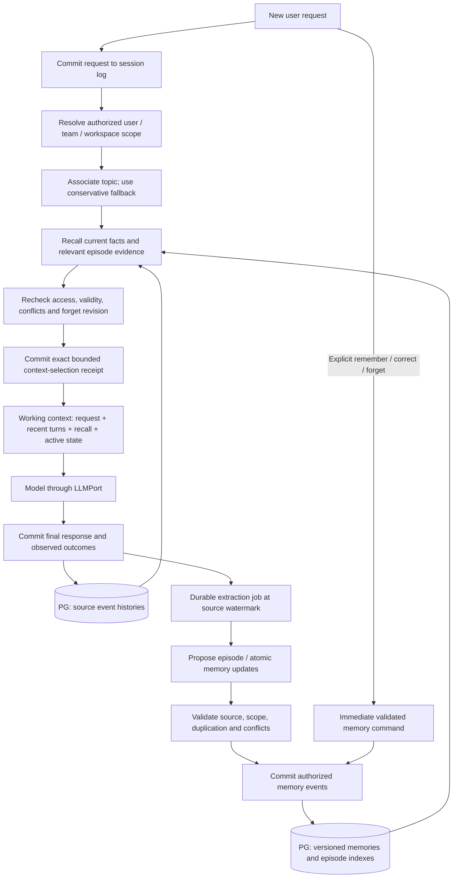
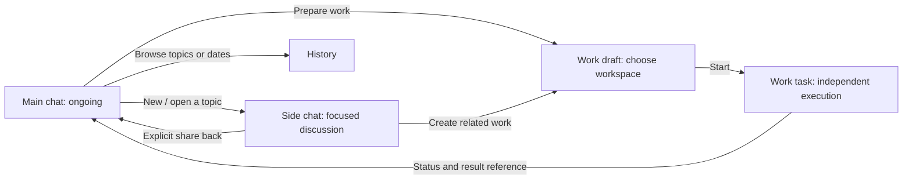

# Refactor Trinity as a personal assistant

Status: **Assistant foundations and primary flows implemented. Current behavior and remaining rollout work are recorded in §13.**  
Date: 2026-10-21
Revision: Chat is a fully capable ad-hoc task with an automatic workspace; Task binds to a selected workspace. This supersedes the earlier conversation-only Chat boundary. Runtime workspace and tool alignment is implemented; see §13.

This document records the approved product direction and supporting architecture. The implementation now includes durable session kinds, Main chat, independent conversations/work, history and scoped memory. `docs/design.md` §11.5/§21 describes the runtime and persistence changes. Detailed research and future capabilities below remain design guidance where §13 identifies a narrower initial implementation.

## 1. Recommended product model

Trinity opens into **Main chat**, an ongoing personal conversation with the assistant. It remains the same conversation across days. Topic episodes organize its history, dates provide an alternate browsing view, and scoped durable memory retains relevant facts and decisions without resetting the conversation.

The sidebar has one **New** action. It opens a fresh creation screen with **Chat / Work** choices in the main pane. The choice is available only before the new conversation starts. After creation, its kind is immutable and its header displays that kind rather than a switch.

**Chat** creates an ad-hoc session with an automatic workspace. **Task** binds to a selected personal or team workspace for coding, long-running research, or other ongoing work. The current UI/API calls this kind **Work** (`work`); that implementation name does not define a different capability tier. Both can be linked to Main chat while keeping their detailed histories separate.

| Surface        | Purpose                                                            | Workspace                                            | Lifetime                                                                              |
| -------------- | ------------------------------------------------------------------ | ---------------------------------------------------- | ------------------------------------------------------------------------------------- |
| Main chat      | Everyday questions, coordination, decisions, and returning results | Automatic durable session workspace                  | One ongoing conversation per user within a tenant; topic history and date browsing    |
| Side chat      | An ad-hoc request, research, file processing, or troubleshooting   | Automatic durable session workspace                  | Multiple turns; user can archive or reopen it                                         |
| Work task      | Execute a defined request and produce a result                     | Explicit personal root/subfolder or team space       | Queued/running through a terminal outcome; follow-up runs remain attached to the task |
| Scheduled task | Define future or recurring Work                                    | Workspace and permissions captured in its definition | A persistent schedule with independently tracked runs                                 |

**Recommendation:** default entry is Main chat; default choice on New is Chat. Work remains a deliberate choice. “Side” describes a conversation's relationship to Main chat, not an internal model subagent.

## 2. References and what we take from them

Meta's [How We Designed Muse](https://introducing.muse.ai/) describes a continuing main conversation, side chats for separate topics, and background tasks with visible activity. These inform Trinity's separation between everyday conversation, focused discussions, and ongoing work. Daily archiving was an initial option in this discussion. The revised recommendation in §6 uses topic episodes with date browsing; that is a Trinity design decision, not a claim about Muse's archive implementation.

Meta's [Muse Code side-chat recipe](https://dev.meta.ai/docs/cookbook/side-chats) provides a useful technical analogy: independent session logs, an explicit source snapshot, and a side discussion that can proceed while other work continues. Muse Code is a separate product surface. Its exact inheritance and write-back behavior are not assumed to describe the Muse personal assistant or required for Trinity.

The earlier [ChatGPT Work reference](https://developers.openai.com/training/walkthroughs/getting-started) remains useful for task-oriented entry. Trinity's proposed Chat / Work creation choice and workspace rules below are our product decisions.

## 3. Navigation and layout

### Sidebar

Keep the sidebar short, stable, and independent of the current conversation kind:

```text
Trinity

+ New
  Main chat
  Tasks                 2 running · 1 needs you
  Scheduled
  History

Recent
  Chat  Weekend plans
  Work  Compare suppliers        Running
  Work  Fix sign-in              Needs approval

──────────────────────────
Account / settings
```

- **New** always means create a new side chat or Work task. It never clears Main chat.
- **Main chat** returns to the ongoing personal conversation and its preserved draft.
- **Tasks** lists Work with filters for active, needs input, and completed. Counts represent actual persisted states.
- **Scheduled** manages schedule definitions and their run history once scheduling exists. Until then it is clearly unavailable, with no fake creation flow.
- **History** opens Main chat by topic or date, with a separate filter for manually archived side chats, tasks, and topics.
- **Recent** shows a small mixed list with kind and relevant state. It does not show date groups or every topic episode as a separate conversation.
- Account settings contain teams, personal preferences, and the authorized audit entry. Work creation still exposes workspace selection directly.

Desktop uses a narrow sidebar, a central conversation, and an optional right-side detail pane. Opening an existing task or side chat can use that pane; the user can expand it to the main area. Opening New uses the main area with enough room for Work setup. On mobile, the sidebar becomes a drawer and the detail pane becomes a full-screen route with a clear Back action.

Use explicit headers: **Main chat**, **Chat · Weekend plans**, and **Work · Compare suppliers**. A task keeps its workspace and status visible in its header. This makes the current context clear without relying on the sidebar selection.

### New screen

```text
New

                 [ Chat | Work ]

Chat:
  What would you like to talk about?
  [ Message…                                    Send ]

Work:
  What would you like to get done?
  Workspace   [ Choose personal or team space       ▾ ]
  Folder      [ Choose folder                        ]
  Permissions [ Workspace write · ask                ▾ ]
  [ Describe the task…                         Start ]
```

Chat has no folder or team selector. Work places these controls next to the composer rather than hiding them in general settings.

## 4. Chat / Work selection and the locking boundary

Chat and Work must become **durable session kinds**, enforced by the server for workspace allocation and session organization. Tool capabilities follow the effective permission policy rather than a conversation-only Chat allowlist. Changing labels or the input placeholder is insufficient.

| State                                                           | Can change Chat / Work? | Can change workspace? |
| --------------------------------------------------------------- | ----------------------- | --------------------- |
| Local draft; typing or locally staged files only                | Yes                     | Yes, for Work         |
| Creation/upload/submission request in flight                    | No                      | No                    |
| Session created, including an attachment-only session           | No                      | No                    |
| Running, waiting for approval, completed, reopened, or restored | No                      | No                    |
| Request failed and server confirms no session was created       | Yes                     | Yes                   |
| Request outcome unknown after disconnect                        | No, until reconciled    | No, until reconciled  |

“Before anything happens” means before the first operation that creates durable session state or begins execution. Typing remains local and does not lock the choice. Switching the draft choice preserves text and compatible locally staged files, but starts no execution and grants no permissions.

The current attachment path uploads immediately and can create a session. The proposed flow stages files locally first. Sending the message or choosing Upload/Start commits the selected kind and, for Work, workspace before uploading. A failed upload after session creation does not unlock or convert that session.

Creation uses a client operation ID for idempotency. On reconnect, resolve the creation outcome before enabling another mode choice. An empty transcript is never evidence that a persisted session is still a draft.

After creation, replace the Chat / Work switch with the fixed kind in the header. To change kind or workspace, offer **Create related work** or **New**, preserving a link to the source; do not convert the existing log in place. Main chat is always Chat and never displays the switch.

## 5. Shared capabilities and workspace context

### Main chat and side chats

Chat is an ad-hoc task with a real, durable workspace allocated automatically at creation, for example `/sessions/<user_id>/<session_uuid_v7>`. The deployment owns the session storage root; clients cannot supply an arbitrary absolute path. Main chat also keeps its own stable workspace across dates and topics. Ad-hoc does not imply temporary storage, a short execution deadline, or deletion when the conversation is closed.

Chat and Task use the configured tool set: workspace CRUD, uploaded-file processing, browser research, knowledge-base retrieval where available, skills, commands and delegation where configured. Permissions, authenticated scope, sandbox boundaries and deployment availability govern execution. Session kind alone must not hide these capabilities. Chat can research public documentation or troubleshoot a computer issue without requiring a new Task. Host access outside its workspace still follows the normal authorization/approval mechanism.

Uploads and generated files belong to the Chat workspace or authorized artifact storage. Persist large browser pages, extracted data and intermediate research outside model context; expose bounded excerpts, cursors/ranges and durable source references through the existing artifact/evidence contracts. Never load an entire large artifact merely because it belongs to Chat.

A request involving a particular existing repository can use a related Task to select that workspace. This is an explicit workspace/context choice, not a requirement for every execution request. Keep session identity and existing workspace bindings stable rather than silently switching a Chat into a project directory.

A side chat starts with either no inherited context or an explicitly selected source message/range. Show that reference in the new chat. Inherited material is a bounded, persisted snapshot of relevant user input and final answers, clearly marked as reference rather than active instructions. Internal tools, approvals, and unrelated private history are not copied as a transcript.

### Work

Work requires a resolved workspace before execution:

| Choice          | Behavior                                                                            |
| --------------- | ----------------------------------------------------------------------------------- |
| Personal root   | Explicit selection of `$WORKSPACE_ROOT/<user_id>`                                   |
| Personal folder | Browse an existing allowed subfolder; it becomes the sandbox root                   |
| Team space      | Select a team the user belongs to; show its name and shared visibility before Start |

The initial proposal retains the existing team-root behavior. Team subfolder selection can be a later extension; the UI must not imply it is already supported.

Show the effective permissions before Start. Keep the current safe default, `workspace-write` with approvals, subject to role and deployment policy. Scope validation, team membership, and execution authority are checked server-side on creation and execution. A missing workspace or revoked access blocks execution.

The task header continues to show the workspace, sharing scope, and task state. Work supports execution history, approval requests, stop, final output, artifacts, and follow-up requests. Changing a permission policy through an existing authorized mechanism remains distinct from changing a session's kind or workspace; the latter remain immutable.

## 6. Main chat, topic history, and memory

**Revised recommendation:** keep one continuous Main chat, organize it into automatically suggested **topic episodes**, and offer dates as a secondary history filter. Neither midnight nor a detected topic change ends the conversation or resets model context. A durable memory system supplies relevant information across episodes and sessions.

This replaces the earlier recommendation to make daily archives the primary organization. The combination below is a design recommendation based on the sources and Trinity's requirements; the literature does not establish one universally best implementation.

### 6.1 Research findings

| Primary source                                                                                                                | Finding relevant to Trinity                                                                                                                                    | Design implication and limit                                                                                                                                                                       |
| ----------------------------------------------------------------------------------------------------------------------------- | -------------------------------------------------------------------------------------------------------------------------------------------------------------- | -------------------------------------------------------------------------------------------------------------------------------------------------------------------------------------------------- |
| [SeCom, ICLR 2025](https://arxiv.org/abs/2502.05589)                                                                          | Constructs retrieval memory from topically coherent conversation segments and evaluates it against turn/session/summary approaches.                            | Topic episodes are a useful retrieval unit. Benchmark results do not establish that an online subject-change detector should move the user's UI or create new sessions.                            |
| [LongMemEval, ICLR 2025](https://arxiv.org/abs/2410.10813)                                                                    | Evaluates extraction, multi-session reasoning, temporal reasoning, knowledge updates, and abstention; studies decomposition, indexing, retrieval, and reading. | Test actual recall, corrections, time, and “not enough information,” rather than only testing that a summary was saved. Retrieval units need timestamps and original evidence.                     |
| [Anthropic: effective context engineering](https://www.anthropic.com/engineering/effective-context-engineering-for-ai-agents) | Describes compaction, structured notes, and selective retrieval for long-running agents.                                                                       | Keep a bounded working context plus durable external records. A running summary alone should not carry every long-term fact.                                                                       |
| [LangChain: memory overview](https://docs.langchain.com/oss/python/concepts/memory)                                           | Separates thread-scoped state from namespaced long-term memory; describes semantic/episodic/procedural memory and foreground/background writes.                | Separate memory purposes and authorization scopes. Use immediate commits for explicit requests and background processing for derived candidates. These concepts do not require adopting LangGraph. |
| [Google ADK: memory](https://adk.dev/sessions/memory/)                                                                        | Distinguishes session interaction history from persistent memory services and supports extraction/consolidation separately from transcript search.             | Model memory as a dedicated port and durable store, separate from event history and current context. No dependency on a hosted memory vendor is necessary.                                         |

### 6.2 Compare the organization choices

| Approach                                            | Useful properties                                                      | Main problem                                                                                   | Recommendation                                                                   |
| --------------------------------------------------- | ---------------------------------------------------------------------- | ---------------------------------------------------------------------------------------------- | -------------------------------------------------------------------------------- |
| Daily archive as the primary boundary               | Predictable, simple chronological browsing                             | A day mixes unrelated subjects and splits work spanning midnight                               | Keep date filters and optional daily digests, not automatic conversation closure |
| Hard split whenever the subject changes             | Focused histories                                                      | Ambiguous follow-ups, returning topics, and multi-topic messages cause disruptive false splits | Do not automatically create or switch sessions                                   |
| One rolling summary                                 | Easy to carry forward                                                  | Loses detail through repeated compression; makes correction and precise recall difficult       | Use for working-context continuity only                                          |
| Topic episodes plus scoped memory and date browsing | Supports focused recall, returning subjects, and chronological history | Requires indexing, uncertainty handling, and user correction                                   | Recommended product model                                                        |

A **topic** is a recurring subject, such as “Trinity UI redesign.” An **episode** is a coherent sequence of turns about it. Returning to the same subject tomorrow creates a new episode linked to that topic. A topic can therefore reference noncontiguous parts of Main chat without reordering or moving any messages.

### 6.3 Detecting a subject change when a request arrives

Use the incoming request to propose one of **continue current episode**, **resume an earlier topic**, **start a new topic**, or **uncertain/multiple topics**.

1. Explicit links and selections take precedence: replying to a message, opening a task, or selecting “Continue this topic” provides a reliable anchor.
2. Compare the request with a bounded set of recent topic titles, entities, open-task references, and episode summaries. Retrieve older candidates when the user refers back to earlier work. Do not scan the entire transcript with a model on every request.
3. A small structured classification through `LLMPort` can resolve semantic ambiguity. Its result includes the proposed topic/episode, supporting source references, and uncertainty. Model self-reported confidence is not a calibrated probability; any automated threshold must be evaluated on Trinity fixtures.
4. Record the proposed association with the prompt ID and source watermark. The prompt itself is committed normally even when classification is unavailable. Default to the current episode or an unclassified turn; a topic-indexing outage must not lose the message or block ordinary chat.
5. Finalize episode membership using completed user/final-answer turns. A provisional boundary can be revised by an appended association event. Never split a tool call/result pair or reinterpret an unfinished execution because a title changed.
6. A returning subject reuses a topic ID and retrieves its relevant decisions. A multi-topic message can have secondary topic links while retaining one primary episode and the existing prompt/response identity.

**Examples:** “Can you expand on that?” continues the current episode. “Unrelated: help me plan Kyoto” suggests a new topic. “Back to the UI proposal” resumes its earlier topic. “Use the trip dates in that report” needs references from both topics rather than an arbitrary hard split.

Show a quiet topic heading, such as **Kyoto trip**, within the continuous timeline. Provide Rename, Merge topics, Move this turn, and Continue topic. Corrections change versioned metadata, not the original event log. Inferred topics must not change permissions, workspace, Chat/Work kind, task cancellation, or memory scope. Starting a separate Chat/Work remains an explicit New/handoff action.

A paused subject remains recoverable. Topic change is not task completion, permission to forget open commitments, or permission to store a personal fact.

### 6.4 History, dates, and the ongoing Main chat

Maintain one active Main chat identity per `(tenant, user)`. It has no ordinary “complete” action and no automatic midnight closure. The assistant is idle between requests and authorized background work.

Replace the sidebar's **Archives** destination with **History**. The page supports **Topics / Dates / Archived** filters. Topic browsing is primary; dates remain a dependable alternate route when titles or classifications are imperfect. “Archived” is an explicit user organization action for side chats/tasks/topics, not deletion or cancellation.

Store committed timestamps, prompt/turn references, and bounded sequence ranges. Topic indexes are versioned, rebuildable projections over those records. The first page shows recent Main chat turns and relevant active-task cards, with stable cursors for older history; it does not fetch the lifetime log. Topic-specific browsing can select disjoint completed turns and must load enough boundary context to render them correctly.

Use a persisted IANA timezone for date browsing and optional daily digests. Midnight adds a date separator, with no context reset. Handle DST and prospective timezone changes explicitly; do not partition by fixed 24-hour increments. A turn crossing midnight remains one response anchored to its prompt, with continuation links if a date filter shows only part of it. Historical replies append a new turn with a source reference rather than modifying an older range.

Daily digests are optional derived summaries with source ranges and an “as of” watermark. Their failure does not affect conversation continuity. Retention, explicit deletion, model compaction, and UI archiving remain separate policies.

### 6.5 Foundations inspected before implementation

The initial repository inspection found these foundations:

- `packages/core/src/context/context-manager.ts` appends `compaction/summary` checkpoints under context pressure and retains the source log.
- `packages/contracts/src/session.ts` and `packages/core/src/loop/to-model-messages.ts` rebuild conversation/model context, preserving current execution pairs and durable control state while completed turns retain input/final output.
- `packages/core/src/session/memory-session-store.ts` is an in-process session-store implementation for local/testing use. Its name does not mean it stores durable personal memories.

**Before this refactor, those components did not implement durable cross-conversation facts/preferences, topic retrieval or correction/forget controls.** The new contracts, PG adapters, runtime context selection and Memory UI now provide these capabilities; see §13 for the initial scope and remaining evaluation work. Compaction remains working-context continuity, separate from durable memory.

### 6.6 The proposed memory mechanism

| Layer              | Stores                                                                                                          | Lifecycle and use                                                                                                                                                    |
| ------------------ | --------------------------------------------------------------------------------------------------------------- | -------------------------------------------------------------------------------------------------------------------------------------------------------------------- |
| Source history     | Committed user inputs, final answers, source references, execution/audit events                                 | Durable evidence. Query bounded authorized ranges; never treat assistant statements as verified personal facts.                                                      |
| Working context    | Current request, recent relevant exchanges, active tool pairs, loaded instructions, checkpoint, selected recall | Assembled for a model request; replayable and compacted under context pressure. A topic switch can change relevance selection without discarding active obligations. |
| Episodic memory    | Topic episodes: request/outcome, decisions, unresolved questions, related task IDs, source ranges               | Indexed after completed turns; versioned summaries are retrieval aids with original evidence available.                                                              |
| Semantic memory    | Atomic user preferences, user-stated facts, and approved project/team facts                                     | Durable, scoped, versioned, with provenance, validity, correction, and forgetting. Shared only within the authorized scope.                                          |
| Procedural memory  | Reviewed skills/workflows and their instruction versions                                                        | Continue to use Skill Runtime. Conversation-derived suggestions cannot rewrite system instructions or grant execution permission.                                    |
| Task/control state | Plans, approvals, task status, budgets, deadlines, reservations                                                 | Existing authoritative execution records, read as current state. Never infer or restore these from a memory summary.                                                 |



The diagram shows logical stages; a topic association can finish asynchronously. An uncommitted classification or memory candidate is never presented as an established fact. Successful memory changes and the selected context are durable before the assistant claims to have saved or used them.

### 6.7 Memory records and authority

Proposed fields, to be formalized with Zod schemas in contracts:

| Group              | Required information                                                                                        |
| ------------------ | ----------------------------------------------------------------------------------------------------------- |
| Identity and scope | Memory ID/revision, tenant, personal owner or team/project scope, kind                                      |
| Content            | Atomic subject, predicate, value; optional condition such as “for technical answers”                        |
| Provenance         | Source session/event IDs and precise supporting range, source actor, explicit/user-confirmed/derived origin |
| Time               | Recorded time, effective/valid interval with precision, optional expiry/review time                         |
| Lifecycle          | Candidate/active/disputed/superseded/forgotten; prior revision/replacement links                            |
| Control            | Extraction version, source watermark, authorization/policy revision, deduplication key                      |

Example, shortened for readability:

```json
{
  "memoryId": "mem-language",
  "revision": 2,
  "scope": { "tenantId": "tenant-a", "userId": "sam" },
  "kind": "preference",
  "subject": "user",
  "predicate": "response_language",
  "value": "English",
  "origin": "explicit_user_request",
  "source": { "sessionId": "main-1", "eventId": "message-42" },
  "recordedAt": "2026-10-20T09:00:00Z",
  "status": "active",
  "supersedesRevision": 1
}
```

This is an illustrative record, not a new wire protocol or an assertion about the current user's preferences. A separate memory stores answer length; changing language must not accidentally erase that preference.

Source references establish where a claim came from, not that it is true. Store “the user stated X” or an observed outcome at its proper authority. Model-generated text, pasted documents, webpages, and quoted speech cannot silently become user identity or durable instructions. Extractors emit candidates; deterministic validation and policy control commit.

Prefer explicit corrections over older values within the same subject/predicate/condition. A one-off request (“use French for this answer”) remains turn-local unless the user makes it durable. Distinguish the time a fact became true from when it was learned, and preserve uncertain date precision. Conflicting claims that cannot be resolved become disputed and prompt clarification when relevant; do not use last-write-wins on model completion time.

### 6.8 Writing and consolidating memory

**Foreground:** “Remember…”, “Change my preference…”, and “Forget…” use authenticated typed commands. Persist the change before acknowledging it. Explicit memory changes must be usable by the next request in another session, with no dependency on background extraction finishing.

**Background:** completed turns enqueue an idempotent job keyed by source session, watermark, and extractor version. It maintains episode summaries and proposes durable facts. Use the AI SDK through `LLMPort`, normal quota/accounting and cancellation; record processing cursors durably. A worker crash retries the same source span without multiplying memories.

Recommended initial policy: saved personal facts/preferences require an explicit request or user acceptance of a candidate. Automatic episode indexing is enabled because it organizes existing authorized history; it does not promote every topic into a permanent personal profile. An optional **Auto-save preferences** setting can later activate narrowly eligible, low-risk user-stated preferences after evaluation. Sensitive facts, inferred personality traits, and third-party personal details must not be auto-promoted. Credentials and secrets are excluded from memory entirely and use the existing secret-storage path; even an explicit “remember my API key” request cannot write it into a memory/event payload.

Consolidation deduplicates repeated support, creates revisions for changes, and records supersession. A topic boundary is a useful indexing trigger, but not the sole trigger: also index completed-turn watermarks and task outcomes so a never-ending topic can still be recalled. Generate summaries from original bounded source evidence, not only from an accumulating summary of previous summaries.

Concurrent updates use an expected revision and source ordering. A delayed extractor cannot resurrect a forgotten value, override a newer user correction, or broaden scope. Keep pending candidate counts and indexing watermarks inspectable; missing background work must not be mistaken for complete recall.

### 6.9 Reading memory for each request

1. **Authorize first:** select only the current tenant and permitted namespaces. Personal memory is unavailable to team Work unless the user explicitly shares the relevant items. Search/rerank never receives another user's or unauthorized team's content.
2. **Retrieve by purpose:** exact active preferences first, then current/resumed-topic decisions, then related episodes using lexical/entity/time filters. Add embedding search through an injected port and PG-backed index if evaluation demonstrates its benefit. A separate vector database or knowledge graph is not required for the initial design.
3. **Resolve validity:** apply current corrections, scope, conditions, expiry, uncertainty, and forget rules. For questions about the past, retrieve valid-at-that-time versions instead of pretending the current value always applied.
4. **Fetch evidence:** expand a promising episode into bounded original user/final-answer excerpts and current task-state reads. Do not answer an exact past-detail question from an approximate topic summary alone.
5. **Assemble a bounded selection:** prioritize the current request, mandatory instructions and active tool/control state. Add relevant preferences and evidence, then recent context. Choose limits against the actual model window; excess history remains retrievable. These are per-request context limits, not a new task-duration or cumulative evidence ceiling.
6. **Persist a receipt before dispatch:** record memory IDs/revisions, source ranges, delivered bounded text or immutable content references, source watermark, topic association, policy revision, and omitted/stale indicators. IDs alone are insufficient if their content can change. Model replay uses the committed selection rather than querying today's memory store for yesterday's request.
7. **Allow targeted recall:** the model can request more authorized evidence when needed. Current user instructions govern the current task; memory content is clearly marked as reference data and never overrides execution policy.

When relevant memory is missing or ambiguous, the assistant asks a focused question or says it cannot recall confidently. A memory-store outage permits a labeled no-memory conversation only when authorization and forget-policy checks can still be enforced. If those checks cannot be established, do not inject cached recall. Explicit saves fail visibly rather than claiming success.

### 6.10 Correction, forgetting, and retention

Corrections create a new revision and invalidate derived facts/episode summaries that depended on an old claim. Routine retrieval uses the current valid version; explicit historical questions can inspect superseded versions with their dates. A verification outcome such as “tests passed” remains an observation about that run and cannot become a timeless claim about the repository.

**Forget saved memory** stops future automatic use of the selected fact and its derived copies. Persist a suppression record before acknowledgement, invalidate retrieval caches and affected context checkpoints, and ensure queued extractor jobs cannot recreate it from the same source. Rebuild future context from permitted source spans when a prior checkpoint contains the forgotten value; if lineage is unknown, exclude that checkpoint until it can be safely rebuilt. This must cover every participating session, not just Main chat.

A model request already sent cannot be made to unsee its input. Recheck the policy revision before subsequent dispatch, fence stale memory writes, and stop/rebuild affected in-flight work where needed. The UI must state when the change takes effect rather than promising retroactive erasure.

Forgetting a saved fact does **not** delete its original conversation from the append-only event log or from retention backups. Expose separate controls for **Forget saved memory**, **Exclude this topic from future recall**, and the repository's separately designed data-retention/deletion workflow. Excluding a topic suppresses its source spans and derived indexes from model retrieval while preserving authorized history browsing. Physical erasure is not claimed by adding a tombstone; payload retention/purge needs its own approved storage design.

Read historical context receipts only for authorized audit/replay; do not inject an old receipt into a new request in a way that bypasses the current forget or access policy. Historical reproducibility and permission to reuse historical content are different operations.

### 6.11 Memory UI and a concrete walkthrough

Add **Memory** under account/settings, with views for **Saved facts & preferences**, **Topic history**, and **Memory used for this answer**. Each saved item shows its scope, source, effective time, and Edit/Forget actions. Each answer's disclosure shows selected memories and source excerpts, without exposing internal reasoning. A session can opt out of contributing new personal memory; personal opt-out does not remove mandatory execution/audit records.

Example behavior:

| User action                                               | Topic/history action                         | Memory action                                                                                 |
| --------------------------------------------------------- | -------------------------------------------- | --------------------------------------------------------------------------------------------- |
| “Remember: reply in English and keep answers concise.”    | Current Main chat episode                    | Commit two atomic preferences immediately; show Saved only after success                      |
| “Let's redesign Trinity's UI.”                            | Start or resume the UI topic                 | Record source-linked decisions after turns; create Work only through its explicit setup       |
| “Unrelated: help me plan Kyoto.”                          | New trip episode; Main chat remains the same | Recall language/length preferences; do not treat a hypothetical trip as a permanent life fact |
| “Back to the UI proposal; what did we decide about Work?” | Resume UI topic with a new episode           | Retrieve its decisions and original excerpts; unrelated trip details stay out                 |
| “Remember: reply in Chinese from now on.”                 | Current episode                              | Supersede the language preference; preserve concise-answer preference                         |
| “Forget my answer-length preference.”                     | Conversation remains browsable               | Suppress that preference and derived copies in future context; retain language preference     |

### 6.12 Storage, ports, and release requirements

Use PostgreSQL for append-only memory change events, typed source references, and rebuildable active-memory/topic projections. Redis distributes committed work/events and may cache authorized projections; it is not the source of truth. Store user/team namespaces and membership checks explicitly. Validate payload sizes and typed boundaries before persistence, bound each source expansion and retrieval page, and keep payloads out of ordinary diagnostic logs.

Proposed ports: `MemoryStorePort` for durable versioned changes and authorized retrieval, and `ConversationIndexPort` for topic/episode associations and source ranges. A context-selection service in core consumes those ports plus `SessionStore` and the existing task/skill ports. Extraction uses `LLMPort`; optional embedding/reranking capabilities belong behind contracts. App roots assemble them. Port and event names here are provisional until architecture review.

Model-visible recall snapshots belong to the session event stream so compaction/replay preserve exactly what was used. Personal/team memory mutations have a separate durable scope stream with their own revisions and authenticated actor, not a mutable field on a random chat session. Any source-history event must be durably committed before the extraction job referencing it becomes dispatchable. Consumers use source watermarks and idempotent retry; dual writes cannot silently lose a memory command.

**A personal-assistant release must include explicit semantic-memory writes/updates/forgetting, episodic recall, scoped retrieval, and replayable context receipts.** These are part of the Main chat delivery gate, not a vague future memory feature. More aggressive automatic learning, graphs, and procedural self-improvement remain optional later work.

Evaluate date-only, rolling-summary-only, topic-only, and the proposed hybrid on the same fixtures and model. Follow LongMemEval's ability categories while adding Trinity-specific cases: returning topics, multi-topic messages, incorrect boundaries, explicit corrections, temporary instructions, forgotten-fact resurrection, team revocation, source poisoning, delayed extraction, and crash recovery. Measure retrieval recall and answer correctness separately, plus unsupported recall, boundary corrections, token cost, and latency. Benchmark comparisons guide selection; they are not proof of production safety or a universal winner.

Release requires zero cross-user/team leakage and no forgotten or superseded values used as current facts in the deterministic gate fixtures; assess recall/latency targets on representative data before rollout. Also validate the experience when topic detection or memory extraction is unavailable. Do not describe this mechanism as implemented until its contracts, persistence, runtime, UI, and checks ship.

## 7. Main chat, side chats, and tasks working together



**Example:** In Main chat, the user asks for a supplier comparison. Trinity prepares Work; the user selects Personal / Procurement and starts it. Main chat receives a linked task card. The user asks an unrelated question in Main chat while the task runs. An optional side chat discusses comparison criteria. When Work finishes, its card shows the outcome and links to the report. The detailed browser/tool history stays inside Work.

A side chat and Work task are independent persisted sessions, with an optional origin session and source message/range. Opening, closing, or navigating away from a pane does not cancel either session. Each has its own draft and execution state.

Work's proposed aggregate states are **draft, queued, running, needs approval, needs input, completed, failed, cancelled**. Derive them from recorded lifecycle events rather than from whether a browser currently has a stream open. A follow-up starts a new run under the same task; past outcomes remain visible. Archiving a task hides it from the active list and does not masquerade as cancellation. Stop waits for the recorded terminal outcome.

### Keep the main conversation responsive

The initial implementation can serialize ordinary Main chat requests using durable prompt ordering while independent Work tasks execute concurrently. The composer remains usable: further requests are recorded as queued, with visible status and cancellation. This requires extending the current busy-composer behavior; it is not achieved by opening another UI tab.

Do not run overlapping model turns against the same Main chat log using the existing turn-boundary assumptions. Side chats and Work run against their own logs and task reservations. A later interleaved main-chat model would require explicit prompt/run correlation throughout events, projections, and compaction before enabling it.

A personal-assistant task is also different from the loop's internal subagents. Each Work run owns its normal durable task reservation; its internal children share that run's budget rules. A source link to Main chat does not make every independent Work task share the lifetime budget of Main chat.

### Returning results

Use typed, durable linked-task cards for started, needs-input, approval-waiting, and terminal states. These are activity entries, not extra assistant final answers for the originating user prompt. Each actual prompt still has one assistant response with expandable execution history.

Persist notification delivery with a stable task/run/outcome key so replay or worker retries cannot announce completion twice. Publication through Redis/SSE follows the committed PG record; a durable outbox or equivalent recoverable dispatch handles crashes between task completion and Main chat delivery. Aggregate task state updates in the same card rather than flooding Main chat with tool steps.

Side chat content stays separate by default. **Share back** publishes a selected answer or bounded summary with a source reference. It does not merge the side chat log into Main chat.

Team work requires an explicit context-sharing boundary in both directions. Before seeding a team task from personal conversation, show the content that will become team-visible. By default, Main chat receives a generic team-task status and an authorization-checked link, not a permanent copy of team files or results. Recheck access when opening or retrieving details; revocation must not be bypassed through a main-chat summary cache.

When the model needs a task result, retrieve an authorized, versioned final result through the normal tool path and persist the observation. A task link alone is not model context or proof of a claim. Preserve usage attribution and the current-turn Sources / View evidence rules when presenting retrieved evidence.

## 8. Scheduling

Scheduled is a future execution capability, not a renamed task-history page. Its design belongs in this proposal so navigation has a coherent destination, but adding a scheduler is a separate delivery phase.

A schedule stores the request, owner, workspace, effective permission policy, timezone, recurrence/next instant, and enabled/paused state. Each due occurrence produces an independently identifiable run with a unique occurrence key. The schedule's owner and workspace access are revalidated before execution; missing approvals or revoked access cannot become permission to run unattended.

Recommended defaults: no overlapping occurrences of the same schedule; skip missed occurrences after downtime and show that outcome rather than silently executing a backlog. Display the next exact local run time before enabling a schedule. Use persisted calendar rules for DST and timezone changes; let the user inspect, pause, edit, and delete definitions.

The schedule definition, execution queue, task outcome, and notification delivery must remain recoverable from PG-backed records. BullMQ handles dispatch; it is not the sole record that a run should or did occur. An occurrence is unique, while external effects still require their normal idempotency and unknown-outcome recovery; queue deduplication does not guarantee exactly-once side effects.

## 9. Supporting architecture changes

These are proposed responsibilities and contracts, not code to add before review. Before implementation, register approved new module boundaries in `docs/design.md` §5, define ports and Zod DTOs in `packages/contracts`, and assemble implementations only at app composition roots.

| Area                | Proposed change                                                                                                                                                                                    |
| ------------------- | -------------------------------------------------------------------------------------------------------------------------------------------------------------------------------------------------- |
| Session identity    | Persist immutable kind (`chat` or `work`), role (`main`, `side`, or `task`), origin references, and creation operation ID. Validate legal combinations.                                            |
| Main chat ownership | Store an atomic unique mapping from tenant/user to Main chat; ordinary New never changes it.                                                                                                       |
| Chat execution      | Allocate a durable per-session workspace and compose the configured tools under the normal permission policy; never fall back to a shared deployment root.                                         |
| Work execution      | Persist the validated workspace binding and run relationships; use the existing loop, sandbox, permissions, cancellation, and task execution ports.                                                |
| History             | Add versioned topic/episode source indexes, date filters/timezone preferences, and bounded history queries. See §6.                                                                                |
| Coordination        | Extend Session Core with origin/snapshot and linked-result operations; use a coordination port if cross-session transactional work warrants it.                                                    |
| Task lists/activity | Project run states and durable delivery/read cursors with authorization on every source reference.                                                                                                 |
| Scheduling          | A later scheduling contract and PG adapter, composed with the current queue/execution ports.                                                                                                       |
| Web / client ACP    | Creation flow, fixed session headers, task list, pane navigation, preserved per-session drafts, memory controls, and typed activity/history DTOs. Keep stream management in `packages/client-acp`. |

Memory and topic indexing add the proposed ports and PG-backed scope streams/projections described in §6.12. Context selection records exact authorized memory/source snapshots before model dispatch. These extend the existing Context Manager and Session Core through contracts; they do not add a framework or require an external memory vendor.

All model-visible context changes, shared summaries, and result references must be represented in replayable events. Session creation must record the selected kind and workspace binding durably so a restart cannot reinterpret them from current UI state. Tables and indexes are metadata or projections with an explicit source; they must not become a competing mutable message store.

Persist the actual workspace binding in session metadata and replayable events for both kinds. Chat allocation and creation-operation reconciliation must resolve to one UUIDv7 session and one workspace. Task requires a validated selected workspace. Legacy Chat rows/events may carry null workspaces; migration 0010 and the atomic `session/workspace_bound` transition provide replayable compatibility before execution. Never grant an old null-workspace Chat the deployment root as a fallback, rewrite append-only history, or reinterpret an existing selected workspace.

Current session enumeration and privacy rules also need review for an ongoing personal Main chat. It is not shared with team members by selecting a team in Work. Existing tenant-admin access remains governed by explicit product/RBAC policy, rather than claiming an absolute privacy guarantee the current system does not provide.

### Compatibility and migration

- Existing sessions have no trustworthy Chat / Work marker. Do not infer kind from the current UI toggle, title, or an empty transcript.
- Preserve their workspace/tool behavior as legacy sessions, labeled **Existing conversation** until migration explicitly classifies them. Do not silently downgrade permissions or present a legacy tool-capable session as restricted Chat.
- Provision a new personal Main chat and leave old history available. Do not concatenate unrelated personal/team logs into it.
- Extend REST/client DTOs and ACP metadata compatibly. New supported clients can create Chat/Work explicitly; legacy clients retain their documented behavior and cannot create invalid new session combinations.
- Apply schema changes through Drizzle migrations; preserve all existing event rows, source references, usage snapshots, request IDs, and task budgets.
- Avoid replaying the lifetime Main chat log on every page load. Topic/date history pagination and incremental projections are a release requirement for this feature.

## 10. Delivery sequence

| Phase | Deliverable                                                                                    | Review gate                                                                                                                                          |
| ----- | ---------------------------------------------------------------------------------------------- | ---------------------------------------------------------------------------------------------------------------------------------------------------- |
| 1     | Immutable Chat/Work creation, fixed **New**, explicit Work space selection                     | Kind and workspace survive upload, reconnect, and replay; correct tool capabilities are enforced server-side                                         |
| 2     | Main chat identity, topic/date history, semantic and episodic memory with user controls        | Recall, corrections, forgetting, scope isolation, context receipts, paging, and crash recovery pass; topic/date changes never reset the conversation |
| 3     | Independent side chats and Work, task pane/list, durable result delivery, queued main requests | Main chat remains usable during work; independent drafts, cancellation, and authorization hold across sessions                                       |
| 4     | Future/recurring Work with visible schedule controls                                           | Occurrence deduplication, recovery, access revalidation, missed-run behavior, and notifications are durable                                          |

Phase 1 should correct the current presentation toggles instead of layering more visual polish over them. Subsequent phases change the product model and should be reviewed as such. Before each implementation phase, synchronize the approved decisions into `docs/design.md` and the applicable `AGENTS.md` rules.

## 11. Acceptance scenarios for implementation

1. **New is stable:** sidebar says New in every view. Opening it preserves Main chat and existing task drafts.
2. **Draft choice:** type text, switch Chat/Work, select a workspace, and retain text without creating a session or executing tools.
3. **Lock at first effect:** submit or begin upload; mode and workspace lock. Refresh, reconnect, an attachment-only session, and an empty replay cannot unlock them.
4. **Creation uncertainty:** lose the response after the server commits creation; retry resolves to the same session and original mode/workspace.
5. **Shared capabilities, distinct workspaces:** Chat can CRUD files, process uploads, browse docs, retrieve authorized knowledge and execute permitted commands in its own workspace. Task uses its selected workspace. Verify per-user/session isolation, policy denials and approvals, restart/idempotent allocation, legacy null-workspace recovery, large-artifact pagination and research evidence; Chat kind alone never denies a configured tool.
6. **Workspace selection:** Work can start in the personal root, an existing personal folder, or an authorized team root. Invalid paths, missing space, viewers, and revoked membership fail closed.
7. **Continuous Main chat:** send a message before and after midnight; identity, draft, source references, compaction continuity, and budget state remain correct. Previous dates and topics are browsable without closing the session.
8. **History boundaries:** test returning subjects, ambiguous/multi-topic requests, manual corrections, DST, offline midnight, and cross-day turns. Topic associations and date filters never lose events, duplicate turns, or break tool pairs.
9. **Independent work:** start Work, continue Main chat, open a side chat, close a pane, and reload. Each retains its own draft, status, history, and cancellation target.
10. **Results and recovery:** crash after task completion but before notification publication. Reconnect delivers one linked outcome; no duplicate assistant final or tenant charge appears.
11. **Context boundaries:** side-chat source snapshots stay bounded and replayable; personal content is not silently exposed to a team; revoked team access cannot be recovered from task cards or cached summaries.
12. **History and rendering:** typing and streaming do not rerender unchanged history. Navigation preserves composer nodes/focus where visible; large Main chat histories use bounded pages rather than lifetime-log replay.
13. **Memory lifecycle:** explicit remember/correct/forget commits are visible across sessions; background retries cannot override newer corrections or recreate suppressed facts. Retrieval checks current access and policy while historical receipts remain auditable.
14. **Memory quality:** recall original decision evidence across returning topics, resolve historical/current facts correctly, distinguish temporary instructions, and abstain when evidence is missing. Poisoned content cannot become authority or personal facts.
15. **Scheduling:** duplicate dispatch, downtime, overlapping runs, policy changes, and approval timeouts follow the recorded schedule policy and execution safeguards.

Implementation verification should use injected clocks, fake ACP clients and execution ports, replay/crash tests, and focused browser validation. Implementation checks cover contracts, PG persistence/replay, runtime fences and deterministic browser-component interactions; current verification is recorded in §13.

## 12. Decisions requested at design review

The proposed defaults are concrete so review can focus on product behavior:

- **Home:** one ongoing personal Main chat; New creates side Chat or Work.
- **Lock:** session kind and workspace become immutable at the first durable action, including upload-triggered creation.
- **Chat:** fully capable ad-hoc work with an automatic durable session workspace.
- **Task (currently Work):** ongoing work bound to a selected workspace; the distinction is organization and workspace selection, not tool capability.
- **Work:** explicit personal/team workspace plus independent task history and lifecycle.
- **History:** one logical Main chat with suggested topic episodes and optional date browsing; no subject-change or midnight reset.
- **Memory:** explicit versioned facts/preferences, source-linked episodes, scoped retrieval, correction/forget controls, and exact context receipts are required for the personal-assistant release.
- **Sharing:** selected source snapshots; side chats stay separate; linked Work outcomes return without copying full execution histories.
- **Concurrency:** independent tasks run concurrently; ordinary Main chat turns remain durably ordered initially.
- **Schedules:** designed as a later durable capability with visible availability until delivered.

## 13. Implemented behavior and current limits

### Workspace/capability correction (2026-10-21)

Chat now gets an automatic persistent workspace at `$WORKSPACE_ROOT/sessions/<user_id>/<session_uuid_v7>`. Task/Work keeps its selected workspace. The loop uses the full configured registry, skill preparation, workspace context and verification for both kinds. Knowledge retrieval and browser availability still depend on configured implementations and normal policy; there is no new knowledge-base service or implicit browser deployment.

Older null-workspace Chat is bound on first execution or upload. A PG transaction appends `session/workspace_bound` and fills the metadata once, preserving original creation history and rejecting later rebinding. Both server and worker use this path. Uploads retain their original blob plus a writable workspace copy; a `session/attachment` event exposes the file path alongside matching model-visible attachment references. Large browser evidence retains its existing bounded artifact/receipt path.

### Delivered

- **Creation and capabilities:** one New entry; Chat/Work choice only before creation; explicit Work space/folder/permissions; automatic per-session workspace for Chat; immutable DB identity/binding; operation-ID reconciliation including a browser recovery descriptor. Legacy sessions retain their execution behavior. Files stage locally until submit.
- **Ongoing conversation:** unique tenant/user Main chat; no midnight reset; bounded timeline pages; separate per-session drafts persisted in the browser session; topic/date history with IANA timezone selection, source excerpts, manual labels and recall exclusions.
- **Independent work:** Tasks uses persisted lifecycle events. A side conversation/Work pane has its own stream, draft, approvals and Stop, and can expand into the main area. Create related Work prepares a visible brief and source relationship. Side chats inherit no hidden transcript. Share answer link persists an idempotent reference to the selected completed answer; team content is retrieved through its own authorization boundary.
- **Ordering and recovery:** Main requests commit as queued source events and promote into user turns under a PG lock. Independent jobs can execute concurrently. Stable prompt identities deduplicate completed retries; cancellation keeps its source watermark. PG notification-driven dispatch and startup/retry scans recover pending work; source records survive Redis loss. Task links and statuses are read from durable records instead of publishing extra assistant final answers.
- **Semantic memory:** explicit personal facts/preferences through Memory settings and a deliberately narrow direct-command grammar, including `Remember: reply in English and keep answers concise.`, `Remember: label: value`, `Change my language to Chinese`, and `Forget my answer-length preference.` Multiple supported saves commit atomically, retries preserve their operation IDs, and corrections retain other preferences. Unrecognized or ambiguous instructions make no memory change and direct the user to Memory settings. Credential saves are rejected.
- **Episodic recall:** completed personal Chat and Work turns transactionally index bounded original request/outcome excerpts, source event ranges and the memory policy generation. Incoming requests receive bounded authorized local user/final dialogue and active preferences; cross-session history is retrieved through model-directed `recall`, which supports lexical search and exact source expansion with offsets. Recency alone no longer injects unrelated account episodes. Same-session source event IDs can expand a truncated original answer. Team Work receives no personal profile/history.
- **Interrupted objectives:** failed/cancelled turns may have no completed episode. Fresh context therefore records bounded, same-session original request excerpts and source ranges in the recall receipt, preserving the first unresolved objective and recent steering across repeated continuation prompts. This fallback excludes historical progress/tool output and respects current memory suppression and topic exclusions. A queue failure that exhausts recovery is recorded as a prompt-scoped terminal event and reconciled on worker startup, so it cannot leave the UI indefinitely running merely because the failure occurred outside the loop.
- **Replay and forgetting:** exact selected memory/source snapshots are committed before dispatch and appear in each response's Memory context disclosure. Corrections and forget records suppress previous generations of derived history. Checkpoints are usable only for their recorded prompt/policy generation; later model calls, tools and child agents inherit the current context fence. A policy change can stop active work before another dispatch/effect. Original audit/conversation records remain retained.

### Initial choices and remaining work

The 2026-10-22 session trace exposed unrelated recent episodes entering a translation request and recovery reinforcing a wrong objective. [Intent, context, execution and recovery](intent-execution-design.md) now documents execution v2: bounded local dialogue, model-directed cross-session recall, purpose-specific request assembly, private request manifests, rejected-candidate recovery and dependency-aware evidence. Runtime mechanisms and deterministic regressions are implemented. Broader repeated model trials and human outcome review remain pending; no general quality improvement is established by the mechanism tests.

Topic suggestions currently use explicit subject-change cues and conservative lexical matching. Each completed turn is an index unit, and a recurring topic is represented by its label. There is no semantic classifier, embedding service, or calibrated boundary-confidence claim. Richer topic grouping and a comparative LongMemEval/SeCom-style quality evaluation remain rollout work; the deterministic checks establish behavior and isolation, not general recall quality.

The memory store currently implements personal namespaces and explicit active/forgotten revisions. Team/project memory namespaces, candidate approval queues, auto-save preferences, effective-time/expiry controls and a dedicated historical-fact query experience remain extensions. Superseded values remain in the append-only history; ordinary recall uses current values. The initial conservative correction/forget policy excludes older episode generations, which can reduce recall of unrelated old decisions. Fresh episodes under the current policy remain eligible. Indexed excerpts are bounded and exact source expansion is explicit; there is no recursively rewritten lifetime summary.

Sharing initially publishes links to selected answers and user-reviewed Work briefs. Automatic transfer of a side conversation's transcript, hidden team context, and merged model instructions is not part of this implementation. Date/timezone browsing is available; its browser preference is retained locally. User-managed archive state, daily digests and richer topic aggregation remain optional follow-ups.

2026-10-24 delivery update: opt-in PG once/daily schedules, missed/overlap outcomes, independent Work runs, pause/resume and a durable Updates inbox are now implemented through `apps/control-worker`; Web initially creates daily schedules. Deployments without matching enabled server/worker/control-worker continue showing unavailable. This supersedes the earlier unavailable-only Scheduled delivery status. Durable batch continuations, long-lived question/approval resumption and external notification channels remain pending. See [runtime implementation](runtime-implementation.md) for the authoritative deployment and scope boundary.

### Verification

The implementation is covered by the repository test, lint and typecheck commands, plus the production web build. Added checks exercise creation races and retries, immutable identity, Main prompt ordering/cancellation/deduplication, memory revisions and cross-scope isolation, correction/forget behavior across sessions, source indexing/paging, context/checkpoint/child fences, independent drafts and concurrent ACP subscriptions. Local migrations 0006–0009 were generated, reviewed and applied. Browser visual inspection could not attach to the repository's configured Chrome CDP endpoint on port 9222; no managed browser was launched.
