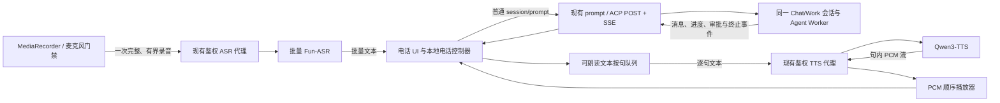

# 电话模式设计

> 状态：**第一阶段（轮流讲话 MVP）已实现并通过自动化与隔离浏览器检查；流式 ASR（`/api/speech/asr/stream` WebSocket 代理 + provisional/final 字幕 + VAD 端点提交）与电话配额/指标已实现并通过自动化与真实上游冒烟；WebRTC 独立媒体面与 AEC/barge-in 未交付。**
>
> 本文记录已确认的产品、技术设计与当前交付边界。已交付部分不得描述为已经完成真实手机/桌面设备验收（物理麦克风/扬声器、iOS Safari/Android Chrome 与端到端延迟仍待验收）；未交付能力均不得由现有实现推导为已经具备。

## 1. 目标与产品定位

电话模式是在**当前 Chat 或 Work 会话之上增加的语音交互层**：用户以说话代替打字，以收听代替阅读，并随时查看同一会话的文字记录、工具进度和审批状态。

它不改变会话的身份和执行语义：

- 不新增 `call`、`phone` 或其他 session kind，也不把 Chat 转成 Work 或反向转换。
- 不创建第二个会话、工作区、Agent Loop 或事件日志。已存在会话的 `sessionId` 绑定进入电话模式时的当前 Chat/Work；New 草稿沿用原有创建流程，并在创建后绑定该会话。
- 语音请求沿用现有 prompt/ACP 路径；工具、工作区、权限、配额、记忆、取消和事件溯源规则保持不变。
- “电话”是 Web 会话中的交互模式，不是 PSTN/SIP 电话，也不表示已具备电信运营商呼叫能力。
- 第一阶段是**轮流讲话**，不是全双工：播放 Assistant 语音时不采集麦克风，用户不能仅靠同时开口完成语音插话，但可以点按“打断”。

### 1.1 保留现有语音入口

Composer 中现有麦克风入口继续保持“**语音转草稿**”：录音经批量识别后，文本追加到当前草稿，用户可以检查、编辑并显式发送。该入口不得因为增加电话模式而变成自动提交。

电话模式使用独立入口。已存在的 Chat/Work 直接绑定当前会话；New 草稿也可以先建立本地电话，首个有效语音 prompt 仍走原有创建流程并绑定创建后的会话，不能借电话入口隐式创建一种新 session kind。

现有单条 Assistant 回复的 Play/朗读能力也不等同于电话模式；它没有因此获得后台采集、全双工或自动审批能力。

## 2. 分阶段范围

| 能力       | 现有语音 I/O 基础              | 第一阶段：电话 MVP（已实现，设备验收待完成）                   | 后续（WebRTC/AEC 未交付）                                               |
| ---------- | ------------------------------ | -------------------------------------------------------------- | ----------------------------------------------------------------------- |
| 语音输入   | 批量录音识别后进入草稿         | 流式 ASR：实时 partial 字幕 + VAD final 自动提交，批量路径兜底 | 更低延迟端点检测随 WebRTC/AEC 演进                                      |
| Agent 协议 | 普通 ACP prompt/SSE            | 完整复用，不新增电话 session kind 或私有 Agent 业务流          | 继续复用 ACP；媒体升级不改写工具与审批权限                              |
| 语音输出   | 单条回复朗读、Qwen3-TTS PCM 流 | Assistant 可朗读文本按句合成、按序播放和取消                   | 独立实时媒体传输与更强的播放/采集协同                                   |
| 对话方式   | 手动录音、手动朗读             | 明确轮流讲话；合成和播放期关麦                                 | 目标为 AEC 与 barge-in 支持的近全双工体验                               |
| 媒体传输   | 鉴权 HTTP + SSE 语音代理       | 流式 ASR 走鉴权 WebSocket 代理；TTS 走 SSE；无 WebRTC          | WebRTC 上行用于识别，电话回复固定走 SSE TTS + PCM 播放；TURN/AEC 未交付 |
| 治理       | 现有模型/会话治理              | 电话专项配额已强制（并发/字节/字符/速率）+ 脱敏指标已上报      | WebRTC 媒体容量治理与媒体质量指标                                       |

第一阶段复用了现有基础设施；UI、状态 fencing 和自动化检查已经实现，但真实设备、真实语音链路和端到端延迟仍须按下文独立验收。

## 3. 界面与交互

### 3.1 布局

- **移动端**：电话模式使用全屏界面，突出当前状态、字幕和主要控制。关闭全屏或挂断不应销毁底层 Chat/Work 的草稿、composer 节点、ACP 订阅或正在执行的 Agent。
- **桌面端**：电话模式使用居中面板和背景遮罩，不替换或卸载会话历史；最小化后可查看当前会话并保留持续可见的电话控制。最小化与挂断都不能被实现为 `session/cancel`。
- 两种布局共享同一电话控制器和状态语义，不分别实现两套 ACP/SSE 逻辑。
- 最小化只隐藏电话面板，并保留带状态和挂断入口的迷你控制条；切换会话、页面隐藏、刷新页面或 App 卸载会结束对应的本地电话交互。旧电话的媒体回调不会迁移，也不会因此取消该会话已经提交的 Agent 工作。

### 3.2 必备信息与控制

第一阶段界面必须提供：

1. **状态**：至少区分准备麦克风、正在聆听、识别中、Agent 处理/等待中、正在播放、已静音、错误和已挂断；等待人工审批同时显示现有审批界面。状态文案不得把轮流讲话标成“全双工”。
2. **字幕**：显示当前已确认的用户识别文本和当前 Assistant 原始回复；Assistant 字幕与独立的 TTS 文本投影分离，跳过朗读的标记或引用仍可在文字记录中查看。批量 ASR 没有部分识别结果时显示“识别中”，不能伪造逐字实时字幕。
3. **静音/取消静音**：静音立即关闭采集并使未提交的当前 utterance 失效；取消静音必须来自用户明确操作，不能因回调、页面重新可见或新音频到达而自动开麦。
4. **点按打断**：在合成或播放期间立即停止本地播放、取消后续句子并令旧音频结果失效；如果对应 Agent turn 仍在运行，同时通过现有控制面请求取消。prompt 提交尚未结算时先登记取消意图，结算后取消；只有 `alreadyStopped`、实际终止事件或匹配 `promptId` 的 Main `prompt_queue: cancelled` 才能解除等待，不能提前开始下一轮；New 创建/提交失败且没有 session 可取消时必须进入可见错误，不能保留失效 response。它不是声学 barge-in，也不等同于挂断。
5. **文字记录**：展示同一 Chat/Work 的普通用户/Assistant 消息及必要的执行/审批状态，并可回到完整会话。记录来自 ACP 会话投影，不另建一份电话专用消息事实源。
6. **挂断**：释放本地麦克风、播放器、录音器、语音请求和临时队列，退出电话界面；不发送 Agent 取消，不删除消息，不撤销已产生的工具效果。

如果需要停止 Agent，用户使用会话已有的 **Stop/取消** 控制，并等待既有终止事件确认。挂断和 Stop 必须在 UI 与实现上保持为两个不同动作。

### 3.3 审批必须人工

电话模式不得把语音中的“同意”“继续”“确认”或 Assistant 的表述映射为审批决定：

- 审批仍通过现有 ACP/REST 审批路径，由经过鉴权的人类用户在可见界面中明确点按。
- 用户必须能查看实际操作、目标和参数；只听一段 TTS 或识别到一句口令不构成授权。
- 等待审批时可以暂停电话的自动轮流交互并关麦，但不得自动批准、自动拒绝或以超时成功冒充已处理。
- 审批组件缺失、鉴权失败、请求已失效或超时，继续遵循现有 fail-closed 规则。
- 电话挂断只影响本地媒体；待决审批仍按原会话规则存在，不能由挂断静默放行。

## 4. 第一阶段架构

### 4.1 组件与数据流



电话控制器只维护短期本地状态并协调异步任务：

- 浏览器不直连 Fun-ASR/Qwen3-TTS，继续通过服务端鉴权代理。
- ACP 仍是 Agent 业务协议。不得为电话消息另建私有 UI 事件流，也不得把原始音频、PCM 块或媒体回调塞入 ACP 文本事件。
- PostgreSQL 仍是已提交会话内容的事实源；电话控制器不是另一个持久会话存储。
- ASR/TTS 的不可用、浏览器权限拒绝和音频格式错误必须显式呈现，不能用假的识别文本、字幕或“已播放”状态掩盖。

### 4.2 一轮轮流讲话

1. **进入电话**：在当前 Chat/Work 上创建新的本地 `callId` 并绑定其 `sessionId`，初始化 `responseEpoch`；New 草稿在首个有效 prompt 的原有创建流程后完成绑定。用户手势内准备麦克风和 AudioContext。
2. **采集 utterance**：仅在页面可见、未静音且处于可采集状态时开麦，为本次录音创建新的 `utteranceId`。首选流式路径：AudioWorklet 采集 16 kHz PCM16 经鉴权 WebSocket 代理持续上送，上游 VAD 端点产出 final；代理不可用则回退 MediaRecorder 批量录音 + 本地静音检测。
3. **识别**：流式模式下 upstream 返回 partial（仅字幕）与 final（端点，即 utterance 文本），返回前后都检查电话与 epoch 是否仍有效；批量模式下停止采集后经现有代理交给批量 Fun-ASR。
4. **提交普通 prompt**：有效且非空的识别文本（流式 final 或批量转写）通过现有 `session/prompt` 进入绑定的 `sessionId`。这是电话模式与“语音转草稿”入口的差别；提交仍使用现有请求 ID、幂等、排队和错误恢复语义，不新增电话专用 Agent 方法。服务端返回的 `promptId` 是当前语音响应的稳定关联身份。
5. **接收会话更新**：消息、工具进度、审批和终止状态继续经 `packages/client-acp` 与 ACP SSE 到达。电话文字记录与普通会话显示同一份内容。
6. **逐句合成**：只把 Assistant 主响应中的稳定、可朗读文本按句切分，不把工具输出、执行详情、审批决定或结构化 `citationList` 当作普通回答朗读；Sources / View evidence 仍只负责展示。朗读文本由 remark/GFM AST 投影而非关键词/特殊字符正则删除生成：保留普通段落文本，链接只读非 URL 标签，跳过代码块、图片、HTML、引用定义及 autolink；普通正文中的 `C++`、`C#`、`a*b`、`snake_case` 和 “Ground Truth Reference” 等术语保持可读，不能按词语或字符类别误删。未闭合的 Markdown 链接、强调、表格、行内代码、代码块、HTML 和裸 URL 所在尾部等待最终快照，不能朗读半截结构；流式文本发生非追加式修订时停止旧播报，并在最终快照按正确文本恢复。每句独立调用 Qwen3-TTS 的现有流式合成路径，句内可流式接收 PCM，句间按既定顺序播放。
7. **关麦播放**：从进入合成/播放阶段起不采集麦克风，因此不会把扬声器声音作为下一句话识别，也不存在第一阶段的同时说话检测。
8. **进入下一轮或被打断**：播放完成且媒体门禁允许时回到可聆听状态。用户点按打断则提前停止本地语音并递增 `responseEpoch`；如果 Agent 尚未结束，同时使用现有取消请求，并等待实际终止状态后才提交下一轮，绝不重复或重放不确定副作用。

按句合成是第一阶段电话响应的边界：不是把整段多句回复一次性合成，也不声称已拥有第二阶段的独立全双工媒体通道。若响应被替换、终止或属于旧 `responseEpoch`，对应未播放句子必须失效；删除/重试会解绑旧电话响应，不得仅凭相同文本猜绑替代 prompt。

## 5. 状态机与媒体门禁

电话状态和 Agent turn 状态是两个关联但独立的维度。电话界面结束不推导 Agent 结束，Agent 结束也不要求电话界面挂断。

### 5.1 电话主状态

```text
idle
  └─ 用户进入电话 → starting
starting
  ├─ 权限/媒体准备成功 → listening
  └─ 失败 → error（可显式重试或挂断）
listening
  ├─ 完成一次录音 → transcribing（停止本轮录音）
  ├─ 静音 → muted（保留电话，停止本轮录音）
  └─ 页面隐藏/挂断 → ending
transcribing
  ├─ 有效文本 → dispatching
  ├─ 空文本/可恢复错误 → listening 或 error
  └─ 失效/挂断 → 丢弃结果，不提交 prompt
dispatching
  ├─ 已被现有 ACP 接受 → agentRunning
  └─ 结果未知 → 按现有幂等/恢复路径核对，不盲目重发
agentRunning
  ├─ 有稳定可朗读句子 → synthesizing / speaking（关麦）
  ├─ 需要审批 → awaitingApproval（人工操作）
  └─ 无可朗读文本且终止 → listening 或 idle-error
synthesizing / speaking
  ├─ 当前句子完成 → 下一有效句子，或 listening
  ├─ 点按打断 → listening / agentCancelling（旧合成与播放失效）
  └─ 挂断 → ending（不取消 Agent）
任意活动状态
  ├─ 页面隐藏 → ending（释放麦克风，不取消 Agent）
  ├─ 静音 → muted（停止本轮录音，不取消 Agent）
  └─ 挂断 → ending → ended（不取消 Agent）
```

`error` 是可观察的本地交互状态，不应自动重试结果未知的 prompt。`awaitingApproval` 可以覆盖在 Agent 仍在等待的期间；审批完成后是否继续朗读由当前电话/response fencing 决定。

页面重新可见不会自动重进电话或开麦。用户必须明确开始新的电话，并基于当前 ACP 会话状态继续，而不是补放已经失效的旧队列。

### 5.2 麦克风不变量

- 只有 `listening` 且页面可见、未静音、电话仍有效时，才允许存在用于识别的活跃 `MediaRecorder` 录音。为降低下一轮启动延迟，电话前台期间可以保留已授权的 MediaStream，但非聆听状态不得录音。
- 调用 `MediaRecorder.stop()` 后必须保留 stopping 引用，直到对应 `dataavailable`/`stop` 事件完成清理；该异步窗口内不得创建第二个录音器。挂断/换电话可以使旧引用失效，但旧 stop 事件仍须按 call identity 隔离。
- `transcribing`、`dispatching`、`synthesizing`、`speaking`、`awaitingApproval`、`muted`、`ending` 和 `ended` 均不得新开录音。
- `document.visibilitychange`、页面隐藏/卸载、组件卸载和会话切换必须触发确定性的本地资源清理。
- 页面隐藏时立即停止麦克风并使未提交 utterance 失效；已经提交给 ACP 的 Agent 工作继续。页面重新可见不得自动开麦。
- 中止 fetch、停止 MediaRecorder 或销毁播放器只是资源清理的一部分；所有异步回调仍须经过第 6 节的身份/epoch 校验。

## 6. 迟到结果防护

仅依赖 `AbortController` 不足以防止已经完成的 Promise、排队音频或旧 ACP 回调在挂断后落到新界面上。第一阶段必须同时使用以下标识：

| 标识            | 生命周期与用途                                                                                                                         |
| --------------- | -------------------------------------------------------------------------------------------------------------------------------------- |
| `callId`        | 每次进入电话模式生成的本地随机 ID；标识一次电话界面实例。挂断、刷新或会话切换后旧 `callId` 永久失效。它不是工具调用的 `callId`。       |
| `sessionId`     | 进入时绑定的现有 Chat/Work ID；用于确认结果仍属于当前授权会话。不得在电话中途因 UI 导航把旧回调静默路由到另一会话。                    |
| `utteranceId`   | 每次录音生成的 ID；关联录音、批量 ASR 结果和随后的本地提交尝试，防止旧识别文本覆盖或提交为新一句话。                                   |
| `promptId`      | 普通 prompt 提交返回的服务端稳定身份；优先用它关联用户/Assistant 投影，历史分页重建临时 React key 后也不能回退到较早的同文本问答。     |
| `streamEpoch`   | 流式 ASR 会话代数；静音、打断、挂断递增，迟到 final 依此失效，防止暂停窗口外的识别文本进入新轮次。                                     |
| `responseEpoch` | 当前电话内单调递增的本地响应代数；新响应、点按打断、挂断及其他使播放失效的操作推进代数，用于淘汰旧 TTS Promise、SSE 音频块和排队句子。 |

具体要求：

1. 录音开始、ASR 完成、prompt 提交前、TTS 入队、每个音频块交付以及播放结束前都检查捕获的上下文是否仍为当前上下文。
2. ASR 相关回调至少匹配当前 `callId + sessionId + utteranceId`；响应投影优先匹配 `promptId`，语音合成/播放还必须匹配捕获的 `responseEpoch`，并保留其来源 utterance/响应关联。
3. 挂断先使当前电话上下文失效并推进 `responseEpoch`，再清理资源。这样即使清理期间仍有回调，也无法提交旧 ASR、更新字幕或在新电话中发声。
4. 同一会话挂断后重新进入必须使用新 `callId`；旧电话的 ASR/TTS 结果不能进入新电话。
5. 切换 `sessionId` 不复用旧电话控制器。旧会话已提交的 ACP 事件仍可在普通会话中持久化和展示，但不得驱动新会话的电话字幕或音频。
6. “丢弃迟到结果”只针对本地电话瞬时效果，不能删除、改写或忽略 PostgreSQL 中正常提交的会话事实。
7. `utteranceId` 可与现有 prompt 请求幂等 ID 建立本地关联，但不要求新增 ACP 字段。结果未知的提交按原会话机制核对，不能仅因电话超时重复产生用户请求。

这些标识是客户端并发 fencing，不是授权凭据。服务端会话访问仍由现有认证与授权决定。

## 7. 持久化、隐私与故障边界

### 7.1 不写原始音频和电话临时状态入 PG

第一阶段明确不新增电话音频档案或持久电话状态机：

- 原始麦克风音频、PCM、录音 Blob 和逐句音频队列不得写入 PostgreSQL、`session_events` 或通用 BlobStore，也不得作为普通聊天附件保存。
- `callId`、`utteranceId`、`responseEpoch`、识别中/播放中/静音/页面可见性和本地 TTS 队列属于电话临时状态，不写入 PG，不追加为模型可见的会话事件。
- `sessionId` 本身仍是现有会话身份；上述规则不意味着删除或绕开原有会话记录。
- 只有成功进入普通 prompt 流程的识别文本，以及 Agent 正常产生的消息/工具/审批事件，按现有规则持久化。未提交、空、失败或已失效的识别文本不因电话模式额外入库。
- 不在诊断日志中记录原始音频、完整 prompt、识别文本或音频内容。Trinity 不持久化音频不代表可以未经核查就承诺外部/上游 ASR、TTS 进程自身的零留存；其部署与留存配置需要独立审查。

页面刷新后本地电话不能凭 PG 中不存在的临时状态假装恢复。重新进入是新 `callId`，可以从同一会话的文字记录和当前 ACP 状态继续。

### 7.2 挂断与错误语义

- 挂断不调用 `session/cancel`，不等待 Agent 终止，也不把 Agent 标记为已取消。
- 挂断时仍在识别或合成中的上游工作不保证可以物理撤回；本地必须停止等待/播放并丢弃迟到结果。
- prompt 已被服务端接受后，挂断不撤销它；最终结果仍出现在原 Chat/Work 文字记录中。
- TTS 失败只影响语音输出，不能删除已经生成的 Assistant 文本或把成功的 Agent turn 改判为失败。
- ASR 失败不能创建空 prompt；麦克风权限拒绝不能显示为正在聆听。
- ACP/SSE 重连继续按已交付游标和 PG 修复缺口。电话模式不得建立独立的组件级 EventSource 或绕过现有 committed/live chunk 规则。
- 播放取消、打断或失败不自动重放有未知效果的工具，也不自动重发结果未知的 prompt。

### 7.3 仍然不具备

- 播放期间持续采集、AEC、声学 barge-in 或全双工对话（流式 ASR 不改变轮流讲话约束：播放/思考期间仍暂停采集）。
- WebRTC 媒体连接、TURN、独立媒体网关或短期媒体 token。
- 后台持续录音、跨页面刷新恢复原电话媒体状态。
- 语音审批、语音授予工具权限或挂断自动取消 Agent。
- WebRTC 相关的媒体容量配额与媒体质量指标（建连/丢包/抖动/barge-in 延迟）；已交付的配额与指标见 §8.4。

## 8. 后续能力交付状态

### 8.1 流式 ASR（已交付）

电话模式现在首选流式识别：

1. **链路**：浏览器 AudioWorklet 采集 16 kHz PCM16 → 100 ms 帧 → 鉴权 `GET /api/speech/asr/stream`（WebSocket，`?token=` 与 SSE 同规则）→ 服务端代理至 Fun-ASR `/ws` → 结果回传。浏览器不直连 Fun-ASR；代理做租户级配额（连接数/字节/速率，见 §8.4）与帧大小约束。
2. **字幕**：upstream `is_final:false` 为 provisional，只更新电话字幕，永不成 prompt；`is_final:true` 为 VAD 端点后的最终段，走与批量识别完全相同的提交流程与 fencing。`append_to_previous`（标点回插）不入 prompt。
3. **端点**：VAD 端点检测在上游（`split_silence_ms`，默认 700ms）；采集暂停期间不上送音频，恢复后继续识别。
4. **fencing**：迟到 final 由 `callId + streamEpoch + 通话状态门禁` 隔离；静音、打断、挂断使其失效。
5. **兜底**：代理不可用/升级被拒/无 speech 配置时自动回退批量 MediaRecorder 路径（composer 语音转草稿始终走批量）。

已实现并通过：服务端代理测试（真实帧中继、配额拒绝 1013、鉴权拒绝）、控制器流式测试（partial/final、打断/静音/挂断 fencing、意外终止可重连）、上游真实冒烟（PCM 流 → partial/final/flush）。

### 8.2 WebRTC 独立媒体面与短期 token（上行用于电话；TURN/AEC 未交付）

已交付（docs/webrtc-media-design.md §7）：信令契约与端口、短期 token、Signaling WebSocket、**werift 媒体网关适配器**（`packages/media-gateway`，G.711 上下行、纯 TS）、**浏览器 `RTCPeerConnection` 客户端**（通话控制器按 WebRTC → 流式 ASR → 批量自动降级）与 `concurrentMediaSessions` 配额。电话使用 WebRTC 麦克风上行进行识别；Assistant 回复固定使用已验证的 SSE Qwen3-TTS + PCM 逐句播放，不选择 RTP 下行。网关的 `media.speak`/μ-law RTP 下行能力保留，但不作为当前浏览器电话的播放路径，避免 `media.tts_ended` 已结算而浏览器无可听输出的情况。

**仍未交付**：TURN/coturn 公网部署（当前 ICE-LITE host 候选仅覆盖 LAN/同机）、AEC/barge-in（回声消除与真实插话检出需设备验收；打断仍为显式点按）、媒体质量与前端延迟指标、WebRTC RTP 下行的真实浏览器/设备播放验收。通话中媒体失败进入可重连错误态；建立失败自动回退已交付路径。目标与边界以 [webrtc-media-design.md](webrtc-media-design.md) 为准。

### 8.3 AEC 与 barge-in（未交付）

目标维持原设计。流式 ASR 期间仍“播放期不采集”，该约束不能被解释为已经实现 AEC 或 barge-in。

### 8.4 配额和指标（已交付服务端部分）

**配额**（`tenantQuotaSchema` 扩展字段，存于既有 `tenants.quota` JSONB 列，无需迁移；服务端进程内滑动窗口强制，未配置字段=不限量，配额读取失败拒绝请求）：

- `concurrentAsrStreams`：每租户并发流式 ASR 连接数（超出关闭 1013）；
- `concurrentTtsStreams`：每租户并发 TTS 流数（超出 429）；
- `hourlyAsrBytes`：每租户滚动一小时识别音频字节（批量体 + 流式帧累计，超出 429/1013）；
- `hourlyTtsCharacters`：每租户滚动一小时合成字符数（超出 429）；
- `speechRequestsPerMinute`：每租户滚动一分钟语音请求速率（批量 + 流式握手，超出 429/1013）。

被拒绝的请求不消耗 bytes/characters 窗口（速率窗口仍计数防刷）。无 `UsagePort` 或未认证部署不做语音配额（与既有 opt-in 语义一致）。

**指标**（OTel，无 SDK 时 no-op；属性仅有 `kind`/`reason`，不含租户/会话/utterance）：

- `trinity.speech.requests`（asr/tts/asr_stream × ok/error/denied）
- `trinity.speech.asr_audio_bytes`、`trinity.speech.tts_characters`
- `trinity.speech.asr_partials`、`trinity.speech.asr_finals`
- `trinity.speech.tts_stream_seconds`、`trinity.speech.{tts,asr}_active_streams`
- `trinity.speech.quota_denied`（按 reason）

前端延迟类指标（prompt→首音、barge-in 延迟）与 WebRTC 媒体质量指标随 WebRTC 阶段交付。

指标不得包含原始音频、prompt/识别文本、用户身份、会话路径或其他秘密；不得使用 `callId`、`sessionId`、`utteranceId` 等高基数字段作为普通指标标签。

## 9. 验收

以下是第一阶段的验收门槛，不表示所有项目已经通过。确定性测试使用可控 fake ACP、fake ASR/TTS、MediaRecorder/播放器替身和可手动完成的 Promise 覆盖迟到回调；隔离浏览器已经检查桌面/移动布局与主要控制。真实浏览器权限、物理音频设备、真实 ASR/TTS 和端到端延迟仍须单独验收。

### 9.1 产品与协议

1. **原入口不变**：Composer 麦克风识别后只追加草稿，不自动发送；电话入口不会把 New 草稿变成新 session kind。
2. **同一 Chat/Work**：分别在 Chat 和 Work 进入电话，核对 `sessionId`、kind、工作区、权限、工具与历史均保持原值；没有电话专用 session 创建或第二份消息日志。
3. **布局与保留状态**：移动端全屏、桌面端面板均具备完整控制；打开/关闭电话不丢失各会话草稿、composer 焦点语义、ACP 流或后台任务。
4. **普通 prompt/ACP**：有效语音只产生一个普通用户 prompt 和一个对应的 Assistant response 投影，排队、重连、Sources/执行详情和终止状态保持既有行为。

### 9.2 媒体与状态

5. **批量 ASR 正常路径**：一轮完整录音只提交其最终非空识别文本；识别期间没有伪造部分字幕，空识别和 ASR 错误不会创建 prompt。异步 `MediaRecorder.stop()` 的 stop 事件到达前不能创建第二个录音器。
6. **按句 TTS**：多句 Assistant 文本按句请求、按序播放；一句失败/取消不会播放旧句或越过当前 response；工具输出、审批决定和结构化引用不被当作普通回答自动朗读，引用仍完整展示。AST 投影保留普通正文特殊字符和 reference 术语，不读 URL/autolink、代码块和 HTML；未闭合 Markdown 结构不会读出半截内容，最终修订不会被永久静音。电话字幕保留原始 Assistant 回复。
7. **轮流讲话**：合成和整个播放期间没有活跃 `MediaRecorder` 录音，扬声器声音不会进入下一轮 ASR；界面和文案不宣称全双工。
8. **状态、字幕与文字记录**：各阶段状态与真实媒体/ACP 状态一致，字幕对应当前有效文本，电话文字记录与普通会话记录一致，刷新后无伪造的电话临时历史。
9. **静音**：录音中静音会关麦并使未提交 utterance 失效；旧 ASR 返回不能提交。取消静音必须显式操作，且只在允许状态开麦。
10. **页面隐藏**：在录音、识别和播放等状态分别触发隐藏/卸载，均满足关麦和临时结果失效；页面重新可见不会自动开麦，已提交 Agent 不被取消。

### 9.3 打断、挂断与迟到结果

11. **点按打断**：合成和播放中点按均立即停止本地音频、清空未播放句子并推进 `responseEpoch`；延迟到达的旧 PCM 不再播放。提交中的打断在提交结算后取消；仅当对应 Agent turn 仍活跃时走现有显式取消路径，不能以本地状态冒充已终止或提前开始下一轮。
12. **挂断不取消 Agent**：在录音、ASR、dispatching、Agent 运行、TTS、播放和审批等待中分别挂断，本地资源均释放；已接受 prompt 的 Agent 继续，最终结果仍可在原 Chat/Work 查看。
13. **挂断前的 ASR 竞态**：让 ASR 在挂断后返回，确认不提交 prompt、不更新字幕、不启动 Agent。
14. **新电话隔离**：同一会话挂断并立即以新 `callId` 重进，旧 utterance、TTS 和播放器回调不能落入新电话。
15. **跨会话隔离**：从会话 A 切到 B 后，A 的旧回调不能修改 B 的字幕、发送 B 的 prompt 或播放声音；A 已提交的普通会话事件仍按原规则保留。
16. **旧 epoch 与稳定响应隔离**：在多次响应、打断和停止之间乱序完成 TTS 请求，只有当前 `callId/sessionId/responseEpoch` 的句子可以播放；历史分页重建 React key 后仍按 `promptId` 关联，不能朗读较早的同文本答案。
17. **未知提交结果**：模拟 prompt 请求已到达但响应丢失，挂断或重连不得盲目重复提交；沿用现有请求 ID 和恢复路径核对。

### 9.4 审批、安全与存储

18. **人工审批**：说出“同意/批准”、Assistant 输出相同文字或自动播放审批说明均不能解决审批；只有当前鉴权用户在可见现有审批 UI 中明确操作才有效，失效/超时继续 fail-closed。
19. **挂断与 Stop 分离**：挂断不会产生 `session/cancel`；显式 Stop 才走现有取消流程，并以实际终止事件确认，而不是由电话 UI 假定已停止。
20. **PG 内容边界**：检查数据库 schema、`session_events` 和普通 blob 路径，没有原始音频/PCM，也没有电话临时状态或媒体队列入库；成功提交的文本消息和正常 Agent 事件仍完整可重放。
21. **故障诚实呈现**：麦克风拒绝、安全上下文缺失、ASR/TTS 未配置或失败、SSE 中断和音频格式错误都有可见状态；不会显示虚假的已发送、已批准、已播放或已取消。

### 9.5 第二阶段验收状态

已交付（自动化通过；真实设备延迟待验收）：

- **流式 ASR**：§8.1 全链路（WS 代理、partial/final、VAD 端点提交、streamEpoch fencing、批量回退）；服务端代理测试、控制器流式测试与真实 Fun-ASR 上游冒烟通过。
- **电话配额与指标**：§8.4 全部配额字段在服务端强制（429/1013），OTel 指标按 bounded 属性上报；计量单元测试与 HTTP/WS 拒绝路径测试通过。

未交付（不得由上述交付推导）：

- **TURN、RTP 下行设备验收与 AEC/barge-in**：WebRTC 上行已用于电话识别，回复固定走 SSE TTS；网关 RTP 下行能力保留但尚未通过真实浏览器/设备播放验收。TURN 公网部署与 AEC/barge-in（真实插话检出，打断当前为显式点按）未交付；这些能力不得由媒体面交付推导。
- **AEC 与 barge-in**：依赖 WebRTC 媒体面先就绪；播放期仍不采集。
- **前端延迟类与媒体质量指标**：prompt→首音、barge-in 延迟、WebRTC 建连/丢包/抖动随 WebRTC 媒体客户端交付。

流式 ASR 与配额的任何第一阶段测试通过都不能作为 WebRTC/AEC 已交付的证据。
