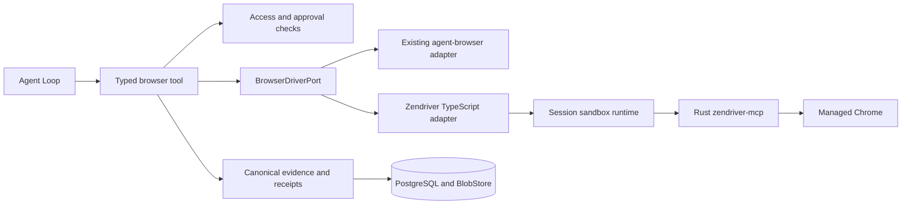

# Zendriver browser integration

Status: implemented as an opt-in trusted-owner runtime; production enforcement and site-specific comparisons remain rollout gates. The sections below retain the approved design rationale; this status section records implementation scope.
Date: 2026-10-21.

Implemented: `BrowserDriverPort`, the existing agent-browser adapter, bounded private MCP transport for `zendriver-mcp` 0.16.37, `apps/browser-runtime`, authenticated HTTP forwarding, PostgreSQL binding/command journal (migration 0011), session locks, worker reconnection to the surviving supervisor, cancellation/process-group termination, private durable per-user profiles with cross-session file leases, idle/session-close process cleanup, driver metadata and `trusted-managed` evidence. A small patch to the pinned MCP source adds a process-level `--user-data-dir` option; profile paths are never MCP tool arguments. The runtime executes the existing browser evidence pipeline under one distributed lock; individual MCP commands never cross its external API. Command outcomes are recorded per originating tool call before replying. Server and worker select the runtime with `BROWSER_DRIVER=zendriver`; saved reads remain local and available offline.

The local Sandbox implementation is restricted to the configured owner's personal Chat/Work sessions. It is not a hostile-tenant container boundary. Stronger sandbox provisioning, enforced egress/privacy, Helm runtime provisioning and comparison against user-identified blocked sites remain future deployment/rollout work. The profile root must be an operator-provisioned persistent encrypted volume mounted only into the browser runtime. Per-user directories have restrictive filesystem permissions, but the current trusted local runtime does not provide hostile-tenant isolation. After an ungraceful supervisor loss, an active binding owned by its previous instance blocks takeover until an operator confirms that instance's browser processes are stopped and invalidates that binding. A profile lease or Chrome `Singleton` lock left by a dead owner is reclaimed automatically at the next session start once staleness is provable: the recorded owner pid is dead on this host and no live process references the profile directory; ambiguous cases (live pid, foreign host, unverifiable ownership) still fail closed to operator recovery. Successful journal entries can be replayed; unfinished commands are never resent. This is conservative recovery, not exactly-once website effects.

Validated locally with Chrome 155.0.8059.84: MCP initialization, isolation/CSP overrides, Unicode extraction, replacing input, keyboard input, native click, PNG capture, the complete canonical evidence/receipt pipeline and saved-image replay. The real-browser test is opt-in; deterministic tests use fakes. Instructions and configuration are in [deployment-guide.md](./deployment-guide.md#managed-zendriver-opt-in).

## 1. Decision and scope

Wrap the Rust `zendriver-mcp` executable behind Trinity's typed `browser` tool. Keep TypeScript responsible for policy, session authorization, evidence, persistence, response fitting and research citations. Use Zendriver for Chrome lifecycle, navigation, isolated-world extraction and browser input. Apply the minimal pinned-source patch in `apps/browser-runtime/patches` to pass a server-selected profile directory at process startup; keep the upstream MCP tool schema unchanged.

This proposal targets [TurtIeSocks/zendriver-rs](https://github.com/TurtIeSocks/zendriver-rs), including its Rust `zendriver-mcp` crate. Similarly named Python MCP projects are separate dependencies.

Zendriver also uses CDP. The expected improvement comes from browser configuration, coherent identity and input behavior, rather than replacing CDP. Whether it helps the sites currently failing is an experiment, not an established result. IP reputation, account state and site-specific defenses can still block access. Upstream explicitly disclaims guaranteed invisibility in its [stealth documentation](https://turtiesocks.github.io/zendriver-rs/stealth.html).

The integration adds an explicitly configured managed-browser mode. Keep the existing owner-controlled Chrome attachment available during rollout. Do not automatically restart, reconfigure or replace the user's Chrome on port 9222. Do not silently switch engines after a failed action.

## 2. Current implementation and required seam

`BrowserAccessPort.authorize` currently returns an authorized binding, but execution is still coupled to `agent-browser`: `browser.ts` directly probes its version, builds CLI argv, executes scripts and transfers screenshot files. Replacing only `TrustedCdpBrowserAccess` cannot replace the driver.

The implementation separates this transport coupling:

| Responsibility                                                              | Location after refactor                                               |
| --------------------------------------------------------------------------- | --------------------------------------------------------------------- |
| Existing model-facing operation schema, approval and ordered execution      | Existing Tool Runtime and Loop                                        |
| Owner authorization and deployment guarantees                               | `BrowserAccessPort`                                                   |
| Validated live page inspection, navigation, checked input and image capture | New `BrowserDriverPort` in contracts                                  |
| Agent-browser implementation                                                | `core/tools/browser-agent-browser.ts`                                 |
| Zendriver MCP implementation                                                | `core/tools/browser-zendriver.ts`                                     |
| Canonical artifacts, exposure receipts, saved reads and citations           | Existing `browser*` evidence code                                     |
| Durable managed runtime identity, placement and command status              | New `BrowserRuntimePort` in contracts; sandbox infrastructure adapter |
| Selecting and injecting implementations                                     | Server and agent-worker composition roots                             |

These are additions to Tool Runtime and Sandbox infrastructure, not a general extension framework. Before implementation, register the driver/runtime responsibilities in design §5 and reconcile §8.2's current prohibition on an independent browser service with the selected sandbox runtime implementation.

## 3. TypeScript and Rust boundary

Prefer MCP over Node native bindings. The upstream executable already supports stdio and Streamable HTTP. Its operator documentation leaves remote endpoint protection to the deployer. See the [MCP reference](https://turtiesocks.github.io/zendriver-rs/mcp.html).

Use a private MCP client inside the Zendriver adapter. Do not register the upstream tool catalog with the LLM. The model continues using the existing `browser` schema, snapshots and refs; it never receives MCP session IDs, arbitrary selectors, JavaScript, debugger endpoints or filesystem paths.

Prefer a private stdio connection owned by the session runtime supervisor. Upstream's [HTTP implementation](https://github.com/TurtIeSocks/zendriver-rs/blob/main/crates/zendriver-mcp/src/transport/http.rs) creates independent browser state per MCP session using a local session manager. That is useful separation, but does not make runtime identity durable across process loss. Reinitializing an MCP session must not be mistaken for recovering the old browser. Worker reconnections should reach the surviving supervisor and its existing private MCP connection.

The implementation defines the following contracts:

- `BrowserDriverPort`: inspect binding/document state; navigate; extract the fixed semantic capture; capture a fixed interaction surface; perform a checked action; capture a bounded screenshot. Every async method accepts `AbortSignal`. Owned resources have deterministic `dispose()`.
- `BrowserRuntimePort`: execute one complete typed live operation under runtime authorization and its distributed session lock. `BrowserRuntimeStore` persists binding generations and per-call dispatch/outcome records. Individual MCP commands, runtime addresses and credentials stay internal. Lifecycle disposal belongs to the supervisor-owned `ManagedBrowserSession`.
- Define cross-process DTOs with Zod in contracts and infer their TypeScript types. Use discriminated command/result unions and explicit error/effect states. Shared UI types are re-exported through shared only when needed.

Use high-level driver commands instead of a public `evaluate(script)` or `callTool(name,args)` port. The adapter may call upstream evaluation tools internally, but only with Trinity-owned extractor, state, readiness and target-validation scripts. Treat every returned value as untrusted JSON and validate immediately.

| Trinity operation | Candidate internal MCP calls                                   | Trinity behavior retained                                            |
| ----------------- | -------------------------------------------------------------- | -------------------------------------------------------------------- |
| `navigate`        | `browser_goto`, fixed extraction                               | Final URL checks, capture and overview                               |
| `get_page_text`   | `browser_evaluate` with fixed semantic extractor               | Visible canonical blocks, pagination and exact ranges                |
| `read_page`       | `browser_evaluate` with fixed surface extractor                | Scoped snapshots and Trinity refs                                    |
| `click`           | `browser_click` or checked mouse input                         | Fresh target validation and per-operation approval                   |
| `fill`            | `browser_type` / `browser_set_value`, subject to parity checks | Exact replacement semantics and sensitive-control denial             |
| `key`, `scroll`   | `browser_press`, `browser_scroll`                              | Validated keys, scope and bounded motion                             |
| `screenshot`      | `browser_screenshot`                                           | Existing pixel/byte limits, crop metadata and evidence authorization |
| Saved read/search | No live MCP call                                               | Existing immutable artifact retrieval                                |

This is a mapping to validate against a pinned upstream schema, not an assertion that the calls have identical semantics. In particular, typing may append, key names may differ, coordinate spaces may differ, and a native input event differs from the current DOM activation workaround. Add explicit translation and parity tests for each.

Do not use upstream HTML trimming as canonical citation evidence. Keep the existing visible semantic extractor and its Unicode behavior. Use isolated-world evaluation where it passes parity checks; any main-world requirement must be identified and reviewed. Keep upstream optional action snapshots private because they have not passed Trinity's evidence pipeline.

## 4. Managed runtime and session ownership

Use one Zendriver process and managed Chrome per active Trinity session, backed by the durable Chrome user-data directory for the authenticated `(tenantId, userId)`. Chrome creates its `Default` profile under that directory. Acquire an exclusive profile lease before launch; a second session for the same user fails closed while another process holds the profile. Hostile-tenant sandbox isolation remains a deployment requirement. Do not rely on an MCP connection or an upstream browser context as the tenant boundary. Do not put several tenants behind one unverified shared upstream process.

Production workers hold disposable client connections only. Browser identity, routing and authority must survive worker replacement:

1. Resolve authenticated tenant/user/session and effective policy before allocating anything. Chat and Work are equally eligible; session kind does not remove browser capability. Existing trusted-CDP access retains its owner-only rules.
2. Acquire a distributed session lease. Persist a runtime binding with opaque runtime ID, generation, deployment mode, engine/version and owned tab ID. Record model-relevant binding transitions in append-only session events; keep credentials and physical addresses out of events.
3. Sandbox infrastructure owns the Zendriver/Chrome process group. For a local compatibility spike, launch stdio through `SandboxPort.openProcess`, with a bounded protocol reader. This spike is disposable and is not a production recovery mechanism.
4. Production uses an authenticated internal runtime endpoint that owns the private MCP connection and fences commands. The adapter must not contact an arbitrary model-supplied HTTP endpoint. A reverse proxy alone supplies transport authentication, not command fencing or recovery.
5. Recover the same runtime and owned tab after worker changes. If it has died, allocate a new generation and invalidate all old snapshots and refs. Saved observations remain readable as historical evidence. Never replay page actions to reconstruct state.
6. On session closure or explicit managed-runtime disposal, stop the owned process group, release the profile lease and retain the durable user-data directory. Worker disconnect alone does not terminate a session runtime intended for recovery. Infrastructure enforces idle/resource limits independently of worker availability.

The sandbox runtime is explicitly stateful execution infrastructure. PostgreSQL remains the authority for session ownership and runtime generations. `BROWSER_PROFILE_DIR` identifies protected persistent storage; the directory layout is `<root>/<tenant-id>/<user-id>/Default`. A private atomic lock file under `<root>/.locks` serializes access across runtime processes. Server/agent-worker memory must not be the authoritative runtime registry.

Users log into their durable managed profile once, then their personal Chat/Work sessions reuse it. `BROWSER_PROFILE_DIR` must point to an operator-provisioned encrypted persistent volume mounted only into the browser runtime. The runtime creates tenant/user directories with mode `0700`; Chrome cookies and local storage remain private and are never returned to the model. A profile is not shared by concurrent Chrome processes. Stop the browser before deleting a user's directory to revoke its stored login state. Reusing the existing desktop profile remains separate and uses the existing owner-controlled CDP attachment. Forks and subagents do not inherit browser bindings or login state implicitly.

## 5. Leases, cancellation and uncertain effects

Trinity's exclusive tool scheduling does not serialize multiple workers or stop an old runtime request. Hold a lease across validation, action and observation. The runtime must check its fencing token at command acceptance and serialize accepted commands for the session.

Persist a bounded command journal outside worker memory, keyed by runtime generation and originating tool call ID. Record dispatch intent before sending an effectful command and its completion status afterward. A journal is recovery evidence, not a claim of exactly-once website effects.

- Duplicate completed commands return the recorded outcome or evidence reference; do not click twice.
- A command left in flight after a crash has an unknown effect. Query status or reobserve before proceeding; never automatically resend it.
- Lease expiry prevents new commands from the old owner, but cannot undo an already accepted browser input. Quarantine the runtime until that command is resolved or the runtime is terminated before granting new control.
- Propagate cancellation through the client and runtime. MCP cancellation is best effort until verified against the pinned build. A timeout does not prove the browser stopped.
- If safe quiescence cannot be established, terminate only the owned managed runtime, invalidate its generation and report the effect as unknown. Closing a browser cannot undo a submitted request.
- Preserve Trinity's existing cancellation terminal-event behavior and same-step failure skipping. No automatic fallback to a different driver for an uncertain action.

## 6. Evidence and compatibility

The Zendriver adapter treats Chrome's exact `chrome-error://chromewebdata/` document as unavailable evidence, returning typed `PAGE_UNAVAILABLE` with `navigate` recovery. Only explicit validated HTTP(S) navigation may leave that error document after the normal session ownership checks; other internal schemes remain denied. A tab/document URL mismatch gets one document recheck to distinguish a stable same-tab URL update from a moving document. Extraction omits link URLs beyond the contracts limit while retaining visible text, avoiding whole-capture schema failures on long redirect links.

Keep the current artifact hashing, immutable blobs, successful-call authorization, exposure receipts, current-turn citation validation and authenticated image route. Persist an observation before returning it through the normal successful tool result. Orphan artifacts never become evidence merely because the driver produced them.

Add versioned optional driver metadata: engine, adapter version, upstream version, Chrome version and runtime generation. Existing artifacts retain their original `cliVersion` and continue validating. Choose an explicit schema-version migration rather than repurposing `cliVersion` to mean something different without compatibility handling.

Keep security guarantees separate from engine choice. `zendriver` does not imply `enforced`. Introduce an explicit managed trust mode, with network/privacy enforcement capabilities, rather than labeling managed sessions `trusted-cdp` or promising enforcement prematurely. Rollout must update every affected enum, parser, artifact validator and UI label together, preserving older artifacts.

Recheck the binding, document and target fingerprint immediately before actions; reobserve afterward. A successful driver response does not prove semantic task completion. Reconnection, navigation, changed viewport or document, failed action and uncertain effects invalidate action targets. Retain existing sensitive-control and coordinate freshness checks.

Enforce bounds while reading MCP frames/SSE, before JSON parsing or base64 decoding. Limit diagnostics separately, validate image dimensions and bytes, and preserve existing per-capture/per-response limits. Set no cumulative per-turn text/image allowance. Saved reads must work when the live runtime is unavailable.

## 7. Browser configuration and deployment

Administrator configuration:

| Setting                        | Meaning                                                                                         |
| ------------------------------ | ----------------------------------------------------------------------------------------------- |
| `BROWSER_DRIVER`               | `agent-browser` initially; explicit opt-in `zendriver`                                          |
| `BROWSER_RUNTIME_ENDPOINT`     | Trusted internal runtime control endpoint; not a raw arbitrary MCP server                       |
| `BROWSER_CDP_ENDPOINT` / owner | Existing attachment configuration for the existing driver                                       |
| `BROWSER_PROFILE_DIR`          | Required encrypted persistent profile root, mounted only into browser-runtime                   |
| Managed profile configuration  | Fixed headless/display, locale, timezone, viewport, identity/input settings and resource limits |

Reject conflicting configuration at startup. Never let the model choose executable paths, launch flags, proxies, profiles, transport credentials or enforcement settings. Pin executable version/checksum, Rust dependency lockfile and Chrome build in build artifacts; deploy no runtime `cargo install` or browser download.

Upstream stealth profiles can change browser security settings, including site isolation and CSP behavior; see the [profile tradeoffs](https://turtiesocks.github.io/zendriver-rs/stealth.html#opting-into-real-site-isolation--real-webgl-native_isolation). Inspect and assert the effective settings in the pinned build. Start with the native profile, preserve Chrome's sandbox and site isolation, and keep CSP bypass disabled. Test stronger profiles separately with explicit administrator configuration; do not randomly mutate identity after a site blocks access.

Build only necessary upstream features. Keep challenge solvers, arbitrary request/interception, cookie/storage export, uploads, downloads and Chrome installation outside the adapter's callable surface in the first phase. Disabling their exposure is required even if the binary contains them. A later challenge-handling capability needs its own typed policy and tests.

The managed browser's network boundary belongs in its sandbox: explicitly allowed outbound access, redirect/subresource/WebSocket handling, private/metadata address denial and protected profile storage. CDP interception alone is not an egress firewall. Keep runtime/CDP endpoints private; use workload authentication and NetworkPolicy. Do not advertise enforced mode until bypass routes and those controls have passed deployment tests.

Logs contain command IDs, bounded error codes, timing and versions. Avoid upstream debug CDP logging in normal deployment because it can contain scripts, page values or credentials. Metrics compare navigation/readiness failures, block/challenge observations, action outcomes, latency and runtime restarts without storing page bodies.

The private MCP command deadline remains 30 seconds. An expired deadline cancels the command, terminates the owned process and preserves a fixed safe timeout explanation in the existing `DRIVER_FAILED` result; caller cancellation remains distinct. The message does not expose upstream arguments or responses, establish a network cause, authorize retrying unknown effects, or change browser availability.

## 8. Implementation sequence and acceptance

1. **Compatibility spike.** Select an exact upstream revision and binary/Chrome matrix. With a disposable sandbox, verify MCP initialization, structured outputs, isolated-world extraction, exact fill/key/click semantics, screenshots, disconnect and shutdown. Verify security overrides, process cleanup, MCP cancellation and recovery behavior. Confirm whether attachment is supported before proposing it; this design does not depend on it.
2. **Extract the driver seam.** Define contracts and wrap the current agent-browser implementation without changing model-facing operations. Run the existing browser/evidence/research tests against it. Preserve legacy artifacts and saved reads.
3. **Add Zendriver behind configuration.** Implement private MCP mapping, bounded transport and parity fixtures. Add the runtime binding/journal schema through Drizzle migrations, runtime adapter and fenced ownership before claiming production recovery. Update design §3/§5/§8.2/§12, AGENTS.md, deployment docs and runtime browser skill as implementation lands.
4. **Controlled comparison.** Use deterministic local fixtures for DOM/citation/input behavior. Separately run opt-in comparisons on user-identified failing sites: same network/account prerequisites, documented Chrome/profile differences, visible successful content and task outcomes. Record challenge/block state; an HTTP success or tool success alone is insufficient. Public-site results are observations, not deterministic unit-test assertions.
5. **Opt-in rollout.** Enable managed Zendriver for selected sessions, monitor errors and resource use, then consider changing the default. Roll back new allocations explicitly; existing bindings keep their recorded driver until intentionally disposed or migrated. Never transfer live action refs across drivers.

Required tests cover malformed/oversize MCP frames, fragmented responses, wrong schemas, unauthorized runtime access, stale generations/refs, duplicate commands, worker loss during a click, cancellation with an active request, storage failure after an action, runtime destruction, profile/cookie isolation, Unicode quote parity, screenshot delivery and offline saved-artifact replay. Use fakes and local fixtures; run the appropriate backend tests, `pnpm lint` and `pnpm typecheck` for implementation changes.

A direct Rust bridge is justified only if the spike proves upstream cannot provide required checked targeting, bounded output, security configuration or lifecycle/cancellation semantics. Keep the same driver port, use a small versioned protocol with fixtures generated from Trinity's schemas, and depend on pinned `zendriver` crates instead of copying upstream code. Add Rust CI/build instructions at that point. Node FFI is unnecessary for the proposed process boundary.

The first deliverable is a browser that passes evidence/action parity and improves observed outcomes on the failing sites. A production default additionally requires the durable runtime and ownership controls above. This proposal does not assert that either milestone has been implemented.

## Guest process integration (2026-10-24)

With matching `EXECUTION_DRIVER=firecracker`, the supervisor retains canonical evidence and PG command journaling while its private MCP stdio process runs inside the personal VM through authenticated Node Agent/vsock routing. `apps/guest-runtime` selects the fixed patched executable and tenant/user profile from host-issued boot metadata, never model arguments. Existing profile lease and stale-lock reclamation code is shared infrastructure in `core/sandbox`; local supervisor behavior is preserved. The guest does not receive PG/provider/host secrets. The real-Chrome opt-in fixture covers MCP transport across the guest RPC channel and PNG preview, while actual Firecracker image, networking and isolation remain unvalidated rollout gates. Trusted-owner restrictions and the `trusted-managed` label remain unchanged.

## Managed browser 用户交互（2026-10-26）

用户通过 owner-only BFF `browser-interaction` 取得临时 PNG 帧并发送经过 Zod 校验的点击、拖动、滚动、文本、按键和 HTTP(S) 导航。内部 MCP / CDP 地址不返回客户端。`BrowserInteractionPort` / `BrowserInteractionStore` 分离输入与模型工具；PG controls / input reservations 通过原执行锁协调 human / agent / paused / quarantined 状态。generation、epoch、view、sequence、request UUID 和最近帧共同约束输入；驱动在执行前复核 owned tab、document revision、fingerprint 与尺寸。具体部署与恢复见 [runtime implementation](runtime-implementation.md#managed-browser-交互部署与行为)。

截图轮询一次只允许一个未完成请求，控制中空闲时以 250ms 间隔请求，输入队列优先，实际频率受捕获延迟限制；没有视频流或刷新率保证。text/key 的 `capture:false` ack 不捕获 PNG，可返回 opaque keyboardId 供同一 controller/generation/epoch 继续输入；该 token 仅授权 keyboard，驱动每次复核 owned document 与 focus revision（包括焦点移走再返回），不因无关 layout 变化拒绝连续输入。明确 Tab/click 可建立新焦点绑定，导航或文本引起的焦点变化终止 continuation；执行前已确认 stale target 返回 none，未知 dispatch 仍 quarantined。前端合并相邻文本、支持 IME/粘贴并保留按键顺序，提供显式插入的本地文本编辑框。明确接管后的私有截图只交付该控制视图，普通观看继续隐藏敏感页面。输入 journal 只存去重及 effect metadata，不存输入内容；图片不成为模型证据。返回 Agent 后，使用旧页面目标的交互强制新观察；显式 navigate / web_search 自身产生新观察，不被 handoff flag 阻止。断开截图请求仅丢弃响应，操作超时与显式取消输入仍保留失败 / unknown 语义。legacy CDP 保持只读，`trusted-managed` 不扩大为网络或租户隔离保证。
